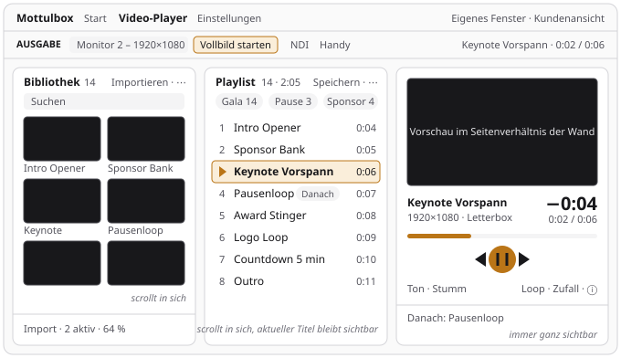
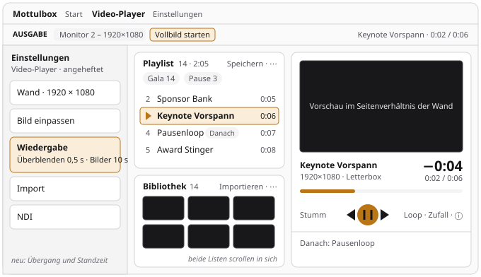

# Plan: Video-Player ohne Scrollen und die „Arbeitsfläche“ als Muster

Aus der Durchsicht vom November 2026 ([PLAN-DURCHSICHT.md](PLAN-DURCHSICHT.md), Teil C). Der
Video-Player ist das Werkzeug, das während der Show bedient wird – und das einzige große, bei dem
man heute scrollen muss, um Transport und Playlist zu sehen. Dieser Plan beschreibt das neue
Layout so genau, dass es sich Schritt für Schritt umsetzen lässt, und zieht daraus ein Muster,
das danach Stage-Timer, Testbild und Video-Generator übernehmen können.

**Stand 13. November 2026:** P1 und P2 sind umgesetzt – die drei Felder stehen, die Seite
scrollt nicht mehr, `e2e/player-layout.mjs` prüft es bei vier Fenstergrößen. Offen sind P3 bis
P6 (Bühne, Playlist, Bibliothek, Doku); was dabei schon miterledigt wurde, steht bei
[Umsetzung](#umsetzung-in-schritten).

- [Anlass: gemessen](#anlass-gemessen)
- [Ziele](#ziele)
- [Entwurf](#entwurf) – [Felder](#die-drei-felder), [Platzregeln](#platzregeln),
  [Bühne](#bühne), [Playlist](#playlist), [Bibliothek](#bibliothek), [Schublade](#schublade)
- [Bausteine](#bausteine)
- [Umsetzung in Schritten](#umsetzung-in-schritten)
- [Abnahme](#abnahme)
- [Auf andere Werkzeuge übertragen](#auf-andere-werkzeuge-übertragen)
- [Offene Fragen](#offene-fragen)
- [Nicht tun](#nicht-tun)

## Anlass: gemessen

Am 12. November 2026 in der gebauten App gemessen, frisches Profil, 14 Medien in Bibliothek und
Playlist, Schublade zu. „Sichtbar“ ist die Höhe der Arbeitsfläche unter Kopf- und Ausgabe-Leiste
(je 53 und 49 px), „Seite“ die Höhe ihres Inhalts:

| Fenster     | Sichtbar | Seite   | Vorschau  | Playlist zu sehen                 |
| ----------- | -------- | ------- | --------- | --------------------------------- |
| 1024 × 600  | 498 px   | 1305 px | 429 × 241 | nein                              |
| 1366 × 768  | 666 px   | 1323 px | 600 × 338 | nein – erst nach dem Scrollen     |
| 1920 × 1080 | 978 px   | 1479 px | 877 × 493 | die ersten zwei Einträge          |

Warum das so ist (alles in `src/renderer/src/tools/video-player/`):

- **Die Seite wächst statt der Listen.** `VideoPlayer.tsx` legt zwei Karten nebeneinander
  (`flex gap-6`, ab 900 px Breite), ohne Höhe; die Arbeitsfläche von `ToolShell.tsx` scrollt als
  Ganzes.
- **Die Vorschau wächst mit der Breite** (`aspect-video w-full` in der damaligen Karte
  „Wiedergabe“, heute `Stage.tsx`): Je
  größer das Fenster, desto mehr Platz nimmt sie der Playlist – deshalb scrollt selbst Full HD.
- **Die Playlist steht ganz unten** in der Karte „Wiedergabe“, unter Vorschau, Titel,
  Suchleiste, Transport, Tastenkürzel-Zeile, Modi und Bild-Standzeit. Wer zur Playlist scrollt,
  sieht den Transport nicht mehr.
- **Die Bibliothek ist auf 460 px gedeckelt** (`max-h-[460px]` in `Library.tsx`); darunter
  bleibt die Karte leer, bei Full HD rund 400 px.
- **Feste Spalten nach Fensterbreite** (`grid-cols-2 sm:grid-cols-3`): `sm:` richtet sich nach
  dem Fenster, nicht nach dem Platz neben der Schublade (Skill `review-checkliste`, „Raster“).

Dazu vier Dinge, die beim Lesen auffielen und in dieselben Dateien gehören:

- Zwei Knöpfe heißen „Ordner“ mit demselben Symbol: oben importiert er einen Ordner, unten
  öffnet er den Medienordner (`Library.tsx`).
- Ein Medium löscht der Papierkorb ohne Rückfrage, „Playlist leeren“ ebenfalls – ein Klick
  daneben nimmt in der Show das Bild weg (danach zeigt die Ausgabe das Idle-Bild).
- Die Wiedergabe ist ab Werk stumm (`EMPTY_PLAYER_STATE` in `shared/player.ts`: `muted: true`);
  zu sehen ist das nur an einem kleinen Symbol und „0 %“.
- Was als Nächstes kommt und wie lange der laufende Titel noch dauert, steht nirgends groß. Die
  Reihenfolge kennt `nextIndex()` in `shared/player.ts` schon (auch bei Zufall).

## Ziele

1. **Ab 1024 × 600 ohne Scrollen:** Vorschau, Titel mit Restzeit, Transport und mindestens fünf
   Zeilen der Playlist sind gleichzeitig sichtbar – mit zugeklappter Schublade, bei 1366 × 768
   auch mit angehefteter.
2. **Der Platz folgt dem Fenster:** Bibliothek und Playlist füllen die Höhe und scrollen in
   sich. Die Vorschau bekommt, was übrig ist, und hat das Seitenverhältnis der Wand.
3. **Live zuerst:** Was läuft, wie lange noch und was danach kommt, steht groß. Was man einmal
   einstellt (Übergang, Bild-Standzeit), wandert in die Schublade.
4. **Kein Klick nimmt versehentlich das Bild weg:** Löschen und Leeren fragen nach.
5. **Wiederverwendbar:** Das Gerüst (Felder, Platzregeln) ist ein Baustein, kein Sonderbau des
   Players.

Nicht Ziel: neue Funktionen der Wiedergabe (Logo-Overlay, Zeitplan), ein anderes Aussehen der
Kopf- und Ausgabe-Leiste, Änderungen an `PlaybackEngine.tsx` oder am Zustand im main.

## Entwurf

### Die drei Felder



Von links nach rechts in der Reihenfolge der Arbeit: **Bibliothek** (Material) → **Playlist**
(Abfolge) → **Bühne** (was läuft). Bibliothek und Playlist liegen nebeneinander, weil man
zwischen ihnen zieht; die Bühne steht rechts, wo heute die Wiedergabe ist.



### Platzregeln

Gemessen wird die Arbeitsfläche selbst (`useElementSize` aus `useElementSize.ts`), nicht das
Fenster – so stimmt es auch mit angehefteter Schublade und im eigenen Fenster.

| Stufe    | Bedingung                          | Aufbau                                                              |
| -------- | ---------------------------------- | ------------------------------------------------------------------- |
| `breit`  | Breite ≥ 1180 px, Höhe ≥ 420 px    | drei Spalten: Bibliothek · Playlist · Bühne                         |
| `mittel` | Breite 760–1179 px, Höhe ≥ 420 px  | zwei Spalten: links Playlist über Bibliothek (5 : 3), rechts Bühne  |
| `schmal` | Breite < 760 px oder Höhe < 420 px | eine Spalte, die Seite scrollt: Bühne, Playlist, Bibliothek         |

Spalten als CSS-Raster, damit nichts von Hand gerechnet wird (umgesetzt als `PLAYER_RASTER` in
`video-player/layout.ts`):

```text
breit:   grid-template-columns: minmax(280px, 1fr) minmax(280px, 1fr) clamp(420px, 40%, 960px)
mittel:  grid-template-columns: minmax(300px, 1fr) minmax(380px, 1.2fr)
         linke Spalte: grid-template-rows: minmax(0, 5fr) minmax(0, 3fr)
schmal:  eine Spalte (auto auto auto), Listenfelder höchstens 60vh hoch
```

Die linke Spalte von `mittel` war mit 11 : 9 geplant. Nachgerechnet hätte die Playlist bei
1024 × 600 dann nur vier Zeilen gezeigt; mit 5 : 3 und etwas kompakteren Zeilen (`py-1`) sind es
fünf, und die Bibliothek zeigt immer noch eine Reihe Kacheln.

Außenabstand und Lücken 12 px (`p-3`, `gap-3`) statt heute 24 px. Jedes Feld hat `min-h-0` und
`min-w-0`, sein Inhalt `overflow-auto` – sonst wächst wieder die Seite. Nachgerechnet (vor P2):

| Fenster, Schublade     | Arbeitsfläche | Stufe    | Spalten            | Vorschau (16 : 9) |
| ---------------------- | ------------- | -------- | ------------------ | ----------------- |
| 1024 × 600, zu         | 1024 × 498    | `mittel` | 455 · 545          | etwa 520 × 293    |
| 1366 × 768, zu         | 1366 × 666    | `breit`  | 386 · 386 · 546    | etwa 522 × 294    |
| 1366 × 768, angeheftet | 1006 × 666    | `mittel` | 441 · 529          | etwa 505 × 284    |
| 1920 × 1080, zu        | 1920 × 978    | `breit`  | 552 · 552 · 768    | etwa 744 × 418    |
| 1024 × 600, angeheftet | 664 × 498     | `schmal` | eine               | Seite scrollt     |

### Bühne

Von oben nach unten, das Feld hat keinen eigenen Kopf:

1. **Vorschau – in P2 umgesetzt, aber noch fest 16 : 9:** Der Rahmen ist so breit wie das Feld
   und 16 : 9 hoch; fehlt die Höhe, schrumpft er (`flex-shrink`, höchstens bis 120 px), und der
   Kasten darin passt sich per Container-Einheiten ein (`container-type: size`,
   `width: min(100cqw, calc(100cqh * 16 / 9))`). So stehen die Knöpfe immer direkt unter der
   Vorschau, freier Platz bleibt unten im Feld. Geplant war ein Rahmen mit `flex-1` – dann
   schwebte die Vorschau bei 1920 × 1080 mitten im Feld, und die Knöpfe klebten am unteren Rand.
   **Offen (P3):** das Seitenverhältnis der Wand (`pstate.wall`) statt 16 : 9 – an beiden
   Stellen in `Stage.tsx`, beim Rahmen (`aspect-video`) und in der Formel; „Live-Vorschau“ und
   „FPS“ als kleine Knöpfe oben rechts in der Vorschau, sichtbar beim Darüberfahren und bei
   Tastaturfokus.
2. **Jetzt-Zeile:** links Titel (`text-sm font-medium truncate`) und darunter Maße und
   Einpass-Art; rechts groß die **Restzeit** (`text-2xl tabular-nums`, „−0:48“), darunter klein
   „0:12 / 1:00“. Bei Bildern zählt die Standzeit herunter. Ohne Titel: „Nichts ausgewählt“.
3. **Suchleiste** wie heute.
4. **Transport:** in der Mitte Zurück, Play/Pause (groß), Weiter. Links Ton: Stumm-Knopf,
   Regler, Prozent – ist stumm geschaltet, steht dort **„Stumm“ in `warning`** statt „0 %“.
   Rechts Loop, Zufall und ein ⓘ (`InfoTip`) mit den Tastenkürzeln, die heute als Zeile unter
   dem Transport stehen. Ist die Spalte schmaler als 460 px, stehen Ton und Modi in einer
   zweiten Zeile darunter.
5. **„Danach: …“** (klein, gedämpft): Titel des nächsten Eintrags aus `nextIndex(pstate)`; bei
   −1 „Danach: Ende“. Gilt auch bei Zufall, weil der main den nächsten Index vorab würfelt.

### Playlist

- **Kopf:** „Playlist“, Anzahl und Gesamtdauer („14 · 2:05“; Videos mit ihrer Dauer, Bilder mit
  der Bild-Standzeit) – **in P2 umgesetzt** (`gesamtdauer` in `layout.ts`). **Offen (P4):**
  rechts „Speichern“ und ein Menü „⋯“ mit „Playlist leeren …“ (fragt nach); heute steht dort
  „Leeren“ ohne Rückfrage, „Speichern“ am Ende der Reiter.
- **Gespeicherte Playlists** als Zeile aus Marken direkt darunter – eine Zeile, bei vielen
  waagrecht scrollbar, kein Umbruch – **in P2 umgesetzt**. Verhalten unverändert: Klick lädt und
  ersetzt die laufende Liste ohne Unterbrechung, ✕ löscht nach Rückfrage.
- **Liste:** füllt den Rest, scrollt in sich. Je Zeile Griff, Nummer bzw. Abspielzeichen,
  Miniatur (40 × 22 px aus `thumbUrl`), Titel, Dauer, ✕. Der nächste Eintrag trägt die Marke
  „Danach“. **Der laufende Eintrag bleibt sichtbar:** Wechselt `pstate.index`, scrollt die Liste
  ihn mit `scrollIntoView({ block: 'nearest' })` heran – nicht, während gezogen wird.
- **Umsortieren** über `useSortable` und `Griff` aus `sortable.tsx` (Ziehen nur am Griff,
  Pfeil-Knöpfe für die Tastatur) statt des heutigen Ziehens an der ganzen Zeile. Ziehen aus der
  Bibliothek (`text/x-media-id`) bleibt, die ganze Liste ist Ziel.
- Schlüssel der Zeilen aus `id` und laufender Nummer **je Medium** (das dritte Vorkommen von X
  heißt `X#3`), nicht aus dem Platz in der Liste – sonst lädt das Umsortieren die Miniaturen
  neu. **In P2 umgesetzt** (`zeilenSchluessel` in `layout.ts`).

### Bibliothek

- **Kopf:** „Bibliothek“ und Anzahl. Rechts ein Knopf **„Importieren“** mit den Einträgen
  „Dateien …“ und „Ordner …“ und ein Menü „⋯“: Ansicht (große Kacheln, kleine Kacheln, Liste),
  „Alle zur Playlist“, „Medienordner öffnen“, „Bibliothek leeren …“. Die Fußzeile entfällt, der
  doppelte Knopf „Ordner“ damit auch.
- **Suchfeld** darunter: filtert nach Titel, ohne Treffer „Kein Medium heißt so“.
- **Inhalt:** füllt den Rest, scrollt in sich, ohne `max-h` – **in P2 umgesetzt** (der ganze
  Inhalt des Felds scrollt). **Offen (P5):** Kacheln mit `repeat(auto-fill, minmax(…, 1fr))` –
  groß 170 px, klein 110 px – statt fester Spaltenzahlen (`grid-cols-2 sm:grid-cols-3` richtet
  sich nach dem Fenster).
- **Hineinziehen von Dateien:** Das ganze Feld nimmt sie an; der gestrichelte Rahmen erscheint
  nur, solange Dateien darüber schweben. Der Leerzustand bleibt als Text in der Mitte.
- **Import-Liste** (`ConvertQueue.tsx`): unten im Feld angeheftet, höchstens drei Aufträge hoch
  und in sich scrollbar. Ohne Aufträge unsichtbar. Fehler bleiben stehen, bis „Erledigte
  entfernen“ sie räumt.
- **Medium löschen** fragt nach (`api.confirm`, `danger`, wie „Bibliothek leeren“).
- Der Hinweis „n Medien ≠ Wand-Auflösung“ bleibt über dem Inhalt.

### Schublade

Neuer Bereich **„Wiedergabe“** in `SetupPanels.tsx`, nach „Bild einpassen“: Übergang (Schnitt
oder Überblenden), Dauer der Überblendung (nur bei Überblenden), Bild-Standzeit. Zusammenfassung
„Schnitt · Bilder 10 s“ bzw. „Überblenden 0,5 s · Bilder 10 s“. Die Befehle bleiben dieselben
(`setTransition`, `setImageDuration`), es ändert sich nur der Ort. Der Bereich ist auch in der
Kundenansicht da.

## Bausteine

Gebaut in P1 und P2 (alles im Renderer):

| Datei | Inhalt |
| ----- | ------ |
| `components/workAreaRaster.ts` | rein, getestet: `Stufe`, `Grenzen`, `GRENZEN` (1180 / 760 / 420 px), `stufe(breite, hoehe, g)`, der Typ `Raster<F>` (`columns`, `rows`, `areas` je Zeile) und `rasterStil(r)` für den Inline-Stil |
| `components/WorkArea.tsx` | `WorkArea`, `Pane`, `useStufe()` |
| `video-player/layout.ts` | rein, getestet: `PLAYER_RASTER` (Raster je Stufe), `gesamtdauer()`, `zeilenSchluessel()` |
| `video-player/Stage.tsx` | die Bühne (umbenannt aus der Karte „Wiedergabe“) |
| `e2e/player-layout.mjs` | die Abnahme, eingetragen in `e2e/run.mjs` |

**`WorkArea({ raster, grenzen?, children })`** füllt den Platz von `ToolShell` (`h-full`), misst
sich (`useElementSize`) und setzt das Raster der Stufe als Inline-Stil
(`grid-template-columns/-rows/-areas`). In `breit` und `mittel` hat sie `overflow-hidden` – es
scrollen nur Felder –, in `schmal` scrollt sie selbst. Kennungen: `data-testid="arbeitsflaeche"`
und `data-stufe`. **Die Kinder stehen in jeder Stufe in derselben Reihenfolge**; wohin sie
gehören, sagt allein ihr Bereich im Raster. Würde die Stufe den React-Baum ändern (andere
Hüllen, andere Reihenfolge), baute React beim Öffnen der Schublade alles neu auf – auch die
Wiedergabe-Engine, deren Video dann neu lüde. Das E2E prüft es mit einer Marke am `<video>`.

**`Pane({ area, title?, label?, count?, actions?, footer?, scroll?, kappen?, testId?, children })`**
ist ein `section` mit `aria-label` (Titel oder `label`), `data-pane` und `style.gridArea`; Kopf
mit Titel, `count` und `actions` (bricht um, wenn die Aktionen nicht in eine Zeile passen),
Inhalt mit `data-pane-inhalt` (`min-h-0 flex-1 p-3`, bei `scroll` mit `overflow-auto`, sonst
`flex flex-col` – der Inhalt regelt sein Scrollen selbst), optional ein Fuß. `kappen` (Vorgabe):
in `schmal` höchstens 60vh hoch; `false` für Felder, die so hoch wie ihr Inhalt sein sollen (die
Bühne). `useStufe()` liefert Feldern die Stufe, falls ihr Inhalt sich anpassen muss.

`ToolShell` bekam nur die Kennung `data-testid="tool-main"` an seiner Arbeitsfläche: Sie scrollt
weiter, wenn der Inhalt höher ist – ein Werkzeug mit `WorkArea` ist nie höher (so macht es
`LedWall.tsx` von Hand).

Noch zu bauen (P5):

```text
src/renderer/src/components/ui/menu.tsx      kleines Aufklappmenü für „⋯“ und „Importieren“
```

**Menü:** `WallMenu.tsx` und `ProjectFileMenu.tsx` bauen je ein eigenes Aufklappmenü (Knopf,
Liste, Klick daneben und Esc schließen). Daraus einen Baustein ziehen und im Player verwenden;
die beiden vorhandenen Menüs erst in einem späteren Schritt umstellen.

## Umsetzung in Schritten

Jeder Schritt ist ein eigener Pull Request und lässt den Player benutzbar zurück. Vorher lesen:
Skills `electron-e2e`, `review-checkliste`, `abschluss-check`; Ablauf und Regeln stehen in
[PLAN-DURCHSICHT.md](PLAN-DURCHSICHT.md#so-wird-ein-paket-umgesetzt). Jeder Schritt ergänzt
seine Prüfungen in `e2e/player-layout.mjs` (welche, steht bei [Abnahme](#abnahme)) und lässt
sie zuerst gegen den Stand davor laufen.

**Erledigt (13. November 2026, ein Pull Request mit zwei Commits):**

- **P1** – reine Helfer mit Tests (`workAreaRaster.ts`, `layout.ts`) und `e2e/player-layout.mjs`;
  gegen den alten Stand rot mit den gemessenen Werten. P1 und P2 kamen gemeinsam: Das E2E aus
  P1 scheitert am alten Stand absichtlich und hätte als eigener Pull Request die CI rot gemacht.
- **P2** – `WorkArea` und `Pane`, die drei Felder; die Seite scrollt nicht mehr. Über den Plan
  hinaus gleich miterledigt, weil die Abnahme es bei 1024 × 600 sonst nicht schaffte: die
  Vorschau schrumpft mit der Höhe (aus P3, noch fest 16 : 9), Anzahl und Gesamtdauer im Kopf,
  gespeicherte Playlists in einer Zeile und Schlüssel je Vorkommen (aus P4).

| Schritt | Inhalt | Größe |
| ------- | ------ | ----- |
| **P3** | Bühne: Vorschau im Seitenverhältnis der Wand (siehe [Bühne](#bühne), Punkt 1), Jetzt-Zeile mit Restzeit, „Danach“, „Stumm“ sichtbar, Tastenkürzel hinter ⓘ, „Live-Vorschau“ und „FPS“ in die Vorschau. Übergang und Bild-Standzeit in die Schublade (Bereich „Wiedergabe“). | mittel |
| **P4** | Playlist: Miniaturen, „Danach“, laufender Eintrag bleibt sichtbar, Sortieren mit Griff, „Speichern“ und „Leeren“ in den Kopf, „Leeren“ mit Rückfrage. | mittel |
| **P5** | Bibliothek: „Importieren“, Menü „⋯“, Suche, Kacheln nach Platz, Import-Liste unten, Löschen mit Rückfrage, Menü-Baustein. Heute bricht der Kopf bei 1366 px Breite in zwei Zeilen um (Ansicht, Dateien, Ordner) – mit „Importieren“ und „⋯“ passt er wieder in eine. | mittel |
| **P6** | Doku: Abschnitt Video-Player in `WERKZEUGE.md` vervollständigen, dieses Dokument dorthin überführen und löschen; das Muster `WorkArea` steht schon im Skill `neues-werkzeug`, die Lehren in `review-checkliste`. | klein |

P3–P5 sind unabhängig voneinander und können in jeder Reihenfolge folgen; vorher die
[offenen Fragen](#offene-fragen) klären.

## Abnahme

`e2e/player-layout.mjs` (Testmedien per lavfi: zehn kurze Clips und vier Bilder, alle in die
Playlist, drei gespeicherte Playlists; Wand 1280 × 720, damit der Import schnell geht). Maße
liest `page.evaluate` aus der Seite; Kennungen `tool-content`, `tool-main`, `arbeitsflaeche`
(mit `data-stufe`), `feld-bibliothek`/`feld-playlist`/`feld-buehne`, `vorschau`,
`playlist-liste`. **Seit P2 im Skript:** 1 bis 4 und 8, dazu „Wechsel der Stufe baut die
laufende Wiedergabe nicht neu auf“ (Marke am `<video>`, Schublade auf, schmal, wieder breit).
**Kommen mit ihren Schritten dazu:** 5, 7 und 10 mit P3, 6 und „Leeren fragt“ aus 9 mit P4,
„Löschen fragt“ aus 9 mit P5. Jede Prüfung bei zugeklappter Schublade, sofern nichts anderes
dasteht:

1. **Kein Scrollen der Seite** bei 1024 × 600, 1366 × 768 und 1920 × 1080: Die Arbeitsfläche
   (`[data-testid="tool-content"]` und darin der Bereich von `ToolShell`) hat `scrollHeight`
   gleich `clientHeight`. Bei 1366 × 768 auch mit angehefteter Schublade.
2. **Alles Wichtige im Bild:** Die Rechtecke von Vorschau, Play/Pause-Knopf und der ersten fünf
   Zeilen der Playlist liegen ganz innerhalb des Fensters.
3. **Listen scrollen in sich:** Die Playlist hat bei 1024 × 600 `scrollHeight` größer als
   `clientHeight`; die Bibliothek ebenso.
4. **Vorschau frisst den Platz nicht:** Bei 1920 × 1080 ist sie höchstens 60 % der Höhe der
   Arbeitsfläche hoch.
5. **Seitenverhältnis der Wand:** Wand auf 3840 × 1080 stellen (über die Schublade, wie ein
   Nutzer) – Breite durch Höhe der Vorschau liegt zwischen 3,4 und 3,7.
6. **Laufender Eintrag sichtbar:** Befehl `goto` auf den letzten Eintrag – seine Zeile liegt
   danach im sichtbaren Teil der Liste.
7. **„Danach“:** Bei Eintrag 3 von 14 nennt die Bühne den Titel von Eintrag 4; mit Loop „Eines“
   denselben Titel wie jetzt; am Ende ohne Loop „Ende“.
8. **Schmal scrollt:** Bei 700 × 600 ist `scrollHeight` größer als `clientHeight`, und die Bühne
   steht vor der Playlist.
9. **Löschen fragt:** Papierkorb an einem Medium mit `stubConfirm(app, false)` – die Bibliothek
   hat danach gleich viele Einträge; mit `true` einen weniger. Ebenso „Playlist leeren …“.
10. **Stumm sichtbar:** Im frischen Profil steht „Stumm“ in der Bühne; nach einem Klick auf den
    Ton-Knopf nicht mehr.

Vorhandene Skripte, die den Player anfassen: `e2e/player.mjs` (Playlist-Reiter, Importe),
`e2e/layout.mjs` (Ausgabe-Leiste des Players, Monitorwechsel), `e2e/mini-manual.mjs` (liest
Playlists nur über die Einstellungen). Nach P2 liefen sie unverändert grün; ab P4 (Reiter,
„Leeren“) und P5 (Knöpfe der Bibliothek) vor dem Umbau mit `grep -n "video-player" e2e/*.mjs`
nachsehen, was sie anklicken.

Von Hand, weil kein Test es sieht: ein echtes Video mit Ton abspielen, Ausgabe auf einem zweiten
Monitor öffnen, im laufenden Betrieb umsortieren und zwischen gespeicherten Playlists wechseln –
ohne Ruckeln und ohne Idle-Bild dazwischen.

## Auf andere Werkzeuge übertragen

Nach dem Player, je Werkzeug ein eigener Pull Request. Erst messen wie im
[Anlass](#anlass-gemessen) (Fenster 1024 × 600, 1366 × 768, 1920 × 1080; Höhe der Seite gegen
die sichtbare Höhe), dann umbauen – wo die Seite nicht scrollt, gibt es nichts zu tun.

| Werkzeug | Heute | Mit `WorkArea` |
| -------- | ----- | -------------- |
| **Stage-Timer** (`StageTimer.tsx`) | Vorschau, Transport und Nachricht links, Abschnitte rechts; bei 1024 × 600 mit Schublade rutschen die Abschnitte aus dem Bild | zwei Felder: Bühne (Vorschau, Transport, Nachricht) und Abschnitte, die in sich scrollen |
| **Testbildgenerator** (`TestPatterns.tsx`) | Vorschau, darunter die Karte „Export“ – bei 768 px Höhe unter dem Rand | Vorschau füllt die Höhe; Export als schmales Feld daneben, `schmal` darunter |
| **Video-Generator** (`VideoGenerator.tsx`) | Storyboard, darunter die Vorschau-Karte | Storyboard und Vorschau nebeneinander, das Storyboard scrollt in sich |

Listen-Werkzeuge (Video-Konverter, Medien-Info, Packliste, YouTube-Downloader, Handbücher) sind
Dokumente, die man von oben nach unten liest – sie scrollen als Seite und bleiben so. Der
LED-Wall-Konfigurator hat sein eigenes Gerüst und braucht keinen Umbau; ob er später `Pane`
übernimmt, entscheidet sich, wenn der Baustein sich bewährt hat.

## Offene Fragen

Vor P3 bis P5 zu klären – die Vorgabe in Klammern gilt, wenn nichts anderes entschieden wird:

1. **Übergang und Bild-Standzeit in die Schublade?** (ja) Am Handy bleiben sie auf der
   Steuerseite. Wer sie am Rechner oft live umstellt, will sie in der Bühne behalten.
2. **Löschen mit Rückfrage oder mit „Rückgängig“?** (Rückfrage) „Rückgängig“ ist angenehmer,
   braucht aber einen Papierkorb im main, der die Datei erst später entfernt.
3. **Reihenfolge der Felder:** Bibliothek · Playlist · Bühne (Vorgabe) oder die Bühne in der
   Mitte? Für die Vorgabe spricht das Ziehen zwischen benachbarten Feldern.
4. **Stumm ab Werk** bleibt? (ja – dieser Plan ändert nur die Sichtbarkeit.)
5. **Ansicht der Bibliothek** im Menü „⋯“ (Vorgabe) oder weiter als drei Knöpfe im Kopf?

## Nicht tun

- Keinen Zustand in den Renderer ziehen: Wiedergabe und Playlist bleiben im main, das Fenster
  spiegelt (`api.player.command`, `onState`). Neu sind nur Anordnung und Anzeige.
- Keine Höhen in Pixeln ausrechnen und setzen. Raster und `flex` mit `min-h-0` lösen es; gemessen
  wird nur für die Stufe.
- Nicht `sm:`/`lg:` für den Aufbau der Felder verwenden – die richten sich nach dem Fenster.
- Keine neue Farbe: Rot bleibt „live“, „Stumm“ ist `warning`, der laufende Eintrag `primary` wie
  heute.
- Die Steuerseite fürs Handy (`player/remotePage.ts`) bleibt, wie sie ist.
- Nicht mehrere Schritte in einen Pull Request legen, auch wenn sie dieselbe Datei berühren.
