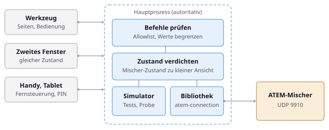
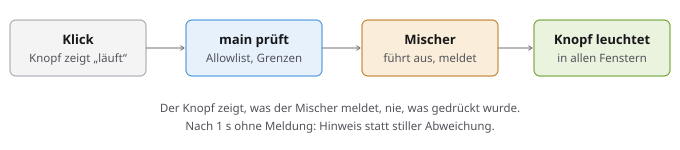
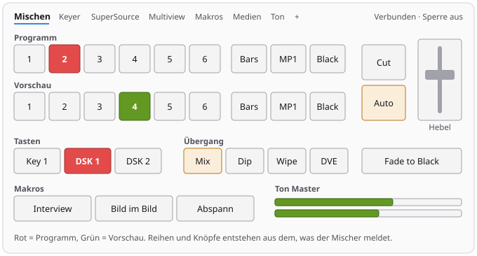
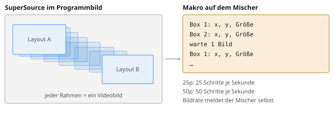
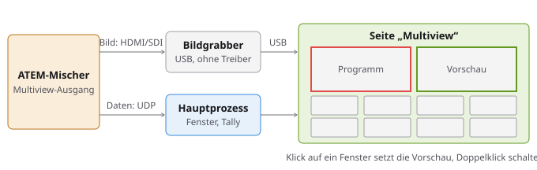
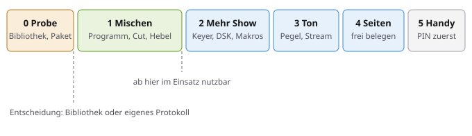

# Plan: ATEM-Steuerung

**Status:** Phase 0 ohne Mischer und Phase 1 sind gebaut, die Seite „Mischen“ lief am ATEM Mini
Extreme, siehe [Stand](#stand). Zum Testen stehen ein ATEM Mini Extreme und ein ATEM Mini bereit, die
[offenen Fragen](#offene-fragen) betreffen nur noch Details.

Blackmagic-ATEM-Mischer vom Laptop bedienen, später auch vom Tablet oder Handy: Programm und
Vorschau, Übergänge, Keyer, SuperSource mit bildgenau animierten Wechseln, Multiview im Werkzeug,
Makros, Ton und eigene Seiten, mit Rückmeldung vom Mischer. Vorbild für den Funktionsumfang ist [MixEffect Pro](https://mixeffectpro.app); Oberfläche und Namen bleiben
Mottulbox, nachgebaut wird nichts.

- [Stand](#stand)
- [Entscheidung](#entscheidung-eigenes-werkzeug)
- [Aufbau](#aufbau) – [Bibliothek](#bibliothek), [Weg eines Befehls](#weg-eines-befehls),
  [Verbindung](#verbindung), [Simulator](#simulator)
- [Oberfläche](#oberfläche)
- [SuperSource](#supersource) – [Animierte Wechsel](#animierte-wechsel)
- [Multiview im Werkzeug](#multiview-im-werkzeug)
- [Umsetzung im Code](#umsetzung-im-code)
- [Stolpersteine](#stolpersteine)
- [Phasen](#phasen) · [Verzahnung](#verzahnung) · [Tests & Doku](#tests--doku) ·
  [Offene Fragen](#offene-fragen) · [Quellen](#quellen)

## Stand

**Phase 0, Teil ohne Mischer: erledigt am 31. Oktober 2026.** Die Installer für Windows, macOS (Apple
Silicon) und Linux wurden in der CI gebaut und ausgeführt, die App daraus wurde gestartet
(`e2e/paket.mjs`):

- `threadedclass` läuft aus dem `app.asar` als `worker_threads`, `disableMultithreaded` ist nicht nötig.
- `@julusian/freetype2` lädt auf allen drei Systemen und zeichnet eine Beschriftung mit der Schrift
  aus dem `app.asar`. Ins Paket kommt nur das Binary der Zielplattform.
- Ein Schein-Mischer (`e2e/atemFake.mjs`) spricht das echte UDP-Protokoll: Handshake, Zustand, Befehl
  und Rückmeldung laufen so ohne Gerät durch die echte Bibliothek. Das Intel-Paket für macOS wird
  mitgebaut, aber nicht gestartet: Der Runner hat Apple Silicon.

**Phase 1: gebaut, am ATEM Mini Extreme grob abgenommen.** Dienst, Simulator, Verbinden und Seite
„Mischen“ sind fertig, E2E `atem` läuft mit Simulator und Schein-Mischer. Abweichungen vom Entwurf unten:
`atem:connect` nimmt ein Ziel (`{ host }` oder `{ simulator }`), der Hebel hat eine eigene reine Datei
(`src/shared/atemHebel.ts`), und die Sperre sitzt in der Leiste statt in der Schublade: Sie muss in der
Show mit einem Klick erreichbar sein, und Aktionen gehören nicht in die Schublade. `onLevels` kommt
mit Phase 6.

**Erster Test am Gerät, 31. Oktober 2026:** Grobtest der Seite „Mischen“ am ATEM Mini Extreme, ohne
angeschlossene Quellen und Monitore: Alles funktionierte. Die Knöpfe zeigen nur, was der Mischer meldet,
damit sind Verbinden, Befehle und Rückmeldung am Gerät belegt. Nicht belegt ist, was man nur im Bild sieht.

**Noch offen:**

1. Rest von Phase 0: Verbinden aus dem Installer unter Windows und macOS, die
   [Messungen zur Animation](#animierte-wechsel), USB-Ausgang als Kamera.
2. **Am Extreme mit Quellen und Monitor:** Übergänge, Hebel und Fade to Black im Bild.
3. **Null am Ende des Hebels:** Wir senden 10000 und danach 0, wie ältere Hardware-Steuerungen. Im
   Grobtest fiel nichts auf, ob die Null nötig ist, wurde aber nicht gemessen. Sie stammt aus der
   Erinnerung an die Arduino-Bibliothek von SKAARHOJ.
4. **Am ATEM Mini:** Verbinden, Quellen und Stile wie am Gerät.

## Entscheidung: eigenes Werkzeug

Ein eigenes Werkzeug **„ATEM-Steuerung“** (id `atem-control`, Kategorie „Steuerung“), kein weiteres
Ziel in der OSC-Steuerung.

| Weg | Dafür | Dagegen |
| --- | --- | --- |
| **Eigenes Werkzeug** (gewählt) | Mischer-Zustand ist das Herz: Tally, Hebel, Reihen je nach Modell. Feste Seiten funktionieren sofort, ohne dass jemand etwas anlegt | Eigene Oberfläche |
| Drittes Ziel neben OSC und NovaStar | Editor und Raster sind schon da | Kachel-Raster kennt keinen Gerätezustand; jeder Knopf müsste von Hand angelegt werden, die eine Sache, die der Mischer selbst liefert |

Das Raster der OSC-Steuerung bleibt trotzdem nützlich: [Phase 7](#phasen) nutzt es für eigene
Seiten, statt ein zweites zu bauen.

## Aufbau



Der Hauptprozess bleibt autoritativ, wie bei Player und Timer: Er hält **eine** Verbindung, Fenster
und Handy spiegeln nur. So läuft die Verbindung weiter, wenn das Werkzeug geschlossen wird, und
zwei Fenster verbrauchen keinen zweiten Platz am Mischer.

### Bibliothek

[`atem-connection`](https://github.com/Sofie-Automation/sofie-atem-connection): MIT-Lizenz, aus dem
Sofie-Projekt des NRK, Version 3.10.3 vom 1. Oktober 2026 (damit über die 7-Tage-Regel hinaus),
Node ab 18. Sie deckt alles ab, was der Plan braucht: `changeProgramInput`, `changePreviewInput`,
`cut`, `autoTransition`, `setTransitionPosition`, `fadeToBlack`, `setUpstreamKeyerOnAir`,
`setDownstreamKeyOnAir`, `macroRun`, `setMediaPlayerSource`, `setAuxSource`,
`setFairlightAudioMixerSourceProps`, `setClassicAudioMixerInputProps`, `startStreaming`,
`startRecording`, `uploadStill`, `setSuperSourceBoxSettings`, `uploadMacro`,
`macroInsertTimedWait`, `setMultiViewerWindowSource`. Der Zustand kommt über das Ereignis
`stateChanged(state, pfade)`, Pegel über `levelChanged`.

Zwei Abhängigkeiten sind für die Paketierung zu prüfen ([Phase 0](#phasen)):

- **`threadedclass`** legt den UDP-Socket in einen eigenen Thread. Das ist erwünscht: Hängt der
  Hauptprozess kurz, verpasst der Socket sonst Bestätigungen an den Mischer. Geladen wird
  `./atemSocketChild` zur Laufzeit, das muss aus dem `asar`-Archiv heraus funktionieren. Notlösung:
  `disableMultithreaded: true`, dann läuft der Socket im Hauptprozess.
- **`@julusian/freetype2`** ist nur für Multiview-Beschriftungen da, wird aber fest mitgeladen.
  Nötig sind Vorab-Binaries für Windows, macOS und Linux unter der aktuellen Electron-Version.

Das Protokoll ist nicht offiziell dokumentiert, die Bibliothek ist nachgebaut. Blackmagics eigener
Weg ist das ATEM-SDK. Eine neue Firmware kann also ein Update der Bibliothek verlangen; deshalb
zeigt das Werkzeug Modell und Protokollversion an und warnt bei einer unbekannten.

### Weg eines Befehls



**Der Knopf zeigt, was der Mischer meldet, nie, was gedrückt wurde.** Bei einer Show ist ein Knopf,
der fälschlich „Programm“ zeigt, schlimmer als gar keiner. Das gilt auch, wenn jemand am Hardware-
Panel oder in ATEM Software Control umschaltet: Alle Ansichten folgen dem Mischer. Der Knopf zeigt
sofort „läuft“, damit der Klick spürbar bleibt.

Befehle kommen vom Fenster und vom Handy und sind in beiden Fällen fremde Eingaben: Sie laufen über
eine Allowlist (`AtemCommand`, Muster `player/remoteCommand.ts`) mit geprüften Werten, also
vorhandene Quelle, vorhandene M/E, Bereich des Hebels.

### Verbindung

Zustände: getrennt, verbindet, verbunden, verloren. Die Bibliothek baut eine verlorene Verbindung
selbst wieder auf; das Werkzeug zeigt das rot in der Leiste und sperrt Knöpfe, statt sie ins Leere
laufen zu lassen. Die letzte Adresse liegt in `settings.json`, „Beim Start verbinden“ ist wählbar.

Die Zahl gleichzeitiger Steuerungen ist begrenzt. Im Blackmagic-Forum ist von fünf die Rede, eine
offizielle Angabe habe ich nicht gefunden. Mottulbox belegt immer genau einen Platz.

### Simulator

Ein `AtemSimulator` im Hauptprozess mit derselben Schnittstelle wie die echte Verbindung: Er führt
Befehle aus und meldet den neuen Zustand, kennt verschiedene Modelle (viele Eingänge, Fairlight
oder klassischer Ton). Das bringt dreierlei:

- E2E-Tests und CI laufen ohne Mischer.
- Die Oberfläche lässt sich für jede Mischer-Größe entwickeln, nicht nur für die vorhandene.
- „Probebetrieb“ in der App: Bedienung üben und Seiten vorbereiten, ohne Gerät. MixEffect bietet
  das ebenfalls.

Er prüft nicht das Protokoll. Dafür bleibt der Abnahmetest am echten Mischer je Phase.

## Oberfläche



Nach dem Werkzeug-Muster (`ToolShell`, `ToolBar`, Schublade):

- **Leiste:** Verbindung (Adresse, Verbinden), Modell, rechts der Status. Aktiv („live“, rot), solange
  gestreamt oder aufgezeichnet wird.
- **Arbeitsfläche:** Seiten als Reiter. Fest: Mischen, Keyer, SuperSource, Multiview, Makros, Medien,
  Ton. Dazu eigene Seiten. Was der Mischer nicht kann, erscheint nicht.
- **Schublade:** Verbindung, Beschriftung, Sperre, Fernsteuerung. Keine Aktionen.
- **Aus dem Mischer statt fest verdrahtet:** Zahl der Quellen, M/Es, Keyer, DSKs, Makros und ihre
  Namen stammen aus dem, was der Mischer meldet (`state.info.capabilities`, `state.inputs`). Ein
  ATEM Mini und ein Constellation nutzen dieselbe Seite.
- **Show-Schutz:** „Sperren“ nimmt alle Knöpfe aus der Bedienung, Maus und Tastatur. Fade to Black
  verlangt einen zweiten Klick. Eine Fehlbedienung geht sofort auf Sendung.
- **Tastatur:** 1–9 Vorschau, Umschalt + 1–9 Programm, Leertaste Cut, Eingabe Auto. Nur aktiv, wenn
  kein Textfeld den Fokus hat.

Farben über Tokens: `destructive` für Programm, `success` für Vorschau, die Akzentfarbe für die
Auswahl. Das passt zur Regel „Rot ist live“. Hart kodiert wird nichts, auch nicht im Hebel.

## SuperSource

Eigene Seite, sichtbar nur, wenn der Mischer eine SuperSource hat (`capabilities.superSources`).
Laut MixEffect sind das unter anderem ATEM Mini Extreme, Extreme ISO und Constellation 8K. Zahl der
Boxen und SuperSources meldet der Mischer selbst (`info.superSources`), die Seite hat wie bei den
M/Es von Anfang an eine Auswahl.

- **Arbeitsfläche:** Fläche in 16:9 mit allen Boxen. Ziehen verschiebt, die Ecke skaliert, Griffe
  beschneiden. Dazu je Box Quelle und Ein/Aus, für die SuperSource Hintergrund und Vordergrund (Art).
- **Layouts:** Stand aller Boxen als benanntes Layout, im Store und in der Projektdatei. Abruf per
  Knopf, später auch per OSC.
- **Beim Ziehen** gilt die Regel des Hebels: je Bild höchstens ein Wert, immer der neueste.
- **Rahmen:** Ältere Modelle kennen einen Rahmen je SuperSource, Constellation HD ab Firmware 9.6
  einen je Box. Die Ansicht fasst beides zusammen.

### Animierte Wechsel



Für SuperSource-Boxen gibt es keinen Befehl zum Überblenden, jede Animation ist eine Folge einzelner
Positionen. **Die Recheneinheit ist deshalb das Videobild, nicht die Zeit.** Die Bildrate kommt aus
`settings.videoMode`, also von 23,98 bis 59,94, bei Halbbild-Modi je Vollbild ein Schritt.

**Die Dauer gilt in Bildern**, wie alle Übergangsraten am ATEM, und so speichert sie auch das Layout.
Dasselbe Layout läuft bei 50p also halb so lang wie bei 25p. Die Seite zeigt daneben die Sekunden zur
aktuellen Bildrate, damit das auffällt, wenn ein Projekt auf einem anderen Mischer läuft.

Eine reine Funktion rechnet aus Start, Ziel, Bildzahl und Kurve alle Werte je Bild. Jeder Wert
entsteht direkt aus Start und Ziel statt aufaddiert: Rundungsfehler laufen nicht auf, der letzte
Schritt ist exakt das Ziel. Es gehen nur geänderte Felder hinaus (der Befehl hat dafür eine Maske).
Kurven: linear, weich, anziehen, ausrollen, überschwingen, federn. Boxen, die neu dazukommen oder
wegfallen, fahren von außerhalb des Bilds herein oder hinaus.

Zwei Wege, gleiche Schritte:

| | **Makro auf dem Mischer** (Standard) | **Direkt senden** (Rückfall) |
| --- | --- | --- |
| Takt | Mischer: nach jedem Schritt eine Pause von 1 Bild | Laptop: Zeitgeber in Bildrate |
| Genauigkeit | bildgenau, unabhängig von Netz und Laptop | schwankt mit Netz und Zeitgeber |
| Grenzen | nur ein Makro gleichzeitig, begrenzte Länge, belegt einen Platz | hohe Befehlszahl im Netz |
| Gut für | Layoutwechsel | Ziehen, sehr lange Fahrten, wenn schon ein Makro läuft |

Auch TouchDirector erzeugt für SuperSource-Animationen Makros zur Laufzeit und begründet das mit der
Netzlast. MixEffect fügt beim Aufzeichnen nach jedem Schritt eine Pause von 1 Bild ein; wie es live
sendet, verrät die Doku nicht.

**Ablauf:** aktuellen Stand lesen, Schritte rechnen, Makro bauen, per `uploadMacro` auf einen
reservierten Platz laden, starten. So fängt das Makro immer beim echten Stand an und springt nicht.
Hochladen ist besser als Aufzeichnen, denn eine Aufzeichnung nähme alles mit, was währenddessen
am Mischer geschieht. Das Datenformat ist nicht dokumentiert und wird aus `downloadMacro` einer
Testaufnahme abgeleitet. Klappt das nicht, bleibt `macroStartRecord` mit `macroInsertTimedWait`.

**Messung in Phase 0**, alles Annahmen, bis sie am Gerät belegt sind: Wirken mehrere Box-Befehle
zwischen zwei Pausen im selben Bild? Wie viele Schritte fasst ein Makro? MixEffect warnt, dass lange
Übergänge beim Aufzeichnen abbrechen. Wie lange dauert das Hochladen? Wie viele direkte Befehle je
Bild verträgt der Mischer? Gemessen wird an einer Aufnahme des Programmbilds, Bild für Bild mit ffmpeg
(Skill `ffmpeg-labor`).

## Multiview im Werkzeug



**Über das Steuerprotokoll kommt kein Bild.** Die Bibliothek kennt nur die Einstellungen des
Multiview (Aufteilung, Quelle je Fenster), Live-Video überträgt sie nicht. Das Bild kommt über den
USB-Ausgang: Der ATEM Mini Extreme gibt dort wahlweise das Multiview, jeden Eingang oder einen anderen
Feed aus, und der Rechner sieht ihn als Kamera, auch in der Kamera-App von Windows. Ein Bildgrabber
ist dafür nicht nötig.

| Weg | Bewertung |
| --- | --- |
| **USB-Ausgang des Mischers** (gewählt) | ATEM Mini Extreme: Multiview oder jeder andere Feed, ohne Zusatzgerät |
| HDMI/SDI über USB-Bildgrabber | Für Modelle, die am USB-Ausgang nur das Programmbild liefern. Im Werkzeug derselbe Weg, nur ein anderes Kamera-Gerät |
| NDI | Keine ATEM-Quelle dafür gefunden, es bräuchte einen Konverter. Empfang kann das NDI-Binding (`receive`), die Bilder müssten aber aus main zum Fenster. Später |
| Ohne Bildquelle | Gleiche Fenster mit Namen und Tally, ohne Bild. Das ist der Rückfall, wenn der USB-Ausgang belegt ist |

Das Bild läuft direkt im Fenster per `getUserMedia` in ein `video`-Element, nichts davon geht durch
main. Darüber liegt ein Raster aus dem Mischer-Zustand: Die Aufteilung ist eine Maske je Viertel
(groß oder vier kleine), die Quellen stehen je Fenster in `settings.multiViewers`.

- **Bedienen:** Klick auf ein Fenster setzt die Vorschau, Doppelklick schaltet. Rahmen in Rot und
  Grün zeigt das Werkzeug selbst, sie folgen dem Mischer.
- **Modelle:** Die Seite erscheint nur, wenn der Mischer ein Multiview meldet (`info.multiviewer`),
  am ATEM Mini also nicht.
- **Auswahl:** Gerät und Auflösung in der Schublade, gemerkt je Rechner. Ein Gerät mit „ATEM“ oder
  „Blackmagic“ im Namen ist vorgewählt. Ist es schon belegt, etwa durch die Kamera-App oder OBS, sagt
  das Werkzeug das klar.
- **USB-Ausgang umschalten:** Das Werkzeug kann den Feed selbst wählen, auch um einen Eingang groß zu
  prüfen. Die Bibliothek kennt dafür `SourceAvailability.WebcamOut` je Quelle und das Multiview als
  eigenen Quellentyp (`InternalPortType.MultiViewer`); keine Nummer muss fest im Code stehen.
  Geschaltet wird vermutlich per `setAuxSource`, welcher Bus das ist, zeigt Phase 0 am Extreme.
- **Vorsicht beim Umschalten:** Hängt am USB-Ausgang zugleich Zoom oder OBS, sehen die den neuen Feed
  ebenfalls. Darum verlangt das Umschalten eine Bestätigung, die aktuelle Quelle steht immer sichtbar da.
- **Netzwerk bleibt nötig:** Die Bibliothek spricht nur UDP. Für die Steuerung braucht der Mischer also
  Ethernet, auch wenn das Bild über USB kommt.
- **Eigenes Fenster:** Multiview auf einem zweiten Monitor über `createOutputWindow()`.
- **Nicht vorgesehen:** Multiview aufs Handy. Das bräuchte eine eigene Bildkodierung.

Ob MixEffect Live-Video zeigt, ist unklar: Seine Doku beschreibt ein Bedienfeld mit Standbildern je
Quelle und nennt keinen Bildweg. Hier geht es also über das Vorbild hinaus.

**Berechtigung:** Die App verweigert heute jede Kamera (`windowPolicy.ts`). Nötig ist eine Ausnahme
wie beim RTA: nur diese Routen, nur Video, nie Ton, Unit-Test und Schritt im E2E `security`. Dazu
`NSCameraUsageDescription` in `electron-builder.yml` und ein Eintrag in `docs/SICHERHEIT.md`. Unter
Windows kann die Kamera-Freigabe des Systems den Zugriff sperren, das braucht einen klaren Hinweis.

## Umsetzung im Code

Neue Dateien:

```text
src/shared/
  atem.ts                   Typen AtemCommand, AtemView, AtemStatus; Prüfung atemCommand(v)
  atemView.ts               Mischer-Zustand zu kleiner Ansicht verdichten
  atemAnimation.ts          Schritte je Bild, Kurven, Bildrate aus dem Videomodus
  atemMultiview.ts          Fenster-Rechtecke aus Aufteilung und Vertauschung
src/main/services/atem/
  atemVerbindung.ts         Schnittstelle, die atem-connection kapselt
  atemSimulator.ts          dieselbe Schnittstelle ohne Gerät
  atemService.ts            eine Verbindung, Zustand, Sinks; dünn wie der NovaStar-Dienst
  atemMakro.ts              Schritte zu Makro, Platz reservieren, hochladen, starten, abbrechen
  atemRemoteServer.ts       Fernsteuerung (Phase 8), dazu atemRemotePage.ts
src/renderer/src/tools/atem-control/
  index.ts, AtemControl.tsx Werkzeug, je Seite eine eigene Datei
  useAtem.ts                spiegelt die Ansicht
  store.ts                  eigene Seiten und Layouts, persistiert und versioniert
```

Die Dateien in `src/shared/` bleiben rein und getestet. Der volle Mischer-Zustand ist groß und ändert
sich laufend, deshalb geht über IPC nur die verdichtete Ansicht.

**IPC** (Skill `ipc-kanal`), mit dem neuen Vertrag nur ein Abschnitt plus Handler:

```ts
atem: {
  status: anfrage<() => AtemStatus>('atem:status'),
  connect: anfrage<(host: string | 'simulator') => AtemStatus>('atem:connect'),
  disconnect: anfrage<() => AtemStatus>('atem:disconnect'),
  view: anfrage<() => AtemView | null>('atem:view'),
  command: anfrage<(cmd: AtemCommand) => void>('atem:command'),
  onStatus: ereignis<(status: AtemStatus) => void>('atem:statusChanged'),
  onView: ereignis<(view: AtemView) => void>('atem:viewChanged'),
  onLevels: ereignis<(levels: AtemLevels) => void>('atem:levels')
}
```

Animationen laufen im Hauptprozess, nicht im Fenster: Ein verdecktes Fenster würde gedrosselt. Sie
sind ein normaler `AtemCommand` (Layout, Bildzahl, Kurve), also kein eigener Kanal.

**Speichern:** Adresse und Autostart in `settings.json`, eigene Seiten und SuperSource-Layouts im Store
und als Abschnitt `atem` der Projektdatei (Skill `projektdatei`), damit sie mit dem Event mitwandern.

## Stolpersteine

- **Hebel:** Beim Ziehen entstehen viele Befehle. Höchstens rund 30 je Sekunde senden, immer den
  neuesten Wert, nie eine Warteschlange. Der Mischer kehrt die Richtung nach jedem Übergang um; das
  muss der Hebel nachbilden, sonst springt er. Die Logik wird rein und getestet.
- **Nur ein Makro gleichzeitig:** Ein neues Makro beendet das laufende. Vor einer Animation prüft der
  Dienst `macroPlayer`: Läuft ein fremdes Makro, wird direkt gesendet, statt es abzubrechen.
- **Reservierter Makro-Platz:** Nie einen fremden Platz überschreiben. Der Dienst nimmt einen freien
  von hinten, erkennt ihn am Namen und blendet ihn in der Makro-Seite aus.
- **Wechsel mitten in der Animation:** Das Makro stoppen, aus dem gemeldeten Stand neu rechnen.
- **Zustandsflut:** Während einer Animation meldet der Mischer je Bild neue Werte. Die Ansicht geht
  gedrosselt an die Fenster, wie bei den Pegeln.
- **Pegel:** `levelChanged` kommt häufig. Im Hauptprozess zusammenfassen und auf etwa 15 je Sekunde
  begrenzen, Zeichnen wie beim RTA per `requestAnimationFrame` über Refs, nie über React.
- **Zwei Ton-Welten:** Klassische Mischer und Fairlight haben verschiedene Befehle und Felder. Die
  Ansicht vereinheitlicht beide, damit die Seite nur eine Form kennt. Die ATEM-Mini-Reihe nutzt
  Fairlight, klassischen Ton prüft vorerst nur der Simulator.
- **Mehrere M/Es:** Größere Modelle haben bis zu vier. Die Seite braucht von Anfang an eine Auswahl,
  sonst muss der Zustand später überall umgebaut werden.
- **Beenden:** Eine offene Verbindung zählt nicht als „läuft noch“, ein Stream oder eine Aufzeichnung
  schon; die laufen aber auf dem Mischer weiter. Die Rückfrage (`laufend.ts`) darf nichts Falsches
  behaupten. `exit-hook` aus der Bibliothek muss sich mit dem eigenen Beenden vertragen.
- **Thread-Abstürze:** Der Socket-Thread startet selbst neu (`autoRestart`). Der Dienst muss das
  überstehen, ohne eine zweite Verbindung aufzubauen.
- **Sicherheit:** Der Mischer prüft keine Anmeldung, wer ihn im Netz erreicht, kann schalten. Die
  Fernsteuerung bringt das auf jedes Handy im WLAN. Deshalb kommt sie erst nach dem PIN aus der
  Roadmap, ist ab Werk aus und hat eine Eintragung in `docs/SICHERHEIT.md`.

## Phasen



| Phase | Inhalt | Fertig, wenn |
| --- | --- | --- |
| **0 Probe** | Bibliothek in Electron einbinden, Paket auf allen drei Systemen bauen, Thread und freetype im Installer prüfen, Anbindung am echten Mischer, [Messungen zur Animation](#animierte-wechsel), USB-Ausgang des Extreme als Kamera im Fenster samt Bus und Verzögerung | Installer verbindet sich auf Windows und macOS, der Weg der Animation steht fest. Sonst Entscheidung: `disableMultithreaded`, Abhängigkeit ersetzen oder eigener, kleiner Protokoll-Client |
| **1 Mischen** | Dienst, Simulator, Verbinden, Seite „Mischen“: Programm, Vorschau, Cut, Auto, Fade to Black, Übergangsart und -dauer, Hebel, Sperre, Tastatur | Eine Show lässt sich fahren; E2E mit Simulator; Abnahme am Mischer |
| **2 Mehr Show** | Keyer, DSK, Makros (Liste, Start, Stopp), Media-Player, AUX | Abnahme am Mischer |
| **3 SuperSource** | Seite mit Boxen, Quellen, Beschnitt, Art und Layouts, Projektdatei | Layout anlegen, abrufen, in anderem Projekt laden; Abnahme am Mischer |
| **4 Animation** | Schritte je Bild, Kurven, Makro und direktes Senden, Abbruch | Wechsel läuft bei 25p und 50p ohne Sprung und endet exakt im Ziel, belegt an einer Aufnahme |
| **5 Multiview** | Kamera-Gerät wählen, USB-Ausgang umschalten, Bild mit Raster, Tally, Klick schaltet, eigenes Fenster, Ansicht ohne Bild | Bild steht im Werkzeug, Fenster treffen bei jeder Aufteilung; Abnahme am Mischer |
| **6 Ton** | Master und Eingänge, Pegel, Stream und Aufzeichnung | Beide Ton-Welten laufen, mindestens im Simulator |
| **7 Seiten** | Eigene Seiten auf dem Raster der OSC-Steuerung, Projektdatei | Seite anlegen, speichern, in anderem Projekt laden |
| **8 Handy** | PIN für Fernsteuerungen (eigene Vorarbeit), Steuerseite, Fernsteuer-App | Tablet schaltet, ohne PIN geht nichts |

Phase 5 hängt nur an Phase 1 und lässt sich vorziehen, wenn das Multiview wichtiger ist.

**Später:** Animation auch für DVE-Keyer (für Mischer ohne SuperSource; dort gibt es zudem die
eingebauten Fly-Keys), Fensterbelegung des Multiview ändern, HyperDeck, mehrere Mischer gleichzeitig,
Kamerasteuerung, automatisches Umschalten nach Tonpegel.

## Verzahnung

- **Netzwerk-Scanner:** Er erkennt ATEMs schon (`netscan/atem.ts`); „In der ATEM-Steuerung
  verwenden“ übergibt die Adresse. Das ist ein Fall für den verallgemeinerten Übergabe-Speicher aus
  der Roadmap.
- **Testbild und Video-Generator:** Standbild per `uploadStill` direkt in den Media-Pool.
- **Mini-Manual:** Kapitel Bedienfeld übernimmt Seiten und Makro-Namen, Muster Jingle-Player und OSC.
- **OSC-Steuerung:** Später ein Kachel-Ziel „ATEM“, damit Companion und Stream Deck über OSC mitschalten
  und SuperSource-Layouts abrufen.
- **Packliste:** Mischer, Kabel und Tally aus dem Projekt, sobald die Liste mehr Quellen kennt.

## Tests & Doku

- **Unit:** `atemCommand` (Allowlist, Grenzen), `atemView` (kleine und große Modelle, beide
  Ton-Welten), Hebel-Logik, Drosselung; `atemAnimation` (Schrittzahl je Bildrate, letzter Schritt
  exakt, nur geänderte Felder, Kurven im Bereich), `atemMultiview` (alle Aufteilungen, vertauscht),
  Berechtigung der Kamera (`windowPolicy`).
- **E2E:** eigenes Skript `atem` mit Simulator: Verbinden, Quelle schalten, Knopf folgt erst nach Rückmeldung,
  fremde Änderung erscheint, Sperre wirkt, Verbindungsverlust wird angezeigt, Layout animiert und endet
  im Ziel, Multiview mit der Test-Kamera von Chromium (`--use-fake-device-for-media-stream`). Der
  Simulator spielt dafür auch Makros mit Pausen in Echtzeit ab.
- **Abnahme am Mischer** je Phase, von Hand: am ATEM Mini Extreme alles, am ATEM Mini, dass Seiten
  ohne Fähigkeit fehlen und der Rest läuft. Die CI hat kein Gerät.
- **Doku:** nach der Umsetzung in `docs/WERKZEUGE.md`, README-Überblick, `docs/FERNSTEUERUNG.md`,
  `docs/SICHERHEIT.md`; dieser Plan wird dann gelöscht. Neuer Skill `atem-steuerung`, sobald sich
  Muster gezeigt haben.

## Offene Fragen

1. **Darf die Animation einen Makro-Platz belegen?** Vorschlag: ja, ein freier von hinten.
2. **Wofür zuerst?** Für den Laptop neben dem Mischer oder als Tablet-Bedienung? Beim Tablet rückt
   Phase 8 samt PIN nach vorn.
3. **Sperre:** Genügt ein Schalter, oder soll Entsperren eine eigene Bestätigung verlangen?
4. **Fade to Black mit zweitem Klick:** gewünscht oder im Ernstfall zu langsam?

## Quellen

- [atem-connection](https://github.com/Sofie-Automation/sofie-atem-connection) (Quellcode: Befehle,
  Socket und Thread, Zustand)
- [npm: atem-connection](https://www.npmjs.com/package/atem-connection) (Version, Lizenz, Abhängigkeiten)
- [MixEffect](https://mixeffectpro.app) (Funktionsumfang, Simulator), Doku:
  [SuperSource und Makros](https://docs.mixeffect.app/explore/supersource/supersource-and-macros.md),
  [Multiview-Bedienfeld](https://docs.mixeffect.app/configure/switcher-pages/panels-and-buttons/multiview-switcher.md)
- [TouchDirector](https://apps.apple.com/app/id1450852852) (Makros zur Laufzeit für Box-Animationen)
- Blackmagic-Forum: [Protokoll](https://forum.blackmagicdesign.com/viewtopic.php?p=676464),
  [Verbindungsgrenze](https://forum.blackmagicdesign.com/viewtopic.php?p=777096),
  [Multiview als NDI](https://forum.blackmagicdesign.com/viewtopic.php?p=1022835),
  [Animations-Makros](https://forum.blackmagicdesign.com/viewtopic.php?p=1023346)
