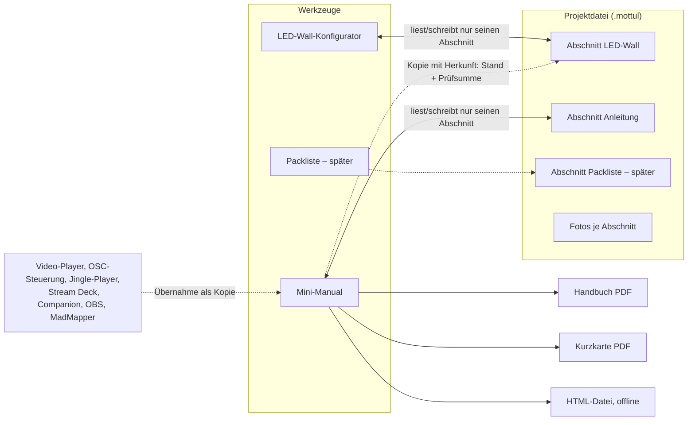
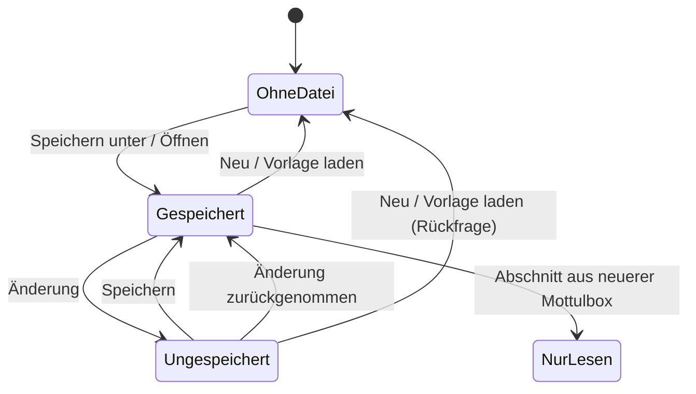
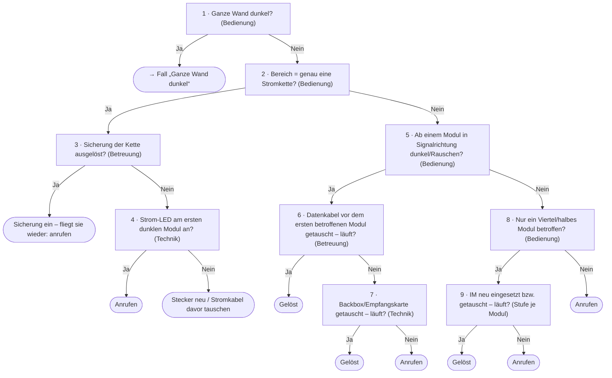

# Plan: Mini-Manual („So bedienst du deine LED-Wall“)

**Status:** Phase 0 umgesetzt (16. Oktober 2026): Projektordner, Projektdatei `.mottul` und das
Datei-Menü des LED-Wall-Konfigurators – beschrieben in
[WERKZEUGE.md](WERKZEUGE.md#projektdateien-und-projektordner), Anleitung für weitere Werkzeuge im
Skill `projektdatei`. Danach zweimal geprüft; alle bestätigten Befunde sind behoben und als
Regeln im Skill `review-checkliste` festgehalten. Abgestimmt in Rücksprachen am selben Tag,
siehe [Festlegungen](#festlegungen); vor den späteren Phasen die [offenen Fragen](#offene-fragen)
klären. Nach der Umsetzung in WERKZEUGE überführen und diesen Plan löschen.

**Phase 1 umgesetzt (16./17. Oktober 2026):** PDF-Weg über eine temporäre Datei, Fotos in der
Projektdatei, das Werkzeug „Mini-Manual“ mit allem aus der Phasen-Tabelle – beschrieben in
[WERKZEUGE.md](WERKZEUGE.md#mini-manual), Inhalte schreiben nach Skill `anleitung-inhalte`.
Abweichungen vom Plan:

- **Vorschau** zeigt Kapitel für Kapitel dieselbe Seite wie das PDF, aber ohne echte
  Seitenumbrüche („Seite 3 von 8“ kennt erst Chromiums Druck).
- **Foto-Speicher** für alle Dateien gemeinsam statt eines Arbeitsordners je Datei (siehe
  [Sicherheit](#sicherheit)).
- **IM-Tausch je Modul** steht seit Phase 2b (Teil 3) in den Stammdaten des Konfigurators
  (`led-wall/data.ts`, Feld `ims`); die Fehlersuche liest sie über `imTausch()`.
- **Fehlerfälle** 1–3 bilden zusammen „Ein Teil der Wand ist dunkel“, 5, 7 und 15 stecken in
  „Die ganze Wand ist dunkel“ (mit Glasfaser/CVT10) – 15 Fälle statt 18.
- **Logo** als PNG/JPG im Foto-Speicher; SVG geht noch nicht (müsste vorher bereinigt werden).

Rückmeldung aus dem ersten Test (17.10.2026), erledigt: Foto auf dem Deckblatt nicht mehr
verzerrt, Logo größer, eingesetzte Platzhalter-Werte fett.

Noch offen aus Phase 1 (klein, bei Bedarf): Aufräumen des Foto-Speichers. (Bausteine
„aktualisieren“ und Vorschläge nach Stichworten sind umgesetzt, 22.10.2026, siehe WERKZEUGE.)

**Phase 2a, erster Teil umgesetzt (17.10.2026):** mehrere Wände je Datei – Abschnitt `ledWall`
Version 3 mit Migration (Speicher, Vorlagen, Datei), Wand-Menü im Konfigurator, Name der Wand in
der Schublade, Packliste je Wand mit Summe gleicher Module, Mini-Manual mit Kopie je Wand
(Anleitung Version 2), Kapitel und Platzhalter je Wand, strengere IM-Regel bei gemischten Modulen.
Abweichungen: **Vorlage laden** ersetzt nur die gewählte Wand und lässt die Datei-Bindung stehen
(vorher „Neu aus Vorlage“ mit gelöster Bindung); die **PDF-Doku** des Konfigurators zeigt die
gewählte Wand (mit Namen), nicht alle; der **geteilte Prozessor** kommt mit der Prozessor-Wahl in
Phase 2b.

**Phase 2a, zweiter Teil umgesetzt (17.10.2026):** Querverweise im Mini-Manual – „bespielt“ am
Prozessor, Ausgänge der Zuspieler mit Bildgröße, Verteiler (neue Rolle) und Ziel-Prozessoren,
Ausschnitt je Wand bei einem Gesamtbild; Systemübersicht mit Pfeilen aus den Signalwegen und
Liste je Wand; Prüfung (Wand ohne Prozessor, Prozessor ohne Wand, Zuspieler ohne Ziel, Ausschnitt
über dem Bild bzw. skaliert). Anleitung Version 3. Abweichung: Eindeutige Fälle (eine Wand bzw.
ein Prozessor) gelten ohne Angabe als verbunden – so bleibt die einfache Anleitung ohne Eingabe;
„vorbelegt aus dem Konfigurator“ kommt erst mit der Prozessor-Wahl in 2b.

**Phase 2b in vier Teilen**, je ein PR und für sich nutzbar:

1. **Kabelverlauf von Hand** – umgesetzt (17.10.2026): Startecke und Richtung je Kette, Kette
   zeichnen (verlängern am letzten Modul), Abgleich mit „nachzeichnen“, Pfeile am Bildschirm und
   im PDF (zwischen den Modulen, Start als Punkt, lange Brücke gestrichelt), Vorne/Hinten,
   Signal + Strom nebeneinander, Hinweise „ohne Verlauf“; `led-wall/cabling.ts`, PDF-Bauer
   `printHtml.ts` rein und getestet, Skill `kabelverlauf`.
2. **Prozessor und Kapazität** – umgesetzt (17.10.2026): Prozessor-Wahl je Wand (Vorbelegung je
   Modul, „teilen mit“ bei gleichem Modul, Ports fortlaufend), Farbtiefe/Bildrate, Grenze je Port
   aus Prozessor und Karte (`led-wall/processors.ts`), Port und Backup je Kette (NovaStar freier
   Port, Tessera Portpaar), „B“ im Plan, Karte „Signal“ mit Warnungen, Tabelle im PDF, Prozessor
   und Backup-Leitungen in der Packliste, Prozessoren im Mini-Manual aus der Kopie anlegen.
   Abschnitt `ledWall` Version 4 (`processor.shareWith`). Abweichung: „bespielt“ nicht still
   vorbelegt, sondern per Klick („Prozessoren aus der LED-Wall-Planung übernehmen“).
3. **Strom** – umgesetzt (18.10.2026): Netz und Absicherung je Wand (Schublade „Strom“), Kreis
   und Phase je Stromkette in der Verlauf-Leiste, Last je Kette und Kreis, Phasenbilanz, Karte
   „Strom“ mit Warnungen, Tabelle im PDF (`led-wall/power.ts`, rein und getestet); IMs in den
   Stammdaten (`data.ts` `ims`, auch in Modulkarte und PDF). Abweichungen: Phasen ohne Angabe
   sind ein Vorschlag (schwächste Phase, ein Kreis auf einer Phase) und werden nicht gespeichert;
   Schieflage nur, wenn eine andere Verteilung merklich besser wäre; Strom je Wand (Kreise
   zweier Wände am selben Verteiler zählen nicht zusammen); „höchstens n Module je
   Stromschleife“ laut Hersteller fehlt noch (keine Angaben) – die Grenze kommt aus der
   Absicherung.
4. **Glasfaser und Anleitung** – umgesetzt (18.10.2026): Glasfaser-Strecke je Prozessor
   (`fiber`, Abschnitt `ledWall` Version 5) mit Variante, Länge und Redundanz (Faser redundant oder
   Hot-Backup mit zweiter CVT10, deren Backup-Leitungen keinen Port am Prozessor belegen), Gruppen
   1–8/9–16, Karte, PDF und Packliste (Boxen, Fasern, PowerCON); Kapitel **Verkabelung** im
   Mini-Manual (Pläne aus der Kopie, ab Werk von hinten) und Fragen mit **Antwort aus der Planung**
   (Glasfaser-Schritte der Fehlersuche nur mit Glasfaser) – Anleitung Version 4. Dazu Fehler der
   Verkabelung in der Prüfung vor dem Export. Abweichungen: Hot-Backup gibt jeder Kette ab Werk
   eine Backup-Leitung (je Kette abschaltbar); Strecke nur am UHD Jr (sonst Warnung); Stecker
   der Fasern (LC-Duplex, opticalCON) offen bis [Frage 11](#offene-fragen).

**Phase 2b ist damit umgesetzt.**

**Phase 3, Teil A umgesetzt (18.10.2026):** Handy-Fassung als eine HTML-Datei (`handy.ts`: Fotos
setzt main ein, Inhaltsverzeichnis, Anrufen-Leiste, Fehlersuche Schritt für Schritt mit einem
kleinen Skript, ohne Skript lesbar), Speichern zum Verschicken, **Online-Ablage** im App-Menü
(Ordner + Adresse, z. B. pCloud Public Folder; main schreibt `<Ordner>/index.html`, Ordnername
aus Projekt + Zufall, bleibt je Anleitung gleich) und der QR-Code der Adresse auf der Kurzkarte
(QR-Encoder bis Version 5, 106 Bytes). Anleitung Version 5 (`ausgabe.online`). Online nie
Zugangsdaten, höchstens Stufe Betreuung. **Teil B** (mit den Beispieldateien): Tastenfeld-Editor,
Import Stream Deck/Companion/OBS, Übernahme aus Video-Player, OSC-Steuerung, Jingle-Player.

**Teil B, Tastenfeld-Editor umgesetzt (22.10.2026):** Modell wie unter
[Bedienfelder](#bedienfelder) (`bedienfeld.ts`: Geräte-Tabelle, Tasten setzen/tauschen, Raster
wechseln, Seiten), Anleitung Version 6 (`bedienfelder`), Kapitel Bedienfeld als eigene Art mit
Blöcken darüber, Ausgabe in Handbuch, Vorschau und Handy (`tastenfeldHtml.ts`), Prüfung (leer,
Tasten ohne Aufschrift). Abweichungen: Navigationstasten gibt es schon im Editor (nächste/vorige
Seite, „Öffnet …“ als Ordner-Ersatz), nicht erst beim Import; Drehregler und Touchleisten stehen
vorerst in der Notiz des Bedienfelds. Offen in Teil B: Übernahme aus Jingle-Player,
OSC-Steuerung und Video-Player; Importe, sobald die Beispieldateien da sind.

Offen sind nur Kleinigkeiten ([Fragen 11–13](#offene-fragen)).
Die Skizzen zu diesem Plan (Arbeitsplatz, Fehlersuche, Kurzkarte, Kabelverlauf zum Ausprobieren)
liegen als Artifact bei Matthias.

Ein neues Werkzeug erzeugt Kurz-Anleitungen für die Leute vor Ort: wie man die LED-Wall
einschaltet und bedient, was wo steht und wie verkabelt ist – und im Fehlerfall Schritt für
Schritt, was man prüfen und selbst beheben darf, bevor man anruft. Ausgabe als PDF (Handbuch und
eine Kurzkarte fürs Rack) und als eigenständige HTML-Datei fürs Handy.

Dazu gehören drei Grundlagen, die auch anderen Werkzeugen nützen:

- **Projektordner** – ein Standard-Speicherort für Projektdateien (App-Einstellung).
- **Projektdatei** – eine Datei mit einem Abschnitt je Werkzeug (LED-Wall, Anleitung, später
  Packliste …) und den Fotos.
- **Kabelverlauf** im LED-Wall-Konfigurator – die Reihenfolge der Module je Kette, mit Pfeilen,
  Port bzw. Stromkreis und Warnungen.

Vorlage für die Richtung (nicht für Inhalt oder Aussehen): die MadMapper-/Stream-Deck-Anleitung
vom Mai 2026 – Zugangsdaten, Start-Routine nach Stromausfall, Stream-Deck-Seiten mit je 15
Tasten, Kontakt.

- [Festlegungen](#festlegungen)
- [Überblick](#überblick)
- [Projektdatei und Projektordner](#projektdatei-und-projektordner)
- [Das Werkzeug](#das-werkzeug) – [Kapitel](#kapitel), [Kenntnisstufen](#kenntnisstufen),
  [Bausteine](#bausteine-und-platzhalter), [Fehlersuche](#fehlersuche),
  [Bedienfelder](#bedienfelder), [Oberfläche](#oberfläche), [Ausgaben](#ausgaben)
- [Datenquellen und Importe](#datenquellen-und-importe) – [aus Mottulbox](#aus-mottulbox),
  [Fremdformate](#fremdformate)
- [Kabelverlauf im LED-Wall-Konfigurator](#kabelverlauf-im-led-wall-konfigurator) –
  [mehrere Wände je Datei](#mehrere-wände-je-datei)
- [Umsetzung im Code](#umsetzung-im-code)
- [Phasen](#phasen)
- [Skills, Doku, Tests](#skills-doku-tests)
- [Offene Fragen](#offene-fragen)
- [Nicht geplant](#nicht-geplant)

## Festlegungen

Aus der Rücksprache vom 16. Oktober 2026:

1. **Einsatz:** hauptsächlich Vermiet-Events. Intern auch als Lernstoff für Lehrlinge.
2. **Inhalt:** zunächst nur LED-Wände. Der Aufbau ist allgemein (Systemtyp, Bausteine mit
   Stichworten), damit Beamer, Ton oder Medienserver später ohne Umbau dazukommen.
3. **Autoren:** zunächst Matthias, künftig auch Kollegen. Deshalb liegen eigene Bausteine von
   Anfang an als einzelne Dateien vor (später in einem geteilten Ordner, Phase 5).
4. **Export:** PDF und HTML. **Kein DOCX.**
5. **Projektdatei:** **eine Datei** (kein Ordner), Fotos stecken darin.
6. **Gesamtprojekt:** ja – als *Datei mit Abschnitten*, ohne app-weites „aktives Projekt“. Das
   beantwortet die Bedenken (schnell nur planen, nie im falschen Projekt arbeiten), siehe
   [Grundsatz](#grundsatz).
7. **Standard-Speicherort:** ja, unbedingt (Phase 0).
8. **Anrede und Sprache:** nur „du“, Deutsch.
9. **Kenntnisstufen:** drei – **Bedienung**, **Betreuung**, **Technik**.
10. **Fremdmodule** (nicht im Bestand) im Konfigurator: vorerst nicht.
11. **Fehlersuche:** Bearbeitung als Liste. Ein grafischer Baum-Editor ist als spätere zweite
    Ansicht derselben Daten beschrieben, aber nicht eingeplant.
12. **Kabelpläne:** in Konfigurator, Anleitung und PDF **umschaltbar** zwischen Ansicht von vorne
    und von hinten.
13. **IM** (Integrated Module) = austauschbares LED-Paneel im Modul, beim Hersteller (LEDitgo)
    auch „Pixelkarte“; dahinter sitzt die Backbox mit Netzteil und Empfangskarte. 4 IMs je Modul
    (2 × 2) bei 496-2,0 und rX3ioBF, 2 je Modul (übereinander) bei uS2+.
14. **IM-Tausch:** bei 496-2,0 und rX3ioBF werkzeuglos von vorne oder hinten – nach Rücksprache
    darf das jeder (Stufe Bedienung mit Rücksprache). Beim uS2+ hat jedes IM 8 Schrauben – nur
    Technik.
15. **Verkabelung** hängt von Größe und Format der Wand und vom Kabelweg ab. Deshalb keine feste
    Automatik. ~~Ein Einspeisepunkt legt fest, wo die Zuleitungen ankommen, daraus der Vorschlag
    für die Startecke und die Länge der Zuleitung~~ – entfällt (Festlegung 24). Startecke und
    Richtung wählt man je Kette frei, oder man zeichnet die Kette.
    Optional je Signalkette eine **Backup-Leitung** vom letzten Modul zum Prozessor, die im
    Fehlerfall greift – Redundanz ist nicht immer vorhanden, daher ab Werk aus.
16. **Prozessoren im Bestand:** NovaStar NovaPro UHD Jr (496-2,0, rX3ioBF), NovaStar VX4S,
    Brompton Tessera S8 (uS2+). Bei längeren Wegen läuft das Signal über Glasfaser zu einer
    Breakout-Box (NovaStar CVT10) an der Wand.
17. **Dateiendung** `.mottul` – bestätigt.
18. **MadMapper 6** ist im Einsatz; sein OSC-Eingang ist ab Werk Port 8010. Die OSC-Steuerung
    sendet deshalb ab Werk an 8010 (umgesetzt am 16.10.2026; gespeicherte Einstellungen behalten
    ihren Port).
19. **Projektordner:** Vorgabe `Dokumente/Mottulbox-Projekte`, im App-Menü änderbar. Neue Dateien
    („Speichern unter“ ohne Datei) beginnen immer dort, „Öffnen“ im zuletzt benutzten
    Projektordner.
20. **Werkzeug in Mottulbox**, keine eigene App und keine PWA (Begründung unten).
21. **Kabelpläne schlank halten** (Rückmeldung zur Skizze, 16.10.2026): Einspeisepunkt und
    Zuleitungen werden **nicht gezeichnet** – das machte den Plan unübersichtlich. Die
    Backup-Leitung zeigt nur ein „B“ am letzten Modul. ~~Einspeisepunkte und Schnellwahl der
    Aufteilung~~ entfallen (Festlegung 24).
22. **Kurzkarte:** A5, genau eine Seite (Rücksprache 16.10.2026; kein A4 zur Wahl).
23. **Firmenprofil:** Logo (SVG, sonst PNG), Firmenfarbe (Hex) und Kontakte liegen bei Matthias
    vor. Sie kommen **nicht ins Repo** – es ist öffentlich auf GitHub –, sondern werden einmal im
    Firmenprofil geladen bzw. eingetragen. Ab Werk hat das Profil kein Logo und die gelbe
    Papierfarbe der bestehenden PDFs. Die **Firmenfarbe ist nur Akzent** (Trennlinien, eventuell
    Überschriften), nie Papierfarbe.

Aus der Rücksprache vom 17. Oktober 2026 (nach dem ersten Test von Phase 1):

24. **Kabelverlauf vorerst nur von Hand.** Ein Konzept, das für jede Größe und jedes Format der
    Wand passt, wäre in der Bedienung zu viel. Deshalb **kein Einspeisepunkt**, keine gerechnete
    Zuleitungslänge und keine Schnellwahl der Aufteilung. Es reicht: Aufteilung wie heute (Klick
    füllt Modul, ganze Reihe oder Spalte), dazu je Kette den **Startpunkt** angeben – oder die
    Kette mit der Maus **zeichnen**. Ersetzt die Einspeisepunkte aus Festlegung 15 und 21; die
    offene Frage 6 entfällt.
25. **Signal und Strom** nebeneinander, wenn der Platz reicht, sonst umschaltbar wie heute – kein
    gemeinsames Raster (wäre unübersichtlich; Festlegung 30).
26. **Ansicht von vorne und von hinten** umschaltbar (bestätigt Festlegung 12).
27. **Backup-Leitung:** Ist sie an, trägt das letzte Modul jeder Datenkette ein „B“, und die
    zusätzlichen Ports zählen in der Rechnung mit (bestätigt Festlegung 21).
28. **Breakout-Box** je Wand an/aus (Glasfaser-Strecke, NovaStar CVT10): Die Packliste nimmt die
    Box und das LWL-Kabel dazu; die Fehlersuche zeigt die Glasfaser-Schritte nur dann.
29. **Mehrere LED-Wände je Projekt** (Wunsch aus der Praxis: ein Laptop bespielt zwei kleine
    Wände). Braucht Querverweise – welcher Zuspieler und welcher Prozessor bespielen welche Wand.

Aus der Rücksprache vom 17. Oktober 2026 (Abend, mit den Handbüchern von NovaPro UHD Jr V1.5.2,
VX4/VX4S Rev 1.1.2, Tessera V3.5 Rev D, CVT10 V1.3.6 und der Kapazitäts-Tabelle der
Empfangskarte A10s Pro):

30. **Signal und Strom nicht in einem Raster** – nebeneinander oder umschaltbar wie heute.
31. **Prozessor je Wand ist die Regel.** Zwei Wände **desselben Typs** können sich einen Prozessor
    teilen (verschiedene Ports); Wände verschiedener Typen (z. B. 496 und uS2+) brauchen ohnehin
    verschiedene Prozessoren.
32. **Zuspieler:** je Wand ein eigener Ausgang (wenn vorhanden und die Leistung reicht), **ein
    Ausgang über einen HDMI-Splitter** (beide Wände zeigen dasselbe) oder **ein Ausgang mit einem
    Gesamtbild**, aus dem jeder Prozessor seinen Ausschnitt nimmt.
33. **Glasfaser mit UHD Jr und CVT10:** Am 10G-Ausgang des UHD Jr (8b/10b) nutzt eine CVT10 nur
    ihre Ports 1–8. OPT1 trägt die Ports 1–8 des Prozessors, OPT2 die Ports 9–16; OPT3/OPT4 sind
    Kopie bzw. Hot-Backup von OPT1/OPT2. Mit vier Glasfaser-Ausgängen heißt das je Gruppe von
    acht Ports **entweder** die Glasfaser redundant (zweite Faser in OPT2 derselben CVT10)
    **oder** mit einer zweiten CVT10 die Kettenenden als Backup speisen (Hot-Backup, deckt auch
    Faser und Box ab) – nicht beides.
34. **Reihenfolge:** zuerst mehrere Wände (im Konfigurator mehrere Wände anlegen, Packliste je
    Wand), dann der Kabelverlauf.

### Warum in Mottulbox und nicht als eigene App oder PWA

- Mottulbox hat schon, was das Werkzeug braucht: PDF-Export im main-Prozess, Datei-Dialoge mit
  gemerktem Ordner, Einstellungen, den LED-Wall-Konfigurator mit allen Kennzahlen
  (`computeWall` in `led-wall/compute.ts` ist rein und wird schon von Packliste, Testbild und
  Video-Generator genutzt), die Packliste und einen QR-Encoder (`components/qr.ts`). Eine eigene
  App müsste all das nachbauen und bräuchte zuerst ein Austauschformat.
- In die Rechner-PWA darf es aus drei harten Gründen nicht: `PWA_TOOLS` muss genau `SMALL_TOOLS`
  sein (Test `src/pwa/tools.test.ts`), der Build bricht bei `api`/`settings` ab
  (`src/pwa/build/plugin.ts`) und Tailwind-Quellen sind auf die Rechner beschränkt
  (`src/pwa/build/sources.ts`).
- **Fürs Handy** gibt es stattdessen die exportierte HTML-Datei: läuft ohne Installation und ohne
  Netz, auch auf dem Handy des Kunden.
- Der fachliche Kern (Datenmodell, Seitenaufbau als HTML-String, Prüfungen, Importe) bleibt
  frei von `api` und Electron. Eine spätere eigene App oder PWA bliebe damit möglich.

## Überblick



Der Weg vom Projekt zur Anleitung:

1. Wand im LED-Wall-Konfigurator planen, Kabelverlauf festlegen, **Speichern unter** →
   `Messe Dornbirn 2026.mottul` im Projektordner.
2. Im Mini-Manual dieselbe Datei öffnen. Es findet den Abschnitt LED-Wall und übernimmt
   Kennzahlen und Pläne als Kopie.
3. Kapitel anhaken, Geräte, Zugangsdaten und Bedienfeld eintragen oder einlesen, Fehlerfälle aus
   der Bibliothek wählen, Fotos dazu.
4. Stufe wählen, Prüfung vor dem Export ansehen, Handbuch/Kurzkarte/HTML erzeugen.
5. Ändert sich die Wand später, meldet das Mini-Manual „Planung geändert (Stand 7 → 9)“, zeigt
   den Unterschied und übernimmt ihn erst auf Klick.

## Projektdatei und Projektordner

### Grundsatz

Die Bedenken aus der Rücksprache: Ein Gesamtprojekt darf die schnelle Einzelplanung nicht
verkomplizieren, und man darf nicht versehentlich im falschen Projekt arbeiten oder falsche
Verweise erzeugen. Daraus folgen fünf Regeln:

1. **Kein app-weites „aktives Projekt“.** Jedes Werkzeug arbeitet wie heute mit seinem eigenen
   Arbeitsstand und ist höchstens an *eine* Datei gebunden. Wer nur schnell eine Wand plant,
   bemerkt von Projektdateien nichts.
2. **Eine Datei, mehrere Abschnitte.** Ein Werkzeug liest und schreibt nur seinen eigenen
   Abschnitt; Mottulbox entfernt nie den Abschnitt eines anderen Werkzeugs. Eine LED-Wall-Datei
   ist einfach eine Projektdatei mit nur einem Abschnitt – ein „Gesamtprojekt“ ist kein eigenes
   Konzept, sondern dieselbe Datei mit mehr Abschnitten.
3. **Verweise nur innerhalb derselben Datei, und nur als Kopie mit Herkunft.** Die Anleitung
   liest LED-Wall-Daten nur aus ihrer eigenen Datei, hält davon eine **Kopie** und merkt sich
   Stand und Prüfsumme der Quelle. So ändert sich keine Kunden-Anleitung still, PDF und HTML
   bleiben reproduzierbar, und „Speichern unter“ der Anleitung allein hinterlässt keinen hängenden
   Verweis. (Das setzt fort, was heute schon gilt: Packliste, Testbild und Video-Generator
   übernehmen LED-Wall-Daten per Klick als Kopie.)
4. **Immer sichtbar, woran man arbeitet.** Dateiname in der Leiste jedes gebundenen Werkzeugs und
   im Fenstertitel (`● Messe Dornbirn 2026 – LED-Wall · Mottulbox`); der Punkt heißt
   „ungespeichert“. Ohne Bindung steht dort „ohne Datei“.
5. **Speichern ist ausdrücklich.** Der Arbeitsstand sichert sich wie heute laufend im Werkzeug
   (Schutz vor Absturz), in die Datei geschrieben wird nur mit Speichern (Strg+S).

Merksatz für Kollegen und Lehrlinge: *Jedes Werkzeug speichert wie Word in eine Datei. In eine
Datei passen mehrere Werkzeuge. Speichern ändert nur den eigenen Teil.*

Verworfen wurden zwei Alternativen: ein app-weites aktives Projekt (genau das befürchtete
Risiko – jedes Werkzeug schreibt ins gerade aktive Projekt; außerdem müssten alle neun
persistierten Stores umgebaut werden) und eine reine „Mappe“ als Export/Import-Schnappschuss
(die Datei wäre nie der gültige Stand, Werkzeug und Datei liefen still auseinander).

### Aufbau der Datei

```
Messe Dornbirn 2026.mottul   (ZIP)
├─ projekt.json
└─ fotos/<sha256>.jpg
```

```json
{
  "app": "mottulbox", "type": "projektdatei", "version": 1,
  "geaendert": "2026-10-16T18:20:00Z",
  "abschnitte": {
    "ledWall":   { "version": 2, "rev": 7, "sha256": "…", "geaendert": "…", "fotos": [], "data": {} },
    "anleitung": { "version": 1, "rev": 3, "sha256": "…", "geaendert": "…", "fotos": ["3fa9c2…"],
                   "data": { "quellen": { "ledWall": { "rev": 7, "sha256": "…", "uebernommen": "…" } },
                             "kopie": { "ledWall": {} } } }
  }
}
```

- **Endung `.mottul`** (von `APP_SLUG`), ein ZIP-Container. Nicht `.json`: Das öffnet einen
  Editor, und die Packliste nutzt `.json` schon.
- **Kopf zunächst ohne Projekt, Kunde, Ort und Zeitraum.** Die stehen heute schon in der
  LED-Wall-Planung (`projectName`, `customerName`) und in der Packliste; ein zweiter Ort wäre
  genau die Quelle für Widersprüche. Die Anleitung pflegt ihr Deckblatt selbst und bietet „aus
  LED-Wall übernehmen“ an. Ein gemeinsamer Kopf kommt erst mit dem Show-Profil (Container-Version
  2).
- **Je Abschnitt:** Schema-`version`, `sha256` (im main über das kanonische JSON von `data` nach
  `sanitize`), `rev` (zählt nur hoch, wenn sich `sha256` ändert – Speichern ohne Änderung meldet
  also kein falsches „Planung geändert“), `fotos` (Liste der benutzten Hashes, **neben** `data`,
  damit der main Fotos auch unbekannter Abschnitte behalten kann).
- **Fotos** beim Einfügen auf längste Seite 2000 px verkleinert, unter ihrem Hash abgelegt.
  Nicht mehr benutzte Fotos fallen beim Speichern weg. Keine Pfade in der Datei.
- **ZIP selbst geschrieben** im main (Node `zlib`: `deflateRawSync`/`inflateRawSync`, `crc32`):
  JSON komprimiert, JPG/PNG gespeichert, kein ZIP64. Lesen mit harten Grenzen (nur Methode 0/8,
  Größe je Eintrag und gesamt, Zahl der Einträge, keine Namen mit `..` oder absolutem Pfad, CRC
  prüfen, nichts auf die Platte entpacken). Geschätzt 150–250 Zeilen plus Tests. Begründung: Das
  Repo hält Laufzeit-Abhängigkeiten bewusst klein (zwei Pakete), ZIP in diesem engen Umfang ist
  überschaubar, und derselbe Leser dient dem Stream-Deck-Import. Ausweichweg, falls doch nötig:
  fflate (MIT, ohne Abhängigkeiten) als devDependency – wird ins main-Bundle eingebaut.
  `zlib.crc32` gibt es ab Node 22.2; die Node-Version in Electron 44 vor dem Bau prüfen.
- **Jeder Abschnitt** hat eine reine Prüf- und Migrationsfunktion (`sanitize…`), dieselbe für
  Datei, gespeicherten Arbeitsstand und Vorlagen. Vorbild: `sanitizeVgenProject` in
  `src/shared/videoGenProject.ts`, tolerantes Einlesen wie `packing-list/io.ts`.
- **Was nicht in den Abschnitt gehört:** reine Bedienzustände (aktive Kette `sigChain`/`pwrChain`,
  `pdfLandscape`) – sonst macht schon das Umschalten die Datei „ungespeichert“.

### Bedienung

Ein gemeinsamer Baustein in der Leiste (`ToolBar`, nicht in der Schublade): Dateichip plus Menü
**Datei** mit Neu, Öffnen …, Zuletzt geöffnet, Speichern (Strg+S), Speichern unter …, Im Ordner
zeigen.



- **Neu:** Ist der Stand ungespeichert (oder ohne Datei und nicht leer): Rückfrage „Speichern
  unter … / Verwerfen / Abbrechen“. Danach „ohne Datei“.
- **Öffnen:** Dialog im Projektordner, Filter `.mottul`, gleiche Rückfrage. Hat die Datei einen
  eigenen Abschnitt: über `sanitize` laden und binden. Hat sie keinen: „Diese Datei enthält noch
  keine LED-Wall-Planung – [Aktuelle Planung hinzufügen] [Leere anlegen] [Abbrechen]“; beim
  Hinzufügen Projekt und Kunde beider Seiten zeigen. So plant man erst schnell und ordnet die
  Planung später einer Projektdatei zu.
- **Speichern** (ohne Datei = Speichern unter): Der Renderer schickt Pfad, Abschnitt, Daten und
  `baseSha` (Prüfsumme beim Öffnen/letzten Speichern). Der main reiht je Pfad ein, liest die
  Datei, vergleicht den `sha256` des eigenen Abschnitts auf der Platte mit `baseSha`:
  - **gleich:** nur den eigenen Abschnitt ersetzen, fremde Abschnitte und Fotos unverändert,
    atomar schreiben, neues `rev`/`sha256` zurück.
  - **verschieden** (Kollege hat auf dem NAS gespeichert): „Die Planung in der Datei wurde
    inzwischen anderswo geändert (Stand 8). Überschreiben / Speichern unter / Abbrechen“.
  Prüfsumme statt Änderungszeit, weil sie eigene und fremde Abschnitte unterscheidet und auf
  Netzlaufwerken verlässlich ist.
- **Speichern unter** auf eine vorhandene `.mottul`: „enthält schon: Anleitung (Stand 3) –
  Planung hinzufügen?“ bzw. „… enthält schon eine LED-Wall-Planung (Kunde X, Stand 5) –
  ersetzen?“. Fremde Abschnitte werden nie entfernt; andere Dateien werden abgewiesen.
- **Schließen:** keine Rückfrage – der Arbeitsstand bleibt wie heute im Store, nach dem Neustart
  zeigt der Chip weiter „● Messe….mottul“. (Eine Rückfrage käme bei mehreren Fenstern desselben
  Werkzeugs mehrfach.) Später möglich: Erinnerung beim Beenden der App mit allen ungespeicherten,
  gebundenen Werkzeugen.
- **Datei nicht erreichbar** (NAS weg): Chip zeigt „fehlt“, Speichern führt zu Speichern unter.
- **Sicherungen:** Vor jedem Speichern legt der main die bisherige Datei unter
  `userData/Sicherungen/` ab (die letzten 10 je Datei) – billiges Netz gegen versehentliches
  Überschreiben, ohne den Projektordner zu füllen.
- **Vorlagen** bleiben persönliche Bausteine im Store, ohne Bindung (ebenso die Jobs der
  Packliste). „Vorlage laden“ wirkt wie „Neu aus Vorlage“: Die Bindung wird gelöst (mit derselben
  Rückfrage), damit eine Vorlage nie still in einer Projektdatei landet. Die Bindung steht deshalb
  **neben** `LedWallConfig`, nicht darin – sonst nähme `snapshot()` sie in jede Vorlage mit. Zum
  Teilen mit Kollegen dient eine `.mottul` mit nur einem LED-Wall-Abschnitt.

**Mehrere Fenster:** Die Bindung `{ path, name, baseSha, rev, savedDigest, readOnly }` liegt im
persistierten Werkzeug-Store; `syncAcrossWindows` verteilt sie an alle Fenster des Werkzeugs.
„Ungespeichert“ heißt: Prüfsumme der aktuellen Abschnittsdaten ≠ `savedDigest` (schnelle
Prüfsumme über das kanonische JSON im Renderer). Kein Setter muss dafür angefasst werden, und eine
zurückgenommene Änderung gilt wieder als sauber. Beim Speichern Daten und Prüfsumme *vor* dem
`await` festhalten und danach nur übernehmen, wenn der Pfad noch passt (Review-Checkliste
„Zustand nach await“). `sanitize` passt beim Öffnen die Raster an die Modulzahl an – sonst macht
`ensureGridSize` die Datei gleich nach dem Öffnen „ungespeichert“.

**Fremde und neuere Inhalte beim Öffnen:**

| Fall | Verhalten |
|---|---|
| `app`/`type` passt nicht | „Keine Projektdatei“, nicht öffnen |
| Container-`version` höher als bekannt | „Neuere Mottulbox nötig“, nicht öffnen, nie schreiben |
| unbekannter Abschnitt | bleibt beim Speichern samt Fotos erhalten; erscheint als „unbekannt – neuere Mottulbox“ |
| eigener Abschnitt mit höherer `version` | nur lesen, Speichern in diese Datei gesperrt |
| eigener Abschnitt mit älterer `version` | `sanitize`/Migration beim Lesen; geschrieben erst beim Speichern dieses Abschnitts |

### Projektordner

- Neue Einstellung `projects: { dir: string, recent: string[] }`, Vorgabe `dir: ''` = Standard
  (Muster „leer bis zur ersten Wahl“ wie `youtube.outputDir`). Der main löst `''` zu
  `Dokumente/Mottulbox-Projekte` auf und legt den Ordner erst beim ersten Speichern an; der
  aufgelöste Pfad wird nicht zurückgeschrieben. Kein Migrationsschritt nötig (`mergeSettings`
  ergänzt neue Felder).
- **App-Menü** (`components/app/AppMenu.tsx`), Gruppe „Projekte“: Ordner anzeigen, „Ändern …“,
  „Standard“, „Im Ordner zeigen“ (über `showItemInFolder`, das auch Netzwerkpfade kann –
  `openPath` lehnt UNC-Pfade ab).
- **Datei-Dialoge:** neue Art `'projekte'` in `DialogDirKind` und ein optionaler `kind` für
  `showOpenDialog`/`showSaveDialog` in `src/main/services/fileDialogs.ts` (heute aus den
  Dialog-Eigenschaften abgeleitet). „Speichern unter“ einer Planung ohne Datei beginnt immer im
  Standard-Projektordner (Name aus dem Projektnamen), „Öffnen“ und „Speichern unter“ einer schon
  gebundenen Datei im zuletzt benutzten Projektordner, ersatzweise im Standard-Projektordner. Die anderen Arten bleiben unverändert (`e2e/smoke.mjs`
  prüft das). PDF- und HTML-Exporte schlagen den Ordner der Projektdatei vor.
- Neue IPC (Skill `ipc-kanal`) `projects.dirInfo()` → `{ path, isDefault, exists }`, weil der
  Renderer den Dokumente-Ordner nicht kennt. Der main prüft den gespeicherten Pfad bei jeder
  Nutzung (`settings:set` übernimmt Patches ungeprüft).
- **Doppelklick** auf eine `.mottul` (Dateizuordnung) erst in Phase 5: electron-builder kann sie
  unter Windows/NSIS nur mit `perMachine: true`, das Repo installiert pro Benutzer.

### Sicherheit

Projektdateien kommen von Kollegen oder per Mail – fremde Eingaben:

- ZIP-Grenzen wie oben, JSON-Größe begrenzt, jedes Feld über `sanitize…` (Allowlist, Längen,
  Zahlenbereiche wie in der Oberfläche).
- Schreiben nur in Pfade aus einem Dialog oder aus „Zuletzt geöffnet“, mit Endung `.mottul` und
  gültigem Kopf (Vorbild: Pfadprüfung des Video-Generators in [SICHERHEIT.md](SICHERHEIT.md)).
  `writeFileAtomic` aus `src/main/services/store.ts` herauslösen, mit eindeutigem tmp-Namen
  (heute fest `.tmp`) und Warteschlange je Pfad (unter Windows Groß-/Kleinschreibung
  normalisieren).
- Fotos bleiben im main, der Renderer zeigt sie über ein eigenes Protokoll (Eintrag in `img-src`
  der App-CSP und in SICHERHEIT, Skill `ipc-kanal`). Über IPC laufen nur Hashes, keine
  MB-Strings. **Nie Fotos in einen persistierten Store:** `debouncedStorage` verschluckt
  „Speicher voll“ still. **Umgesetzt (16.10.2026)** mit einer Abweichung: statt eines
  Arbeitsordners je Datei ein gemeinsamer Foto-Speicher `userData/Projektfotos/<sha256>.<jpg|png>`
  (`src/main/services/fotos/fotoStore.ts`) – gleiche Fotos liegen einmal da, und ein Werkzeug ohne
  gebundene Datei behält seine Fotos über einen Neustart. Einfügen über `api.fotos.pick()`
  (Electrons nativeImage ignoriert die EXIF-Ausrichtung – gemessen –, deshalb dreht die App
  selbst; beim Neukodieren fallen GPS & Co. weg), Anzeige über `foto://bild/<hash>`, Speichern
  holt die Fotos aus dem Speicher in die Datei, Öffnen legt sie zurück (nur bei passendem Hash);
  geprüft in `e2e/fotos.mjs`. **Offen:** Aufräumen des Foto-Speichers (heute wächst er nur) –
  z. B. Fotos löschen, die seit 180 Tagen weder eingefügt noch geöffnet wurden und in keinem
  Arbeitsstand stehen.
- **Zugangsdaten** stehen im Klartext in der Datei. Felder sind als „geheim“ markiert; beim
  Export wählt man drucken, schwärzen oder „wird separat übergeben“. Die Stufe Bedienung enthält
  standardmäßig keine Passwörter. Hinweis in SICHERHEIT.md.

## Das Werkzeug

- **Name:** „Mini-Manual“, id `mini-manual`, Kategorie `rigging` („Strom, Rigging & Aufbau“)
  neben der Packliste – die Übergabe gehört zum Aufbau. Klar unterschieden von
  der bestehenden „Manuals-Bibliothek“ (id `manuals`, `userData/manuals`, Protokoll `manual:`,
  Kanäle `manuals:*`): eigene Namen für Ordner, Kanäle und Protokoll, Suchbegriffe „anleitung,
  kunde, übergabe, bedienung, fehlersuche“.
- **Titel der Anleitung** frei, Vorgabe „So bedienst du deine LED-Wall“.

### Kapitel

Kapitel werden in der Schublade an- und abgehakt und per Ziehen sortiert. Jedes Kapitel hat eine
Mindeststufe (ab der es erscheint); Inhalte darin ebenso.

| Kapitel | Inhalt | Quelle | ab Stufe |
|---|---|---|---|
| Deckblatt | Titel, Projekt, Kunde, Ort, Zeitraum, Foto der Wand, Stand, Stufe | eigene Felder, „aus LED-Wall übernehmen“ | Bedienung |
| Auf einen Blick | Einschalten, Inhalte wählen, Ausschalten, Notfall – zugleich die Kurzkarte | aus den anderen Kapiteln zusammengestellt | Bedienung |
| Systemübersicht | Signalweg als Grafik: Zuspieler → Prozessor → Wand, Bedienfeld, Strom | Geräteliste, LED-Wall | Bedienung |
| Geräte und Standorte | was wo steht, mit Fotos (Rack, Prozessor, Verteiler, Laptop) | Geräteliste | Bedienung |
| Zugangsdaten | PC, Software, WLAN, Fernwartung (AnyDesk/TeamViewer-ID) | Handeingabe, „geheim“ | Betreuung |
| Ein- und Ausschalten | Reihenfolge, Start nach Stromausfall, Nachtabschaltung | Bausteine | Bedienung |
| Software | Bedienung von MadMapper, Resolume, OBS, Mottulbox-Player …, Cue-/Szenenlisten | Bausteine, Importe | Bedienung |
| Bedienfeld | Tastenbelegung Stream Deck, Companion, OSC-Steuerung, Jingle-Player | Importe, Tastenfeld-Editor | Bedienung |
| Inhalte tauschen | Auflösung, Seitenverhältnis, Codec, Ablageort, Benennung neuer Videos | LED-Wall, Video-Konverter-Vorgaben | Betreuung |
| LED-Wall | Kennzahlen, Vorderansicht, Gewicht, Strom, IMs je Modul, Status-LEDs | Abschnitt LED-Wall | Betreuung |
| Verkabelung | Signal- und Strompläne mit Kabelverlauf, Ports, Stromkreise; vorne/hinten | Abschnitt LED-Wall | Betreuung |
| Fehlersuche | Symptom-Übersicht („Was siehst du?“), dann Fehlerfälle Schritt für Schritt | Bibliothek, eigene | Bedienung |
| Pflege und Verbote | Reinigung, Helligkeit, Wetter (outdoor), „bitte nicht …“ | Bausteine | Bedienung |
| Ersatzteile vor Ort | Ersatz-IMs, Kabel, Sicherungen, wo sie liegen | Packliste (später), Handeingabe | Betreuung |
| Kontakt und Support | Ansprechpartner, Erreichbarkeit, QR-Codes (Anruf, WhatsApp) | Firmenprofil, Projekt | Bedienung |
| Dokumentstand | Version, Datum, bearbeitet von, Änderungen | automatisch | Technik |

**Allgemein gebaut:** Ein Systemtyp (zunächst nur `led-wall`) bestimmt, welche Kapitel und
Bausteine vorgeschlagen werden. LED-spezifische Kapitel (LED-Wall, Verkabelung) erscheinen nur,
wenn eine LED-Wall-Kopie vorliegt.

**Geräteliste:** Jedes Gerät hat Rolle (Zuspieler, Prozessor, Bedienfeld, Netzwerk, Strom,
Sonstiges), Name, Modell, Standort, IP, Foto, optional Zugangsdaten und einen Kurznamen für
Platzhalter (`pc`, `prozessor` …). Daraus entsteht die Systemübersicht als SVG mit festen
Spalten je Rolle – kein Layout-Paket nötig.

### Kenntnisstufen

| Stufe | für | darf | sieht zusätzlich |
|---|---|---|---|
| **Bedienung** | Kunde, Moderation, Aushilfe | Ein/Aus, Inhalte wählen, Sichtprüfung, Fehler eingrenzen; nach Rücksprache IM tauschen (496-2,0, rX3ioBF) | – |
| **Betreuung** | Haustechnik, Stagehand | neu starten, Sicherung einschalten, Kabel stecken/tauschen | Zugangsdaten, Pläne, Ersatzteile |
| **Technik** | Techniker, Lehrlinge | Prozessor, NovaLCT/Tessera, IM beim uS2+, Backbox tauschen, Netzwerk | IPs, Ports, Dokumentstand |

- Jedes Kapitel, jeder Inhaltsblock und jeder Fehlersuch-Schritt trägt eine Mindeststufe.
- Die Ausgabe filtert: Was über der gewählten Stufe liegt, fehlt. In der Fehlersuche wird ein
  Sprung zu einem höheren Schritt zu **„Ab hier bitte anrufen“** mit dem Kontakt – die
  Eskalationsgrenze ergibt sich von selbst. Die meisten Fehler kann die Stufe Bedienung
  *eingrenzen* (erstes dunkles Modul, Farbe der Status-LED), auch wenn sie sie nicht behebt – das
  macht den Anruf kurz.
- **Keine Textvarianten je Stufe** – das verdreifachte die Schreibarbeit. Die Stufe steuert nur,
  *was* erscheint.
- **Lernausgabe** für Lehrlinge: alle Stufen, jeder Schritt mit Stufen-Kennzeichen. Dazu „ganze
  Bibliothek drucken“: alle Fehlerfälle auf Stufe Technik als Lernheft.
- Aus einer Datei entstehen mehrere Ausgaben (z. B. Kurzkarte „Bedienung“ fürs Rack, Handbuch
  „Betreuung“ für die Haustechnik).

### Bausteine und Platzhalter

Bausteine sind wiederverwendbare Inhalte: Ein-/Ausschalt-Routinen, Software-Bedienung,
Fehlerfälle, Pflegehinweise. Hier liegt der Gewinn – die zweite Anleitung dauert Minuten.

- **Mitgeliefert** (im Code, nur lesen, mit Version): Startkatalog für LED-Wand, MadMapper,
  Resolume, OBS, Mottulbox-Player, Stream Deck, Companion, NovaStar, Brompton, Windows-Autostart
  und -Autologin, Fehlerfälle (siehe [Startkatalog](#startkatalog-fehlerfälle)).
- **Eigene** (Phase 1): eine JSON-Datei je Baustein unter `userData` (main), „Als eigene Kopie
  bearbeiten“ für mitgelieferte. Verwalten, Export und Import einer Sammeldatei sind umgesetzt
  (siehe WERKZEUGE); der Import nutzt dieselben Regeln, die der geteilte Ordner braucht (höhere
  Version gewinnt, gleicher Name → „(2)“). **Phase 5:** Einstellung „Bausteinordner“ für einen geteilten
  Ordner (NAS, Nextcloud, OneDrive) – eine Datei je Baustein vermeidet Sync-Konflikte; jede trägt
  `geaendertVon`, `geaendertAm`, `version`.
- **Im Projekt** steckt eine Kopie jedes benutzten Bausteins: Die Datei ist in sich vollständig.
  Ist die Bibliothek neuer, bietet das Werkzeug „aktualisieren“ mit Unterschied an.
- **Stichworte** je Baustein: Systemtyp, Software, Gerät, Prozessor – daraus der Vorschlag im
  Werkzeug („Projekt nutzt MadMapper und Stream Deck → diese 6 Bausteine passen“).
- **Text:** Absätze, nummerierte Schritte, Aufzählung, **fett**, Hinweisbox, Foto. Geschrieben als
  kleines Markdown-Subset in einem mehrzeiligen Feld; beim Rendern wird erst alles escaped, dann
  werden nur diese Auszeichnungen umgesetzt. Kein WYSIWYG-Editor, keine Rich-Text-Bibliothek.
  (Ein mehrzeiliges Feld gibt es im Renderer noch nicht: neues `TextArea` in `components/ui`,
  `useDraft` dafür auf Textareas erweitern – es erwartet heute ein Input-Element.)
- **Platzhalter** in geschweiften Klammern, z. B. `{pc.name}`, `{prozessor.ip}`,
  `{wand.aufloesung}`, `{kontakt.mobil}`, `{projekt.ort}`. Quellen: Deckblatt, Geräteliste
  (Kurznamen), LED-Wall-Kopie, Firmenprofil. Leere Platzhalter erscheinen in der Vorschau
  gestrichelt rot und in der Prüfung vor dem Export.

**Firmenprofil** (Einstellung, Phase 1): Firmenname, Logo (Datei unter `userData`, SVG oder PNG –
nie im Repo, Festlegung 23), Akzentfarbe für Trennlinien und Überschriften, Papierfarbe (Vorgabe
das Gelb der bestehenden PDFs), Kontakte (Name, Funktion, Mobil, Büro, Mail,
Erreichbarkeit, WhatsApp ja/nein), Text zur Fernwartung. Je Projekt wählt man Ansprechpartner
daraus. LED-Wall-Doku und Packliste nutzen dasselbe Profil (Kopf, Fußzeile).

### Fehlersuche

Ein **Fehlerfall** besteht aus Titel, Symptom (was man sieht), Mindeststufe und einer Folge von
Schritten. Jeder **Schritt** hat Nummer, Stufe, Frage oder Anweisung, Hinweis, optional Foto, und
je ein Ziel für **Ja** und **Nein**:

- anderer Schritt,
- **Lösung** (Text, z. B. „Sicherung einschalten. Fliegt sie wieder raus: anrufen.“),
- **Gelöst**,
- **Anrufen**,
- anderer Fehlerfall.

Ein Schritt ohne Frage („Datenkabel tauschen“) hat nur „Weiter“.

Zwei Eigenschaften je Schritt kommen aus der Praxis:

- **Rücksprache:** „vorher kurz anrufen“ – erscheint als Hinweis mit dem Kontakt, z. B. beim
  IM-Tausch am 496-2,0. Der Schritt bleibt damit auch für die Stufe Bedienung sichtbar.
- **Stufe aus den Stammdaten:** Derselbe Schritt „IM tauschen“ gilt je nach Modul ab Bedienung
  (496-2,0, rX3ioBF, werkzeuglos) oder erst ab Technik (uS2+, 8 Schrauben); auch der Hinweistext
  kommt aus den Stammdaten des Moduls in der LED-Wall-Kopie.

**Editor als Liste (Plan):** eine Zeile je Schritt – Ziehgriff, Nummer, Stufe, Frage, Ja-Ziel,
Nein-Ziel (Auswahl). Nummern ergeben sich aus der Reihenfolge, Ziele zeigen auf die Schritt-ID,
damit Umsortieren nichts kaputt macht. Die Prüfung meldet unerreichbare Schritte, fehlende Ziele,
Schleifen (Warnung – „nochmal prüfen“ kann gewollt sein) und Fälle ohne Ausgang „Anrufen“.

**Editor als Baum (Option, nicht eingeplant):** Fragen als Kästen mit Nummer und Stufenbalken,
Ergebnisse als farbige Pillen (grün gelöst, rot anrufen), Ja/Nein als Pfeile. Verbinden durch
Ziehen vom Ja- bzw. Nein-Griff eines Kastens auf einen anderen, Texte in einem Inspektor rechts,
Zoomen und Verschieben, die Anordnung rechnet das Werkzeug (Ebenen von oben nach unten). Gut zum
Überblicken, mühsam zum Schreiben, braucht eine Layout-Rechnung und viel Platz. Weil er
**dasselbe Datenmodell** nutzt, lässt er sich später als zweite Ansicht dazubauen.

Beispiel aus dem Startkatalog, „Ein Teil der Wand ist dunkel“ – so sähe der Baum aus:



Auf Stufe **Bedienung** bleiben davon die Schritte 1, 2, 5 und 8; jeder Sprung nach 3 oder 6
wird zu „Ab hier bitte anrufen“. Schritt 9 bleibt beim 496-2,0 und rX3ioBF mit Rücksprache
dabei, beim uS2+ wird er zu „Anrufen“. Auf **Betreuung** kommen 3 und 6 dazu.

**Ausgabe:** Im PDF eine Symptom-Übersicht am Kapitelanfang („Was siehst du?“ → Fall und Seite),
dann je Fall die nummerierten Schritte mit „Ja: weiter bei 3 · Nein: weiter bei 5“. In der
HTML-Datei dieselbe Liste plus eine Schritt-für-Schritt-Ansicht mit großen Ja/Nein-Knöpfen.

#### Startkatalog Fehlerfälle

Von Matthias genannt (16.10.2026), weitere folgen:

1. **Kabel in einer Signalreihe defekt** – ab einem Modul in Kettenrichtung dunkel, Rauschen oder
   eingefroren; alles danach fällt mit aus. Datenkabel zwischen letztem gutem und erstem
   gestörtem Modul tauschen – der Kabelverlauf zeigt welches. Hilft das nicht:
   Backbox/Empfangskarte des ersten gestörten Moduls (Technik). **Mit Backup-Leitung** bleibt die
   Kette bei einem einzelnen Bruch hell, weil sie von hinten versorgt wird – dann zeigen nur der
   Prozessor und beim 496-2,0 die Anzeige der Module die Umschaltung (Fall 14); dunkel wird es
   erst, wenn auch die Backup-Leitung fehlt.
2. **Sicherung der Stromzuleitung** – Block einer Stromkette ohne Strom. Sicherung/FI im Verteiler
   (Beschriftung je Stromkette aus dem Kabelverlauf), einmal wieder einschalten; fliegt sie
   erneut: nicht wiederholen, anrufen.
3. **Defektes IM** – ein Viertel (496-2,0, rX3ioBF) bzw. die obere oder untere Hälfte (uS2+)
   eines Moduls dunkel, flackert, Linien oder falsche Farben. Erst neu einsetzen (nur stromlos),
   dann tauschen. 496-2,0 und rX3ioBF: werkzeuglos von vorne oder hinten, nach Rücksprache von
   jedem; uS2+: 8 Schrauben je IM, nur Technik.
4. **Laptop aus, weil nachts kein Strom** – morgens bleibt die Wand schwarz. Fehlerfall:
   „Rechner einschalten, warten, Software startet selbst“. Vorbeugung als Einrichtungs-Baustein
   für Techniker: Desktop/NUC im BIOS „After Power Failure / AC Recovery = Power On“, Laptop
   „Power On with AC Attach“ (nicht jedes Modell), Mac „Nach Stromausfall automatisch starten“
   (FileVault verhindert die Anmeldung); Windows-Autologon und Autostart der Software;
   Energiesparen aus.

Ergänzt aus der Recherche (Hersteller-Hilfen von Daktronics/NovaStar, Brompton, LEDitgo) und
zusammen mit 14–18 am 16.10.2026 mit der Praxis abgeglichen – Ergänzungen von Matthias bei 7, 9
und 14:

5. **Ganze Wand schwarz, keine Modul-LED** – kein Strom: Verteiler, Sicherung, FI (wie 2).
6. **Sicherung fliegt beim Einschalten** – Einschaltstrom vieler Netzteile, LS-Schalter mit
   B-Charakteristik, zu viele Module je Kreis. Gestaffelt einschalten; Kreise aufteilen bzw.
   C-Charakteristik (Technik, Elektrofachkraft).
7. **Ganze Wand schwarz, Module haben Strom** (Brompton-LED grün) – Prozessor aus, Datenkabel
   Prozessor → erstes Modul, Blackout/Freeze aktiv. Prozessor-Display ansehen, Testbild am
   Prozessor auslösen. **Mit Glasfaser-Strecke:** Breakout-Box (CVT10) ohne Strom oder defekt,
   oder Glasfaserkabel defekt.
8. **Testbild geht, Inhalt nicht** („kein Signal“) – Zuspieler aus oder im Ruhezustand, falscher
   Eingang, HDMI-Kabel, Auflösung passt nicht zur EDID des Eingangs.
9. **Ein Modul andere Farbe/Helligkeit** (oft nach einem Tausch) – Kalibrierdaten fehlen oder
   passen nicht, oder auf den Modulen liegen unterschiedliche rcfgx- bzw. npm-Dateien. Erst die
   Helligkeit einmal ändern – das erledigt es meist. Sonst ist ein Module Flash nötig (Technik);
   Konfiguration nur aus der Datei senden.
10. **Bild verschoben, vertauscht, „kariert“** – Datenkabel am falschen Port oder vertauscht,
    Bildschirm-Konfiguration verloren, Ausgabe am Zuspieler verschoben. Kabel nach Kabelplan
    (Port-Nummern) prüfen, Preset/Konfiguration neu laden.
11. **Helligkeit falsch** – Preset, Zeitplan oder Sensor-Dimmung am Prozessor.
12. **Software nicht im Vollbild oder auf falschem Bildschirm** – Bildschirmreihenfolge
    geändert, Spiegeln statt Erweitern, Autostart vor der Anzeige-Erkennung.
13. **Ein Modul dauerhaft rot (Brompton) oder ohne Verbindung** – Empfangskarte bootet nicht:
    stromlos, neu stecken, sonst Backbox tauschen.

Weitere naheliegende Fälle (zweite Rücksprache):

14. **Prozessor meldet Backup/Redundanz aktiv** – Bild in Ordnung, aber eine Kette läuft über die
    Backup-Leitung: ein Datenkabel oder eine Empfangskarte darin ist unterbrochen. Nicht sofort
    gefährlich, aber vor der nächsten Show suchen (Kabelverlauf zeigt die Kette). Betreuung/Technik.
    **Beim 496-2,0** zeigt die Anzeige am Modul, welche Leitung es versorgt: blau = Main, leicht
    violett = Backup. Die Unterbrechung liegt dann zwischen dem letzten blauen und dem ersten
    violetten Modul der Kette – das kann auch die Stufe Bedienung eingrenzen (abgeleitet, im
    Betrieb bestätigen).
15. **Controller/Prozessor ohne Strom** – Display und LEDs aus: Netzkabel, Steckdosenleiste,
    Schalter, Sicherung des Racks.
16. **Stream Deck/Bedienfeld reagiert nicht** – USB-Kabel, Software nicht gestartet, falsches
    Profil, Steuer-PC schläft.
17. **Steuer-PC erreicht den Prozessor nicht** (NovaLCT, Tessera, OSC) – Netzwerkkabel, Switch,
    falscher IP-Bereich, WLAN statt LAN.
18. **Bild ruckelt oder reißt** – Bildrate von Zuspieler und Prozessor passen nicht, Video zu
    schwer für den Rechner (Codec, Auflösung).

Das ist nur der Anfang – im Betrieb gibt es viel mehr Ursachen. Die Bibliothek ist deshalb nach
**Bereichen** gegliedert (Strom, Signal und Daten, Prozessor/Controller, Zuspieler und Software,
Bedienfeld, Module und IMs, Netzwerk) und wächst mit: Fälle lassen sich jederzeit ergänzen, ab
Phase 5 auch von Kollegen im geteilten Bausteinordner. Die Symptom-Übersicht („Was siehst du?“)
führt unabhängig von dieser Gliederung zum passenden Fall.

Dazu ein Baustein **Status-LEDs**, der in Kapitel LED-Wall und als Hinweis in den Schritten
erscheint: Brompton (uS2+) rot > 1 min nach dem Einschalten = Startfehler, grün = läuft, aber
keine Verbindung zum Prozessor, blau = verbunden, gelb blinkend = Beacon, gelb = Testbild;
NovaStar-Empfangskarte: rot dauerhaft = Strom, grün blinkend = Daten; Anzeige am 496-2,0: blau =
Main-Leitung, leicht violett = Backup-Leitung.

### Bedienfelder

Ein gemeinsames Modell für alles, was Tasten oder Kacheln hat: Gerät, Raster (Spalten × Zeilen),
Seiten mit Tasten `{ position, titel, textfarbe, hintergrund, bild?, funktion, notiz, stufe }`.
Darstellung wie in der Vorlage: dunkle Tasten, Nummer und Titel, Seitenkopf mit Name.
Navigationstasten (Seite vor/zurück, Ordner) erkennt der Import und beschriftet sie selbst.

| Gerät | Raster | Besonderes |
|---|---|---|
| Stream Deck Mini | 3 × 2 | – |
| Stream Deck / MK.2 | 5 × 3 | wie die Vorlage |
| Stream Deck XL | 8 × 4 | – |
| Stream Deck + | 4 × 2 | 4 Drehregler, Touchleiste |
| Stream Deck Neo | 4 × 2 | Infoleiste, 2 Touchpunkte für den Seitenwechsel |
| Stream Deck + XL | 9 × 4 | 6 Drehregler, Touchleiste |
| Stream Deck Studio | 16 × 2 | 2 Drehregler |
| Companion | Vorgabe 8 × 4, erweiterbar | Seiten mit Namen |
| OSC-Steuerung (Mottulbox) | 4–48 Spalten, Kacheln mit Spanne | Fader, Knöpfe, Bänke … |
| Jingle-Player (Mottulbox) | Bänke mit Tasten | Tastaturkürzel 1–9, q–p |
| frei | beliebig | – |

- **Tastenfeld-Editor:** Raster wählen, Taste anklicken, Titel/Farbe/Funktion/Notiz eintragen;
  Seiten anlegen, umbenennen, sortieren.
- **Importe** füllen dasselbe Modell (siehe [Fremdformate](#fremdformate)). Nach dem Import bleibt
  alles von Hand änderbar, denn Titel fehlen oft (nur ein Bild auf der Taste). Das Gerät wird aus
  dem Raster der Datei vorgeschlagen und vom Nutzer bestätigt.

### Oberfläche

Aufbau wie jedes Werkzeug (CLAUDE.md „Werkzeug-Layout“): `ToolShell` mit Auftrags-Leiste
(`ToolBar kind="job"`) und Schublade aus `PanelSection`s.

```
┌ Mottulbox ▾  Start / Mini-Manual   [Einstellungen]                        [Eigenes Fenster] ┐
├ ANLEITUNG  ● Messe Dornbirn 2026.mottul [Datei ▾]   Stufe [Bedienung|Betreuung|Technik]      │
│                                                    [Kurzkarte] [HTML] [Handbuch (PDF)]      │
├──────────────────────┬─────────────────────────────────────────┬────────────────────────────┤
│ Schublade            │ Kapitel: Ein- und Ausschalten           │ Vorschau · Seite 3 von 8   │
│ ▸ Deckblatt          │  Einschalten                            │ ┌──────────────┐           │
│   Messe Dornbirn …   │  ⋮⋮ 1  Verteiler: {verteiler.schalter} ▮▯▯ 📷 │ │ 03           │           │
│ ▾ Kapitel  10 von 16 │  ⋮⋮ 2  Prozessor {prozessor.name} ein  ▮▯▯    │ │ Ein- und     │           │
│   ☑ Auf einen Blick  │  ⋮⋮ 3  Laptop {pc.name} ein            ▮▯▯    │ │ Ausschalten  │           │
│   ☑ Systemübersicht  │  ⋮⋮ 4  MadMapper startet im Vollbild   ▮▮▯    │ │ 1. …         │           │
│   ☑ Ein/Aus      6   │  [+ Schritt] [Baustein einfügen …] [Foto …]   │ │              │           │
│   ☑ Fehlersuche  5   │                                         │ └──────────────┘           │
│ ▸ Bausteine 31 · 6   │                                         │                            │
│ ▸ Vor dem Export  ⚠2 │                                         │                            │
└──────────────────────┴─────────────────────────────────────────┴────────────────────────────┘
```

- **Schublade:** Deckblatt, Kapitel (an/aus, Reihenfolge, Zahl der Einträge), Geräte, Kontakte,
  Bausteine (Bibliothek durchsuchen, Vorschläge), Prüfung vor dem Export. Keine Aktionen in die
  Schublade (CLAUDE.md).
- **Arbeitsfläche:** Formular des gewählten Kapitels; Listen mit Ziehen und Pfeil-Knöpfen
  sortieren (Vorbilder: `video-player/Playlist.tsx`, `launcher/FavoritesBoard.tsx`).
- **Vorschau:** dieselbe HTML-Seite wie im PDF, verkleinert, blätterbar. Sie läuft in einem
  Shadow-DOM-Container (eigene Styles, keine Skripte, kein iframe); die Seite ist ein String aus
  escapten Inhalten wie bei `led-wall/topdown.ts`. Ist das Fenster schmal, klappt die Vorschau
  unter das Formular oder hinter einen Reiter.
- **LED-Wall-Hinweise:** „Planung geändert (Stand 7 → 9) – Unterschiede ansehen / übernehmen“;
  „Quelle nicht in dieser Datei – Kopie bleibt gültig“; ist der Konfigurator an dieselbe Datei
  gebunden und ungespeichert: „Im Konfigurator gibt es ungespeicherte Änderungen – erst dort
  speichern“. Ohne LED-Wall-Abschnitt: „Aus dem aktuellen Konfigurator übernehmen“ (Kopie, vergleicht
  Projekt und Kunde). Zusätzlich zur Kopie speichert die Anleitung die daraus gerechneten
  Kennzahlen – ändert sich später der Modulkatalog (`led-wall/data.ts`), fällt der Unterschied auf.
- **Textfelder** gepuffert (`useDraft`, `TextField`), Speichern im Store wie CLAUDE.md
  „Zustand“ (`debouncedStorage`, `version`, `syncAcrossWindows`).

### Ausgaben

Ein reiner Seitenbauer erzeugt HTML-Strings aus dem Modell, für alle drei Ausgaben und die
Vorschau. Ein gemeinsamer, getesteter Escape-Helfer in `src/shared` ersetzt die zwei
unterschiedlichen `esc()` in `led-wall/print.ts` und `packing-list/print.ts` (eines maskiert
Anführungszeichen, das andere nicht).

- **Handbuch (PDF):** A4 hoch, Kapitel beginnen auf neuer Seite (`break-before`), Schritte und
  Tastenfelder nicht zerteilt (`break-inside: avoid`, im Probedruck prüfen), Fußzeile mit
  Projekt, Stand, Stufe und Seitenzahl (`displayHeaderFooter` mit `footerTemplate`), Logo im Kopf
  der ersten Seite. Ausgabe je Stufe. `<details>` für das PDF immer offen.
- **Kurzkarte (PDF):** genau eine Seite A5 (Festlegung 22). printToPDF kann nicht „einpassen“:
  nach dem Druck die Seiten mit pdfjs zählen (läuft im main schon für die Handbücher) und mit
  kleinerer `scale` neu drucken bzw. in der Prüfung warnen.
- **HTML (offline):** eine einzige Datei, CSS und Bilder eingebettet, **funktioniert ohne
  JavaScript** (`<details>`/`<summary>` und Anker für die Sprünge), weil Datei-Vorschauen am Handy
  (iPhone-Dateien-App, Messenger) oft kein Skript ausführen oder nur Text zeigen. Mit JavaScript
  zusätzlich die Schritt-für-Schritt-Ansicht. Eigene Meta-CSP (`default-src 'none'; img-src
  data:; style-src 'unsafe-inline'; script-src` mit Hash), eingebettete Daten mit `<` als
  `<`, Links nur `https:`/`tel:`/`mailto:`. Fotos auf 1600 px. Muss auf echten Handys
  getestet werden (iPhone, Android, WhatsApp-Anhang).
- **Prüfung vor dem Export** (Schublade, Zahl in der Leiste): leere Platzhalter, Pflichtfelder
  (Kontakt), Passwörter sichtbar?, LED-Wall-Kopie veraltet, Kurzkarte länger als eine Seite,
  Fehlerfall-Prüfung, fehlende Fotos.
- **QR-Codes:** Anruf (`tel:`), WhatsApp (`https://wa.me/…`), Fernsteuerung der Mottulbox im selben
  Netz (`http://<IP>:8090/…` – die IP stimmt nur bei fester Adresse; Hinweis im Werkzeug) und ein
  Link zur HTML-Fassung, *falls* sie irgendwo abgelegt ist (eine Datei auf dem Laptop kann ein
  QR-Code nicht öffnen). Der vorhandene Encoder (`components/qr.ts`) kann nur Version 1–4 mit
  Fehlerkorrektur L (höchstens 78 Bytes) und hat keinen Test: auf größere Versionen und Stufe M
  erweitern (laminierte, verschmutzte Ausdrucke) und gegen bekannte Vektoren testen.

**PDF-Weg im main – gemessen und umgestellt (16.10.2026):** Mit Electron 44 brach eine
`data:`-URL über 2 MB mit `ERR_INVALID_URL` ab – kein PDF, mit Fotos schon ab rund 1,5 MB HTML,
weil `encodeURIComponent` base64 um gut ein Drittel verlängert. (Ein Messskript, das danach
trotzdem druckte, brachte Electron sogar zum Absturz; die App selbst warf nur den Fehler – per
Gegenprobe mit `e2e/pdf.mjs` geprüft.) Über eine temporäre Datei mit `loadFile` liefen 60 MB HTML
in 3 s. Der Druck steckt jetzt in
`src/main/services/pdf/htmlToPdf.ts`: Temp-Ordner je Export, eigene flüchtige Partition, deren
Anfragefilter nur Dateien aus diesem Ordner durchlässt (`data:`-Bilder brauchen keine Anfrage),
Optionsobjekt `{ pageSize: 'A4' | 'A5', landscape }`; geprüft in `e2e/pdf.mjs`. Fotos stehen
im HTML als `foto://bild/<hash>`; der main kopiert sie in den Temp-Ordner und macht die Adressen
relativ. Noch offen: `footer` fürs Handbuch und die Seitenzählung der Kurzkarte. Schriften: Heute nutzen die PDFs
Systemschriften und sehen je Betriebssystem anders aus; eine eingebettete Schrift (`@font-face`
als data:-URI) im Probedruck prüfen.

## Datenquellen und Importe

Alles wird als **Kopie** übernommen (Namen, Dauern, Vorschaubilder), nie als Verweis: Medien-IDs,
Kachel-UUIDs und Bildschirm-IDs sind nur auf diesem Rechner gültig.

### Aus Mottulbox

| Quelle | Was die Anleitung bekommt | Weg | Aufwand |
|---|---|---|---|
| LED-Wall | Kennzahlen, Vorderansicht, Pläne mit Verlauf, IMs | Abschnitt der Datei; `computeWall`, `topDownMarkup`, neue reine Bauer | mittel |
| Video-Player | gespeicherte Playlists mit Clips (Titel, Dauer, Vorschaubild), Übergang, Idle-Bild, Ausgabe-Bildschirm (Name), Fernsteuer-Port | `settings.player.savedPlaylists`, `api.player.libraryList()`, `api.screen.list()` | gering |
| OSC-Steuerung | Kachel-Raster eines Sets (Position, Spanne, Beschriftung, Farbe, Typ, Bank-/Auswahl-Einträge), NovaStar-Kacheln | Store `useOscSurface` per dynamischem Import | mittel (Kachel-Renderer) |
| Jingle-Player | Bänke mit Tasten und Tastaturkürzeln | Store | gering |
| Fernsteuerungen | Adressen und Ports, QR | `api.remoteApp.status()` | gering |
| Packliste | Ersatzteile vor Ort | Store, später Abschnitt | gering |
| Kundenansicht | „startet gesperrt im Werkzeug X, Strg+Shift+K zum Verlassen“ | `kioskToolId` + Registry | gering |
| Manuals-Bibliothek | Verweis auf Geräte-Handbücher | `api.manuals.list()` | gering |
| Video-Konverter | Zielformat für „Inhalte tauschen“ | Einstellungen | gering |

Hinweise:

- Der Video-Player merkt sich `loop`, `shuffle` und die laufende Playlist **nicht** über einen
  Neustart, und es gibt keinen Playlist-Autostart. Für die Anleitung heißt das: „Nach dem
  Einschalten Playlist antippen“ (Baustein) – oder ein Playlist-Autostart als eigene
  Player-Funktion (Roadmap).
- **NovaStar** speichert nichts (Modell, Presets, IP nur im React-Zustand) – Handeingabe, optional
  „aus aktueller Verbindung übernehmen“.
- **Netzwerk-Scanner:** Geräteliste ist flüchtig, die API hat keinen Getter. Für eine IP-Tabelle
  entweder neue IPC `netscan.devices()` oder im Mini-Manual selbst scannen; Bezeichnungen über
  die MAC aus dem Store `netscan-labels`.
- **OSC-Kacheln** haben kein Beschreibungsfeld; Erklärungen je Kachel speichert die Anleitung in
  ihrer Kopie.

### Fremdformate

Für keines dieser Formate gibt es eine offizielle Spezifikation. Belege sind Open-Source-Werkzeuge,
die sie lesen oder schreiben (Stand Oktober 2026). Alle Dateien sind fremde Eingaben: Größen- und
ZIP-Grenzen, nichts entpacken, nichts ausführen, unbekannte Teile roh anzeigen statt verwerfen,
Ergebnis immer als bearbeitbare Kopie.

| Quelle | Format | Was sicher übernehmbar ist | Lücken | Phase |
|---|---|---|---|---|
| **Stream-Deck-Profil** (`.streamDeckProfile`, Export aus der Elgato-Software) | ZIP mit JSON-Manifesten; drei Generationen (Manifest-Version 1.0/2.0/3.0), ab 7.x mit eigenem Kopf | Raster (aus den Koordinaten `"Spalte,Zeile"`), Seiten und Reihenfolge, Navigation (`page.next/previous`, Ordner `openchild`/`backtoparent`), eigene Titel, Schriftfarbe, eigene Tastenbilder, Aktionsname; Klartext für Hotkey, Website, OBS-Szene | Titel oft leer (in einer Stichprobe 6 von 30 Tasten); keine Hintergrundfarbe; Plugin-Standardsymbole und Live-Inhalte fehlen; Tasten des Companion-Plugins tragen nur Seite/Zeile/Spalte | 3 |
| **Companion** (`.companionconfig`) | gzip-JSON (Standard), auch reines JSON oder YAML | Seiten mit Namen, Tasten nach Zeile/Spalte, Text, Text- und Hintergrundfarbe, Bilder, Navigation, Notizen je Taste (ab 5.x), Verbindungsname + Aktion als Funktion | Texte mit `$(variable)` (kennzeichnen); Modell wechselt mit Hauptversionen (vor 3.2 nach „Banks“ statt Zeile/Spalte, ab 5.0 Ebenen) – an `type` je Taste erkennen, nicht an `version`; Voll-Export kann Zugangsdaten der Verbindungen enthalten: nur Seiten lesen, `instances` bis auf Name verwerfen; YAML zunächst nicht | 3 |
| **OBS** – Szenensammlung (JSON, Export im Menü Szenensammlung) | JSON | Szenen mit Namen in Bedien-Reihenfolge (`scene_order`), Tastenkürzel zum Szenenwechsel | programmweite Kürzel (Stream starten …) stehen im Profil, nicht in der Sammlung | 3 (einfach) |
| OBS live (obs-websocket v5, Port 4455) | WebSocket mit Passwort | wie oben plus aktuelle Szene | Server ab Werk aus, Passwort nötig, OBS muss laufen; Reihenfolge dort umgekehrt | später |
| **MadMapper-Datei** (`.mad`, in Version 6 im Ordner `.madproject`) | **unbekannt** (nirgends dokumentiert, kein Parser gefunden) | – | erst planen, wenn eine echte Datei geprüft ist | offen |
| **MadMapper live** (OSCQuery: HTTP-JSON des Parameterbaums) | JSON über HTTP, ohne Abhängigkeit; OSC-Codec und mDNS gibt es schon | Bänke, Spalten, Zeilen mit OSC-Adressen, Medien-Namen | **Ob Namen von Timelines/Szenen im Baum stehen, ist unbelegt**; OSC-Eingang von MadMapper 6 ab Werk 8010 (im Einsatz bestätigt), ob OSCQuery denselben Port nutzt, im Test klären; Version 6 ersetzt Cues durch Timelines; MadMapper muss laufen | 4, nach einem Test |
| Resolume – Komposition (`.avc`) | XML, undokumentiert | Decks, Ebenen, Spalten, Clip-Namen | Struktur je Version prüfen | Ausblick |
| **NovaLCT** – Bildschirm-Konfiguration `.scr` | binär, nachgebaut (Reverse Engineering) | je Port Startecke und Richtung (8 Muster) bzw. je Cabinet die Reihenfolge | inoffiziell, Versionen | 4, nur bei Bedarf |
| NovaLCT – Systemkonfiguration `.scfg` | XML (mit base64-Teil) | grobe Lage der Bereiche | – | 4, nur bei Bedarf |
| NovaLCT – Empfangskarte `.rcfgx` | ZIP mit XML, teils passwortgeschützt | nur Aufbau *im* Cabinet, keine Lage in der Wand | – | nicht geplant |
| Brompton Tessera | Projektformat undokumentiert, CSV-Export „Device Layout“ | Koordinaten | – | nicht geplant |

Einordnung für den Bestand: Laut Hersteller-Seiten sind alle drei Module von LEDitgo; der uS2+
läuft mit **Brompton** (Empfangskarte R2+), für den 496-2,0 gibt es **NovaStar**-Pakete, beim
rX3ioBF ist das Steuersystem offen. Ein NovaLCT-Import deckt den Bestand also nur teilweise ab –
der eigene Kabelverlauf (Phase 2) ist die robustere Quelle für Pläne. Wertvoll ist aber das
NovaStar-Modell: genau **8 Verdrahtungsmuster** (Startecke × waagrecht/senkrecht) plus freie
Reihenfolge je Cabinet – so baut der Kabelverlauf seine Automatik und Handkorrektur, mit
derselben Benennung.

Für Tests braucht es echte, anonymisierte Dateien (siehe offene Fragen); sie kommen als Fixtures
ins Repo.

## Kabelverlauf im LED-Wall-Konfigurator

Heute speichert der Konfigurator in `sig`/`pwr` (`led-wall/store.ts`) nur, **welche Kette** ein
Modul hat – keine Reihenfolge, keinen Port, keinen Stromkreis, keine Blickrichtung.

### Bedienung

Die Verkabelung hängt von Größe und Format der Wand und vom Kabelweg ab. Ein Konzept, das jede
Wand von selbst richtig verkabelt, wäre in der Bedienung zu viel – der Verlauf wird **von Hand**
angegeben (Festlegung 24), mit zwei Wegen:

- **Aufteilung** wie heute per Klick auf Modul, ganze Reihe oder ganze Spalte. Kein
  Einspeisepunkt, keine Schnellwahl, keine gerechnete Zuleitungslänge.
- **Startpunkt und Richtung** je Kette: eine Ecke ihres Bereichs als Start (im Raster anklicken
  oder in der Liste wählen) und waagrecht/senkrecht – die 8 Muster wie in NovaLCT. Daraus rechnet
  der Konfigurator die Reihenfolge als Schlange. Ohne Startpunkt zeigt die Kette **keine Pfeile**
  (der Plan zeigt nur, was jemand festgelegt hat), und die Prüfung meldet „Kette S2 ohne
  Verlauf“.
- **Beispiel aus der Praxis** (Matthias, 16.10.2026): die Wand in vier Viertel geteilt (je
  2 Reihen × 4 Spalten bei 8 × 4 Modulen), Kabel kommen unten an. Jede Kette beginnt am Modul
  direkt neben der Mittelachse, läuft waagrecht nach außen und in der Reihe darüber zurück zur
  Mitte – je Kette ein Klick auf die innere untere Ecke plus „waagrecht“.
- **Kette zeichnen** (Wunsch Matthias, 16.10.2026): mit gedrückter Maustaste über die Module
  ziehen – sie kommen in die gewählte Kette und werden in dieser Reihenfolge verbunden
  (Zuordnung und Reihenfolge in einem Zug). Startpunkt und Richtung bleiben dann leer.
- **Abgleich:** Ändert sich die Aufteilung danach (Klick auf Modul, Reihe, Spalte), fallen
  Module, die nicht mehr in der Kette sind, aus der gezeichneten Reihenfolge; neue hängen hinten
  an und sind markiert („nachzeichnen“). So müssen Zellen-Klicks die Reihenfolge nicht mitpflegen.
- **Backup-Leitung** je Signalkette (an/aus; Vorgabe für neue Ketten aus dem Schalter
  „Redundanz“ der Wand, ab Werk aus): vom letzten Modul der Kette zurück zu einem Backup-Port des
  Prozessors. Fällt ein Kabel in der Kette aus, versorgt sie die Module dahinter von hinten. Im
  Plan nur ein gestricheltes „B“ am letzten Modul (die Leitung selbst wird wie die Zuleitung
  nicht gezeichnet), der Port steht in der Liste neben dem Plan; zählt bei den belegten Ports
  mit; im Fehlerkatalog ändert sie die Symptome (Fälle 1 und 14). Die Packliste zählt die
  Backup-Kabel mit. Je Prozessor unterschiedlich (Handbücher):
  - **NovaStar:** Der Backup-Port ist ein eigener Port des Prozessors bzw. der CVT10 und zählt
    voll mit (VX4S: 2 Ketten mit Backup belegen alle 4 Ports). Mit Glasfaser siehe Festlegung 33.
  - **Brompton Tessera:** „Closed Loop Redundancy“ nur über Portpaare – laut Handbuch 1 → 2 und
    3 → 4 ([Frage 12](#offene-fragen) für 5 → 6, 7 → 8 am S8). Die Last eines Paares zählt wie
    die einer Kette, aber die Gesamtlast des Prozessors verdoppelt sich (halbe
    Gesamtkapazität); höchstens 50 Module je Kette.
- **Port** je Signalkette und Backup (Vorgabe „Port n“ bzw. die nächsten freien Ports),
  **Stromkreis** und **Phase** je Stromkette (z. B. „F3 · L2“), Netz `230 V / 16 A` einstellbar
  (heute 230 V fest in `led-wall/compute.ts`).
- **Prozessor** aus den Vorgaben wählen (je Modul vorbelegt), dazu Farbtiefe und Bildrate:

  | Prozessor | im Bestand für | Gigabit-Ports | je Port (Prozessor-Grenze) | gesamt |
  |---|---|---|---|---|
  | NovaStar NovaPro UHD Jr | 496-2,0, rX3ioBF | 16 Neutrik; dazu 4 × 10G optisch (OPT1 = Ports 1–8, OPT2 = 9–16, OPT3/4 Kopie oder Hot-Backup) | 650.000 px (8 bit), 320.000 px (10/12 bit) | 10,4 Mio. px; höchstens 16.384 px breit, 8.192 hoch |
  | NovaStar VX4S | 496-2,0, rX3ioBF (kleinere Wände) | 4 | 650.000 px (Richtwert) | 2,3 Mio. px (Herstellerangabe; das Handbuch nennt nur höchstens 3.840 px breit, 1.920 hoch) |
  | Brompton Tessera S8 | uS2+ | 8 EtherCON | 525.000 / 420.000 / 350.000 px (8/10/12 bpc, 60 Hz) | 4,5 Mio. px (nominal) |
  | frei | – | eintragen | eintragen | eintragen |

  Werte aus den Handbüchern (17.10.2026). Sonderfälle nur als Hinweis: UHD Jr mit HDR oder 3D
  halbe Kapazität, mit „Low Latency“ höchstens 512 px Breite je Port; Tessera mit „Ultra Low
  Latency“ halbe Kapazität. Das erledigt zugleich den Roadmap-Punkt „Prozessor-Presets“.
- **Breakout-Box NovaStar CVT10** (Handbuch V1.3.6): 2 × 10G optisch (OPT1 Haupt, OPT2 Backup),
  10 × Gigabit-Ethernet – an 10G-Ports mit 8b/10b (UHD Jr) nur Ports 1–8, an 10,3125G (64b/66b)
  alle 10. Variante **S** (Singlemode, OS1/OS2, LC, bis 10 km) oder **M** (Multimode, OM3/OM4,
  LC, bis 300 m). PowerCON, 100–240 V, 18 W; halbe 19″-Breite, 1 HE, 2,1 kg.
- **Ansicht vorne/hinten** umschaltbar in den Reitern Signal und Strom und im PDF. Die Ansicht von
  hinten ist gespiegelt und groß beschriftet („Ansicht von hinten“, Seite „Publikum“ markiert);
  Spalten- und Kettennummern bleiben am Modul.
- **Signal und Strom nebeneinander** (Festlegung 25/30): am Bildschirm eine dritte Wahl neben den
  Reitern Signal und Strom, wenn das Fenster breit genug ist; im PDF beide Pläne auf einer Seite,
  wenn die Module dabei lesbar groß bleiben, sonst je eine Seite. Nie beide in einem Raster.
- **Glasfaser-Strecke** je Wand (Festlegung 28/33): Schalter „mit Breakout-Box (CVT10)“, Variante
  S/M, Länge der Faser von Hand, dazu die Redundanz der Strecke:
  - **keine** – je Gruppe von 8 Ports eine Faser und eine CVT10;
  - **Faser redundant** – zweite Faser von OPT3/OPT4 in OPT2 derselben CVT10;
  - **Hot-Backup** – zweite Faser zu einer zweiten CVT10, deren Ports die Kettenenden speisen
    (schließt die Backup-Leitungen der Ketten ein).

  Die Ketten verteilen sich auf die Gruppen (Ports 1–8 → CVT10 A, 9–16 → CVT10 B); mehr als
  8 Ports je Box warnt. Die Packliste nimmt Boxen, Fasern (Typ aus der Variante, Länge), je Box
  ein PowerCON-Stromkabel und die Patchkabel Box → Wand dazu. Die LED-Wall-Kopie im Mini-Manual
  trägt die Strecke mit, und die Fehlersuche zeigt die Glasfaser-Schritte (Fall „Die ganze Wand
  ist dunkel“) nur dann.
- **Pfeile** in Kettenfarbe am Bildschirm und im PDF, Start mit Ketten-Marke (S1, P1) und
  Port/Kreis in der Liste daneben,
  Sprünge zwischen nicht benachbarten Modulen gestrichelt („lange Brücke“). Bei kleinen Zellen
  nur Pfeile an Richtungswechseln. Gelbe Kettenfarbe im Ausdruck auf Lesbarkeit prüfen.
- **Warnungen** (als `Alert`/`STATUS`, keine Sperre):
  - **Pixel je Signalkette über der Port-Kapazität.** Grenze je Port = der **kleinere** Wert aus
    Prozessor-Grenze (Tabelle oben) und Empfangskarte:
    - **NovaStar A10s Pro** (496-2,0; Tabelle von Matthias): Pixel × B × Bildrate <
      0,95 · 10⁹ mit B = 24 (8 bit), 32 (10 bit), 48 (12 bit) – bei 60 Hz 659.722 / 494.792 /
      329.861 px, bei 50 Hz 791.667 / 593.750, bei 120 Hz 329.861 / 247.396. Mit dem UHD Jr
      bleibt es also bis 60 Hz bei dessen 650.000 bzw. 320.000 px, darüber bestimmt die Karte.
    - **Brompton Tessera** (Tabelle der 1G-Ausgänge im Handbuch, gilt für S8 und uS2+ mit R2+):
      Pixel × Bildrate ≤
      31,5 Mio. (8 bpc), 25,2 Mio. (10 bpc), 21 Mio. (12 bpc) – bei 60 Hz 525.000 / 420.000 /
      350.000 px, bei 50 Hz 630.000 / 504.000 / 420.000.

    Vorgabe: Prozessor wählen, Farbtiefe und Bildrate einstellen, Wert daraus rechnen
    (Roadmap-Punkt „Prozessor-Presets“).

    | Modul | Pixel | Module je Port bei 60 Hz, 8 / 10 bit |
    |---|---|---|
    | 496-2,0 (UHD Jr, A10s Pro) | 57.600 | 11 / 5 |
    | uS2+ (Tessera S8) | 36.864 | 14 / 11 |
    | rX3ioBF (UHD Jr, Karte offen – Frage 13) | 16.384 | 39 / 19 |

    Beispiel: 40 × 496-2,0 (2.304.000 px) brauchen bei 8 bit mindestens 4 Ports, bei 10 bit 8.
  - **Strom je Stromkette über der Absicherung** (16 A bei 230 V ≙ 20 Module zu 180 W bei
    `powerMax`), optional „höchstens n Module je Stromschleife“ laut Hersteller. Hinweis auf den
    Einschaltstrom (B-Charakteristik, gestaffelt einschalten).
  - **Ports:** Haupt- und Backup-Leitungen zusammen mehr, als der Prozessor hat (z. B. VX4S: 2
    Ketten mit Backup belegen alle 4 Ports).
  - **Gesamtkapazität:** Wand größer als der Prozessor insgesamt schafft.
  - Phasen-Schieflage über L1/L2/L3.
  - Lücken in einer Kette.

### Daten (Version 2)

```ts
type Corner = 'tl' | 'tr' | 'bl' | 'br' // Ecke im Bereich der Kette
// Einspeisepunkt: seit Phase 0 im Datensatz, wird nach Festlegung 24 nicht genutzt (bleibt
// stehen, damit Dateien gültig bleiben; eine spätere Automatik könnte ihn wieder aufnehmen)
type Feed = 'left' | 'right' | 'top' | 'bottom' | 'center'
interface ChainRoute {
  start?: Corner // fehlt = kein Verlauf (keine Pfeile, Hinweis in der Prüfung)
  axis?: 'row' | 'col' // fehlt = waagrecht
  order?: [row: number, col: number][] // gezeichnete Reihenfolge (hat Vorrang vor start/axis)
}
interface SigChainMeta extends ChainRoute { port?: string; backup?: { port?: string } | null }
interface PwrChainMeta extends ChainRoute { circuit?: string; phase?: 'L1' | 'L2' | 'L3' }
// zusätzlich in LedWallConfig:
//   sigMeta: Record<string, SigChainMeta>, pwrMeta: Record<string, PwrChainMeta>
//   feed: Feed (ungenutzt), redundancy: boolean (Vorgabe für neue Signalketten, ab Werk false)
//   mains: { voltage: number; breakerA: number }
//   processor: { model: 'novapro-uhd-jr' | 'vx4s' | 'tessera-s8' | 'frei'; bitDepth: 8 | 10 | 12;
//                hz: number; ports?: number; portPx?: number; totalPx?: number } // ?-Felder nur bei 'frei'
//   fiber: { box: 'cvt10'; variant: 'S' | 'M'; redundancy: 'none' | 'fiber' | 'hot-backup';
//            lengthM?: number } | null // neu (Festlegung 28/33), ab Werk null
// Bedienzustand, NICHT im Datei-Abschnitt: planView ('front' | 'rear' | 'beide'), sigChain/pwrChain, pdfLandscape
```

`fiber` ist ein zusätzliches Feld mit Vorgabe – `sanitizeLedWallConfig` füllt es auf, eine neue
Version braucht es dafür nicht. Mehrere Wände bringen Version 3 (siehe unten); `fiber` kann
gleich dort mitkommen.

- **Stammdaten** in `led-wall/data.ts`: IMs je Modul und Anordnung (496-2,0 und rX3ioBF: 4 als
  2 × 2; uS2+: 2 übereinander), IM-Tausch (Stufe und Hinweis: „werkzeuglos, von vorne oder
  hinten, nach Rücksprache“ bzw. „8 Schrauben je IM, nur Technik“), Prozessor-Vorbelegung
  (496-2,0 und rX3ioBF: NovaPro UHD Jr; uS2+: Tessera S8), optional `maxModulesPerPowerLoop`.
  Dazu eine kleine Prozessor-Tabelle (Ports, Kapazität je Port und gesamt, Formel für Farbtiefe
  und Bildrate).
- **Migration 1 → 2** als reine, getestete Funktion (Muster `rta/store.ts` mit
  `rta/store.test.ts`): leere Metadaten = Automatik, Verhalten unverändert – **auch in jeder
  gespeicherten Vorlage** (`presets[].data`; zustand ergänzt nur oberste Felder). Ein gemeinsames
  `sanitizeLedWallConfig` für `migrate`, Vorlage laden und Datei; `snapshot()` um die neuen Felder
  erweitern, `loadPreset` mit Vorgaben auffüllen (heute bleiben fehlende Felder der aktuellen
  Planung stehen).
- **Reine Funktionen** in einem neuen Modul `led-wall/cabling` (mit Tests): Kettenzählung (ersetzt
  vier Kopien: `CableGrid.tsx`, `LedWall.tsx`, `print.ts`, `packing-list/derive.ts`),
  Schlangen-Route aus Startpunkt und Richtung, gezeichnete Reihenfolge und ihr Abgleich, Sprünge,
  Backup-Leitungen und Port-Belegung, Lasten je Kette, Port- und Gesamtkapazität aus
  Prozessor/Farbtiefe/Bildrate, Phasenbilanz, Geometrie und SVG-Markup des Verlaufs.
- **Eine Zeichenquelle** für Bildschirm und PDF wie `topdown.ts`: SVG-String. Am Bildschirm ein
  absolut gelegtes SVG mit `pointer-events: none` über dem Knopf-Raster von `CableGrid.tsx`,
  im PDF an `gridSvg` angehängt. Marker-IDs je Plan eindeutig (Signal und Strom stehen im selben
  PDF).
- **`print.ts` aufteilen** in einen reinen HTML-Bauer und einen dünnen Export – das Mini-Manual
  nutzt die Bausteine mit. `deriveFromLedWall` (Packliste) bekommt die Konfiguration als
  Parameter statt den Store zu lesen.
- Wer den Store von außen liest, wendet `resizeGrid` auf die aktuelle Größe an (`ensureGridSize`
  läuft nur bei offenem Werkzeug).

### Mehrere Wände je Datei

Wunsch aus der Praxis (Festlegung 29): Ein Laptop bespielt zwei kleine LED-Wände – beide gehören
in dieselbe Projektdatei, und die Anleitung muss sagen, was wohin geht.

Umgesetzt (17.10.2026): Datei, Konfigurator, Packliste, die Kopie im Mini-Manual und die
Querverweise (siehe Status oben; im Code `led-wall/config.ts` `wallsOf`, `led-wall/store.ts`
`plannedWalls`, `mini-manual/signalwege.ts`). Offen: der geteilte Prozessor (mit der
Prozessor-Wahl in 2b).

- **Datei:** Der Abschnitt `ledWall` hält eine Liste von Wänden, jede mit `id` und Namen
  („Hauptbühne“, „Seitenwand links“). Version 3; die Migration 2 → 3 packt die eine Wand in die
  Liste (reine Funktion mit Test, wie 1 → 2 auch für Vorlagen). Vorlagen bleiben je Wand.
- **Konfigurator:** Wand-Wahl in der Leiste (Hinzufügen, Duplizieren, Umbenennen, Entfernen);
  alles andere – Raster, Kabelverlauf, Prozessor, PDF – gilt für die gewählte Wand. Das PDF kann
  eine oder alle Wände enthalten.
- **Prozessor:** je Wand gewählt (Regel, Festlegung 31). Wahl „wie Wand 1“ für eine Wand
  **desselben Moduls**: Dann teilen sie sich den Prozessor, Ports werden fortlaufend vergeben
  (Wand 2 beginnt hinter Wand 1), Port- und Gesamtkapazität zählen gemeinsam, und die
  Glasfaser-Strecke gehört zum Prozessor, nicht zur Wand.
- **Packliste:** je Wand ein Abschnitt (Module, Kabel, Rigging), gemeinsam genutzte Prozessoren
  und Glasfaser-Strecken nur einmal; dazu die Summe.
- **Zuspieler und Signalweg** (Festlegung 32) stehen im Mini-Manual, nicht im Konfigurator – der
  kennt nur die Wand und ihren Prozessor.
- **Mini-Manual:**
  - Die LED-Wall-Kopie wird eine Liste (je Wand Kennzahlen, Pläne, Quelle mit `rev`/`sha`).
  - Kapitel LED-Wand je Wand ein Abschnitt; Fehlerfälle gelten für die Module aller Wände.
  - Platzhalter: `{wand.…}` bleibt die erste Wand, dazu `{wand2.…}` usw.
  - **Querverweise in der Geräteliste:** Prozessoren bekommen „bespielt“ (eine oder mehrere
    Wände, vorbelegt aus dem Konfigurator). Zuspieler bekommen je Ausgang einen **Signalweg**:
    Ausgang (z. B. „HDMI 1“), optional ein Gerät dazwischen (neue Rolle „Verteiler“ für
    HDMI-Splitter), Ziel-Prozessor; bei einem Gesamtbild für mehrere Wände je Wand der
    **Ausschnitt** (Lage und Größe in Pixeln). So lassen sich alle drei Fälle aus Festlegung 32
    abbilden.
  - Die Systemübersicht zeichnet je Wand eine Zeile Zuspieler → (Verteiler) → Prozessor → Wand;
    ein Zuspieler oder Prozessor für zwei Wände steht einmal da, mit zwei Pfeilen.
  - Die Prüfung meldet Wände ohne Prozessor, Prozessoren ohne Wand und Ausschnitte, die über
    das Bild des Zuspielers hinausragen.

## Umsetzung im Code

Neue Dateien sind hier ohne Backticks genannt (`npm run check:refs` prüft nur Vorhandenes).

**shared**

- html-Helfer (escape, Attribut, sichere Links) mit Tests – ersetzt die zwei `esc()`.
- Projektdatei: Typen (Kopf, Abschnitt), Grenzen, kanonisches JSON, `sanitize` des Kopfs.
- Typen für `projects`-Einstellung und Firmenprofil in `src/shared/types.ts`.

**main**

- services/projects/: ZIP lesen/schreiben (reine Funktionen auf Buffern, getestet), Abschnitt
  speichern mit `baseSha`-Prüfung, Warteschlange je Pfad und atomarem Schreiben, sha256,
  Sicherungen, „zuletzt geöffnet“; services/fotos/ (umgesetzt): Foto-Speicher, Einfügen.
- ipc/projects.handlers.ts (Skill `ipc-kanal`, Registrierung in `registry.ts`): öffnen (mit
  Pfad), Abschnitt speichern, speichern unter, Foto einfügen/holen, Projektordner-Info; Protokoll
  für Fotos.
- `services/fileDialogs.ts`: optionaler `kind`, Art `'projekte'`; `writeFileAtomic` aus
  `services/store.ts` herauslösen.
- PDF: Optionsobjekt, temporäre Datei statt `data:`-URL, CSP/Partition, Seitenzählung für die
  Kurzkarte.

**renderer**

- `lib/` – Hook für die Datei-Bindung (`useProjectFile(store, abschnitt, sanitize)`: Bindung,
  Prüfsumme, Abläufe Neu/Öffnen/Speichern mit Generationszähler) und ein Leisten-Baustein
  (Dateichip + Menü Datei) für alle Werkzeuge mit Dateien; Dateiname in den Fenstertitel
  (`launcher/ToolHost.tsx` setzt `document.title`).
- `components/ui` – `TextArea` mit Puffer.
- `tools/led-wall/` – `cabling`, `sanitize`/Migration v2, Datei-Bindung, Pfeile, Ansicht
  vorne/hinten, Prozessor/Port-Kapazität, `print.ts` geteilt.
- tools/mini-manual/ – `index.ts` (ToolModule), Store, Modell und `sanitize`, Kapitel-Katalog,
  Bibliothek (mitgelieferte Bausteine), Platzhalter, Fehlerfall-Prüfung und Stufenfilter,
  Seitenbauer (Handbuch, Kurzkarte, HTML), Importe (je Format ein reines Modul mit Fixtures),
  Oberfläche (Kapitel-Formulare, Schritt-Liste, Tastenfeld-Editor, Vorschau).
- `components/app/AppMenu.tsx` – Gruppe „Projekte“; Firmenprofil als eigener Dialog.

## Phasen

Jede Phase ist für sich nutzbar.

| Phase | Inhalt | Ergebnis |
|---|---|---|
| **0 Projektordner und Projektdatei** ✅ | Einstellung und App-Menü, Dialog-Art; ZIP-Container, Abschnitte, Prüfsummen, atomar speichern, Sicherungen; Leisten-Baustein; LED-Wall mit Datei-Menü, `sanitizeLedWallConfig` + Migration auf Version 2 mit allen neuen Feldern (leer = Vorschlag; Bedienung dafür erst in Phase 2 – so bleibt es bei einer Migration) | LED-Wall-Planungen als Datei am festen Ort – umgesetzt 16.10.2026 |
| **1 Mini-Manual, erste Fassung** ✅ | Zuerst ✅: Messung der 2-MB-Grenze im PDF-Weg (aus Phase 0 verschoben) und Fotos in der Projektdatei (Foto-Speicher im main, Protokoll, nur Hashes über IPC); dann Werkzeug, Kapitel-Katalog, Formulare, Vorschau, drei Stufen, Platzhalter, Geräteliste, Fehlersuche als Liste, mitgelieferte und eigene Bausteine, Fotos, Firmenprofil, Prüfung vor dem Export, Handbuch und Kurzkarte als PDF; LED-Wall-Kopie mit „Planung geändert“ | erste echte Anleitung für ein Event |
| **2a Mehrere Wände** ✅ | Version 3 (Liste der Wände, Migration inkl. Vorlagen), Wand-Wahl im Konfigurator, Packliste je Wand plus Summe, Mini-Manual: Kopie je Wand, „bespielt“ und Signalweg der Zuspieler (Ausgang, Verteiler, Ausschnitt), Systemübersicht, Platzhalter `{wand2.…}` | Projekte mit mehreren Wänden in einer Datei, Anleitung sagt, was wohin geht – umgesetzt 17.10.2026 |
| **2b Kabelverlauf** ✅ | geteilter Prozessor gleichen Typs; von Hand: Startpunkt und Richtung, Kette zeichnen, Backup-Leitungen („B“, Ports; NovaStar-Port bzw. Tessera-Paar), Port/Kreis/Phase, Prozessor-Vorgaben und Kapazität (Prozessor- und Kartengrenze), Glasfaser-Strecke mit CVT10, Pfeile in Ansicht und PDF, vorne/hinten, Signal und Strom nebeneinander, Warnungen, IMs in den Stammdaten; Kapitel Verkabelung im Mini-Manual | Pläne, nach denen jemand aufbauen und suchen kann |
| **3 Handy und Bedienfelder** | HTML-Export (ohne JS nutzbar, mit JS Schritt für Schritt), QR-Encoder erweitert, Tastenfeld-Editor; Übernahme aus Video-Player, OSC-Steuerung, Jingle-Player; Import Stream-Deck-Profil, Companion, OBS-Szenensammlung | Bedienfeld- und Szenenseiten ohne Abtippen, Fehlersuche am Handy |
| **4 Weitere Quellen** | MadMapper live über OSCQuery (nach einem Test, ob Namen enthalten sind), MadMapper-Datei nur nach Prüfung echter Dateien, NovaLCT `.scr`/`.scfg` nur bei Bedarf, OBS live, Resolume als Ausblick | Cue- und Szenenlisten automatisch |
| **5 Team und Gesamtprojekt** | Bausteinordner für Kollegen, Packliste als Abschnitt (Ersatz-IMs), Etiketten für Kabel und Geräte, „Event öffnen …“ am Startbildschirm (listet die Abschnitte einer Datei und bindet die gewählten Werkzeuge – eine Aktion, kein Zustand), Dateizuordnung `.mottul` (braucht `perMachine: true`) | ein Projekt für Planung, Material und Übergabe; Weg zum Roadmap-„Show-Profil“ |

## Skills, Doku, Tests

**Neue Projekt-Skills** (`.claude/skills/`):

- **projektdatei** – einem Werkzeug einen Abschnitt in der Projektdatei geben: Typ, `version`,
  `sanitize`/Migration (eine Funktion für Datei, Store und Vorlagen), Bindung neben der
  Konfiguration (nicht in Vorlagen), Bedienzustand heraushalten, Leisten-Baustein einbinden,
  „ungespeichert“ über die Prüfsumme, Tests, Doku-Tabelle.
- **anleitung-inhalte** – Bausteine und Fehlerfälle für das Mini-Manual schreiben: „du“, kurze
  Sätze, eine Handlung je Schritt, Stufe je Schritt, erst eingrenzen dann beheben, Platzhalter-
  Namen, jeder Fall endet in „Gelöst“ oder „Anrufen“, Prüfung mit dem Test der Bibliothek.
- **fremdformat-import** – Importer für fremde Dateien: anonymisierte Fixtures im Repo, Größen-
  und ZIP-Grenzen, tolerant parsen, nichts ausführen, Versionen am Inhalt erkennen, Zugangsdaten
  verwerfen, unbekannte Teile roh zeigen, Test je Format.
- **kabelverlauf** ✅ (angelegt mit Phase 2b, Teil 1) – am Kabelverlauf des LED-Wall-Konfigurators arbeiten:
  reine Funktionen in `led-wall/cabling` mit Tests je Muster, eine SVG-Quelle für Bildschirm und
  PDF, Ansicht von hinten gespiegelt, Verlauf nur von Hand (ohne Startpunkt keine Pfeile),
  Zuleitungen nicht zeichnen, gezeichnete Reihenfolge abgleichen statt mitpflegen, Grenze je
  Port = kleinerer Wert aus Prozessor und Empfangskarte (Werte nur aus Handbüchern, Quelle
  nennen), Prüfung im Ausdruck (gelbe Kette), mehrere Wände.

**Bestehende Skills anpassen:**

- `neues-werkzeug` – Projektdatei-Abschnitt und Leisten-Baustein, Firmenprofil für PDFs.
- `ipc-kanal` – Projektdatei-Kanäle als Vorbild für Datei-IPC mit Pfaden.
- `review-checkliste` – fremde Dateien (ZIP-Grenzen, Pfade, Feldprüfung), Datei-Bindung nach
  `await`, Fotos nie in den Store, Bindung nicht in Vorlagen.
- `electron-e2e` – Projektdatei speichern/öffnen, PDF- und HTML-Export (Dialog stubben wie in
  `e2e/smoke.mjs`, Seitenzahl prüfen).
- `abhaengigkeiten` – nur falls doch ein Paket dazukommt (ZIP, QR).
- **CLAUDE.md** – „Speichern“ um den vierten Ort „Projektdatei“ ergänzen, Projektordner, neue
  Skills in der Liste.

**Doku:** [WERKZEUGE.md](WERKZEUGE.md) (Mini-Manual, LED-Wall-Kabelverlauf, Projektdateien, „Wo die
Daten liegen“), README-Überblick, [ENTWICKLUNG.md](ENTWICKLUNG.md) (Tabelle der Speicherorte),
[SICHERHEIT.md](SICHERHEIT.md) (Projektdateien als fremde Eingabe, Schreiben in Nutzerpfade, CSP
des PDF-Fensters, Zugangsdaten im Klartext), [ROADMAP.md](ROADMAP.md) (Show-Profil teilweise
erledigt).

**Tests:**

- Unit: ZIP (runder Weg, kaputte Dateien, Grenzen, `..`-Namen), Abschnitt speichern (fremde
  Abschnitte und Fotos bleiben, Konflikt über `baseSha`, `rev` nur bei Änderung), `sanitize` je
  Abschnitt, Migration v1 → v2 → v3 inkl. Vorlagen, `cabling` (8 Muster, ohne Startpunkt kein
  Verlauf, gezeichnete Reihenfolge und Abgleich, Backup und Port-Belegung, Lasten, Kapazität,
  gemeinsamer Prozessor zweier Wände), Platzhalter, Stufenfilter und Fehlerfall-Prüfung, Seitenbauer (Escaping,
  Inhalte je Stufe), QR-Encoder gegen bekannte Vektoren, Importe mit Fixtures.
- Bibliothek: jeder mitgelieferte Fehlerfall besteht die Prüfung (keine toten Enden).
- E2E: LED-Wall speichern und wieder öffnen; Mini-Manual mit Foto speichern, öffnen, PDF
  (Seitenzahl) und HTML exportieren; Kurzkarte genau eine Seite.
- Von Hand: HTML-Datei auf iPhone und Android; Ausdruck der Pläne (gelbe Kette lesbar?).

## Offene Fragen

Geklärt am 16. Oktober 2026 (Festlegungen 13–23): Verkabelungspraxis, Einspeisepunkt,
Redundanz, IM-Anordnung und -Tausch, Prozessoren im Bestand, Dateiendung, MadMapper-Version und
OSC-Port, Projektordner, Kurzkarte, Firmenprofil; dazu der Abgleich der Fehlerfälle 5–18. Für
Phase 0 und den Start von Phase 1 ist nichts mehr offen. Später zu klären:

1. **Beispieldateien** (Matthias sammelt; vor Phase 3): exportiertes Stream-Deck-Profil (am besten
   je Gerät), Companion-Export, OBS-Szenensammlung, ein MadMapper-6-Projekt und ein Abzug seines
   OSCQuery-Baums (`http://<ip>:8010/?`), NovaLCT-Dateien. Anonymisiert, kommen als Test-Fixtures
   ins Repo. ~~Datenblätter der Prozessoren~~ – erledigt (17.10.2026): Handbücher von UHD Jr,
   VX4S, Tessera und CVT10 ausgewertet, Werte in der Prozessor-Tabelle und den Warnungen
   unter [Kabelverlauf](#kabelverlauf-im-led-wall-konfigurator). Die Handbücher selbst kommen **nicht** ins Repo (Urheberrecht, Repo öffentlich).
2. **Weitere Fehlerfälle** aus der Praxis (laufend; der Abgleich der Fälle 5–18 ist erledigt).
3. ~~Firmenfarbe~~ – geklärt: nur Akzent, nicht Papier (Festlegung 23). Logo, Farbwert und
   Kontakte bringt Matthias zum Firmenprofil mit.
4. ~~Kurzkarte A4 oder A5~~ – geklärt: A5 (Festlegung 22).
5. ~~HTML-Fassung ablegen~~ – geklärt (18.10.2026): eine in sich vollständige Datei; Standard
   ist verschicken (WhatsApp/Mail), online optional über den pCloud Public Folder von Matthias
   (Adressen `https://filedn.eu/<Kennung>/<Pfad>`) oder einen anderen veröffentlichten Ordner.
   Online nie Zugangsdaten; QR-Code auf der Kurzkarte nur mit Adresse.
6. ~~Kabelverlauf – Annahmen zu den Einspeisepunkten~~ – entfällt: Verlauf vorerst nur von Hand
   (Festlegung 24, 17.10.2026).

Geklärt am 17. Oktober 2026 (Abend, Festlegungen 30–34):

7. ~~Signal und Strom in einer Ansicht~~ – nebeneinander oder umschaltbar, kein gemeinsames Raster.
8. ~~Mehrere Wände – Querverweise~~ – Prozessor meist je Wand, geteilt nur bei gleichem Typ;
   Zuspieler über zwei Ausgänge, Splitter oder ein Gesamtbild mit Ausschnitten.
9. ~~Breakout-Box (CVT10)~~ – 8 von 10 Ports am UHD Jr, Gruppen 1–8 / 9–16, Faser redundant
   **oder** Hot-Backup mit zweiter CVT10 (Festlegung 33).
10. ~~Reihenfolge in Phase 2~~ – zuerst mehrere Wände, dann der Kabelverlauf.

Noch offen (klein, halten Phase 2a nicht auf):

11. ~~CVT10 im Bestand~~ – geklärt (22.10.2026): Variante S, alle Fasern Singlemode LC-LC,
    Längen 20, 50 und 100 m, Patch 1 und 3 m. Die Packliste nimmt die Stücke aus dem Lager
    (`faserAusLager` in `src/renderer/src/tools/led-wall/processors.ts`).
12. **Tessera S8 – Redundanz-Paare:** Das Handbuch nennt nur 1 → 2 und 3 → 4. Gehen am S8 auch
    5 → 6 und 7 → 8? (Im Betrieb nachsehen; Phase 2b.)
13. **rX3ioBF:** Welche Empfangskarte und welcher Prozessor? Die Tabelle rechnet bis dahin mit
    der Grenze des UHD Jr (39 Module je Port bei 8 bit, 60 Hz).

## Nicht geplant

- DOCX-Export, englische Ausgabe, „Sie“-Form.
- Rich-Text-/WYSIWYG-Editor.
- Editor in der Rechner-PWA oder als eigene App.
- App-weites „aktives Projekt“ und Export-„Mappen“ (siehe [Grundsatz](#grundsatz)).
- Eingebaute Cloud-Synchronisation (ein geteilter Ordner reicht).
- Verschlüsselung von Zugangsdaten in der Datei.
- Fremdmodule im LED-Wall-Konfigurator (vorerst).
- Grafischer Baum-Editor für die Fehlersuche (beschrieben, nicht eingeplant).
- Import von NovaLCT-Empfangskarten-Dateien und Brompton-Projekten.
