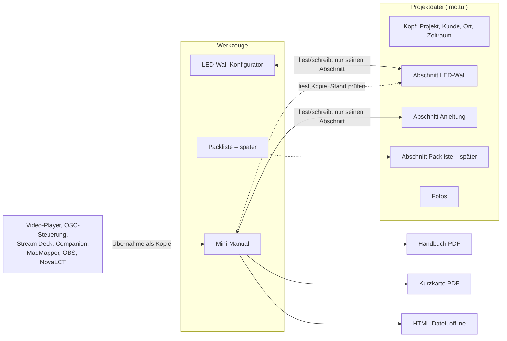
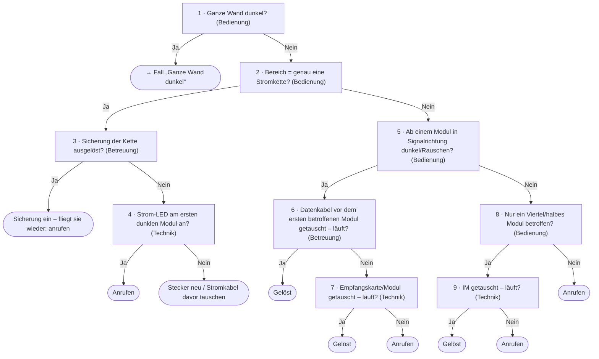

# Plan: Mini-Manual („So bedienst du deine LED-Wall“)

**Status:** Entwurf, Abschnitt Fremdformate folgt; noch nicht umgesetzt (16. Oktober 2026). Abgestimmt in der Rücksprache vom
selben Tag, siehe [Festlegungen](#festlegungen). Vor der Umsetzung die
[offenen Fragen](#offene-fragen) klären; nach der Umsetzung in [WERKZEUGE.md](WERKZEUGE.md)
überführen und diesen Plan löschen.

Ein neues Werkzeug erzeugt Kurz-Anleitungen für die Leute vor Ort: wie man die LED-Wall
einschaltet und bedient, was wo steht und wie verkabelt ist – und im Fehlerfall Schritt für
Schritt, was man prüfen und selbst beheben darf, bevor man anruft. Ausgabe als PDF (Handbuch und
eine Kurzkarte fürs Rack) und als eigenständige HTML-Datei fürs Handy.

Dazu gehören drei Grundlagen, die auch anderen Werkzeugen nützen:

- **Projektordner** – ein Standard-Speicherort für Projektdateien (App-Einstellung).
- **Projektdatei** – eine Datei mit einem Abschnitt je Werkzeug (LED-Wall, Anleitung, später
  Packliste …) und den Fotos.
- **Kabelverlauf** im LED-Wall-Konfigurator – die Reihenfolge der Module je Kette, mit Pfeilen,
  Port bzw. Stromkreis und Warnungen.

Vorlagen für die Richtung (keine Vorlage für Inhalt oder Aussehen): die MadMapper-/Stream-Deck-
Anleitung vom Mai 2026 – Zugangsdaten, Start-Routine nach Stromausfall, Stream-Deck-Seiten mit
15 Tasten, Kontakt.

- [Festlegungen](#festlegungen)
- [Überblick](#überblick)
- [Projektdatei und Projektordner](#projektdatei-und-projektordner)
- [Das Werkzeug](#das-werkzeug) – [Kapitel](#kapitel), [Kenntnisstufen](#kenntnisstufen),
  [Bausteine](#bausteine-und-platzhalter), [Fehlersuche](#fehlersuche),
  [Bedienfelder](#bedienfelder), [Oberfläche](#oberfläche), [Ausgaben](#ausgaben)
- [Datenquellen und Importe](#datenquellen-und-importe)
- [Kabelverlauf im LED-Wall-Konfigurator](#kabelverlauf-im-led-wall-konfigurator)
- [Umsetzung im Code](#umsetzung-im-code)
- [Phasen](#phasen)
- [Skills, Doku, Tests](#skills-doku-tests)
- [Offene Fragen](#offene-fragen)
- [Nicht geplant](#nicht-geplant)

## Festlegungen

Aus der Rücksprache vom 16. Oktober 2026:

1. **Einsatz:** hauptsächlich Vermiet-Events. Intern auch als Lernstoff für Lehrlinge.
2. **Inhalt:** zunächst nur LED-Wände. Der Aufbau ist allgemein (Systemtyp, Bausteine mit
   Stichworten), damit Beamer, Ton oder Medienserver später ohne Umbau dazukommen.
3. **Autoren:** zunächst Matthias, künftig auch Kollegen. Deshalb liegen eigene Bausteine von
   Anfang an als einzelne Dateien vor (später in einem geteilten Ordner, siehe Phase 5).
4. **Export:** PDF und HTML. **Kein DOCX.**
5. **Projektdatei:** **eine Datei** (kein Ordner), Fotos stecken darin.
6. **Gesamtprojekt:** ja – aber als *Datei mit Abschnitten*, ohne app-weites „aktives Projekt“.
   Das beantwortet die Bedenken (schnell nur planen, nie im falschen Projekt arbeiten), siehe
   [Grundsatz](#grundsatz).
7. **Standard-Speicherort:** ja, unbedingt (Phase 0).
8. **Anrede und Sprache:** nur „du“, Deutsch.
9. **Kenntnisstufen:** drei – **Bedienung**, **Betreuung**, **Technik**.
10. **Fremdmodule** (nicht im Bestand) im Konfigurator: vorerst nicht.
11. **Fehlersuche:** Bearbeitung als Liste. Ein grafischer Baum-Editor ist als spätere zweite
    Ansicht derselben Daten beschrieben, aber nicht eingeplant.
12. **Kabelpläne:** in Anleitung und PDF **umschaltbar** zwischen Ansicht von vorne und von hinten.
13. **IM** (Integrated Module) = austauschbares LED-Paneel im Modul: 4 je Modul bei 496-2,0 und
    rX3ioBF, 2 je Modul bei uS2+.
14. **Werkzeug in Mottulbox**, keine eigene App und keine PWA (Begründung unten).

### Warum in Mottulbox und nicht als eigene App oder PWA

- Mottulbox hat schon, was das Werkzeug braucht: PDF-Export im main-Prozess, Datei-Dialoge mit
  gemerktem Ordner, Einstellungen, den LED-Wall-Konfigurator mit allen Kennzahlen
  (`computeWall` in `led-wall/compute.ts` ist rein und wird schon von Packliste, Testbild und
  Video-Generator genutzt), die Packliste und einen QR-Encoder (`components/qr.ts`). Eine eigene
  App müsste all das nachbauen und bräuchte zuerst ein Austauschformat.
- In die Rechner-PWA darf es aus drei harten Gründen nicht: `PWA_TOOLS` muss genau `SMALL_TOOLS`
  sein (Test `src/pwa/tools.test.ts`), der Build bricht bei `api`/`settings` ab
  (`src/pwa/build/plugin.ts`) und Tailwind-Quellen sind auf die Rechner beschränkt
  (`src/pwa/build/sources.ts`).
- **Fürs Handy** gibt es stattdessen die exportierte HTML-Datei: läuft ohne Installation und ohne
  Netz, auch auf dem Handy des Kunden.
- Der fachliche Kern (Datenmodell, Seitenaufbau als HTML-String, Prüfungen, Importe) bleibt
  frei von `api` und Electron. Eine spätere eigene App oder PWA bliebe damit möglich.

## Überblick



Der Weg vom Projekt zur Anleitung:

1. Wand im LED-Wall-Konfigurator planen, Kabelverlauf festlegen, **Speichern unter** →
   `Messe Dornbirn 2026.mottul` im Projektordner.
2. Im Mini-Manual dieselbe Datei öffnen. Es findet den Abschnitt LED-Wall und übernimmt
   Kennzahlen und Pläne als Kopie.
3. Kapitel anhaken, Geräte, Zugangsdaten und Bedienfeld eintragen oder einlesen, Fehlerfälle aus
   der Bibliothek wählen, Fotos dazu.
4. Stufe wählen, Prüfung vor dem Export ansehen, Handbuch/Kurzkarte/HTML erzeugen.
5. Ändert sich die Wand später, meldet das Mini-Manual beim nächsten Öffnen „Planung geändert“
   und zeigt den Unterschied.

## Projektdatei und Projektordner

### Grundsatz

Die Bedenken aus der Rücksprache: Ein Gesamtprojekt darf die schnelle Einzelplanung nicht
verkomplizieren, und man darf nicht versehentlich im falschen Projekt arbeiten oder falsche
Verweise erzeugen. Daraus folgen fünf Regeln:

1. **Kein app-weites „aktives Projekt“.** Jedes Werkzeug arbeitet wie heute mit seinem eigenen
   Arbeitsstand und ist höchstens an *eine* Datei gebunden. Wer nur schnell eine Wand plant,
   bemerkt von Projektdateien nichts.
2. **Eine Datei, mehrere Abschnitte.** Ein Werkzeug liest und schreibt nur seinen eigenen
   Abschnitt; die anderen bleiben beim Speichern unangetastet. Eine LED-Wall-Datei ist einfach
   eine Projektdatei mit nur einem Abschnitt – ein „Gesamtprojekt“ ist kein eigenes Konzept,
   sondern dieselbe Datei mit mehr Abschnitten.
3. **Verweise nur innerhalb derselben Datei.** Die Anleitung liest LED-Wall-Daten nur aus ihrer
   eigenen Datei, nie aus dem Arbeitsstand des Konfigurators oder einer anderen Datei. Sie hält
   eine **Kopie** der Werte, die sie zeigt, plus den Stand (Revision) des Abschnitts, aus dem sie
   stammen. So ändert sich keine Kunden-Anleitung still.
4. **Immer sichtbar, woran man arbeitet.** Dateiname und Kunde stehen in der Leiste jedes
   gebundenen Werkzeugs; ein Punkt zeigt „ungespeichert“. Ohne Bindung steht dort „ohne Datei“.
5. **Speichern ist ausdrücklich.** Der Arbeitsstand sichert sich wie heute laufend im Werkzeug
   (Schutz vor Absturz), in die Datei geschrieben wird nur mit Speichern (Strg+S). Kein stilles
   Schreiben in eine Datei.

Übernahme über Grenzen hinweg ist immer eine sichtbare Aktion mit Rückfrage, z. B. „Aktuelle
LED-Wall-Planung in diese Datei übernehmen“: Zeigt Projektname und Kunde beider Seiten und warnt,
wenn sie nicht zusammenpassen.

### Aufbau der Datei

- **Endung `.mottul`**, ein ZIP-Container:
  - **projekt.json** – Kopf `{ app: 'mottulbox', type: 'projekt', version: 1, id, name, kunde,
    ort, zeitraum, geaendert }` und `abschnitte: { ledWall?, anleitung?, packliste? … }`. Jeder
    Abschnitt hat eigene `version` (Schema), `rev` (zählt bei jedem Speichern hoch) und `data`.
  - **fotos/** – Bilder unter ihrem Hash (z. B. `fotos/3fa9c2….jpg`), beim Einfügen auf
    längste Seite 2000 px verkleinert. Abschnitte verweisen nur per Hash.
- **ZIP selbst geschrieben** im main-Prozess (Node `zlib` für Deflate und CRC32): JSON
  komprimiert, JPG/PNG gespeichert, kein ZIP64. Lesen mit harten Grenzen (Methode nur 0/8,
  Größen je Eintrag und gesamt, keine Namen mit `..` oder absolutem Pfad, CRC prüfen). Geschätzt
  150–250 Zeilen plus Tests. Begründung: Das Repo hält Laufzeit-Abhängigkeiten bewusst klein
  (zwei Pakete), ZIP in diesem engen Umfang ist überschaubar; fflate wäre die Alternative, falls
  später beliebige fremde ZIPs gelesen werden müssen (Stream-Deck-Profile sind ZIPs, siehe
  [Fremdformate](#fremdformate) – dafür reicht derselbe Leser).
- **Unbekannte Abschnitte** (aus einer neueren App) bleiben beim Speichern erhalten. Ein
  Abschnitt mit höherer `version` als bekannt wird nur gelesen angezeigt („neuere Mottulbox
  nötig“), nicht überschrieben.
- **Jeder Abschnitt** hat eine reine Prüf- und Migrationsfunktion (`sanitize…`), dieselbe für
  Datei, gespeicherten Arbeitsstand und Vorlagen. Vorbild: `sanitizeVgenProject` in
  `src/shared/videoGenProject.ts`, tolerantes Einlesen wie `packing-list/io.ts`.

### Bedienung

In der Leiste jedes Werkzeugs mit Dateien (Phase 0: LED-Wall; Phase 1: Mini-Manual; später
Packliste) ein gemeinsamer Baustein:

- **Dateichip:** Dateiname, Kunde, Punkt bei „ungespeichert“; Klick zeigt Pfad und „Im Ordner
  zeigen“.
- **Neu** (fragt bei ungespeicherten Änderungen), **Öffnen …**, **Speichern** (Strg+S),
  **Speichern unter …**, **Zuletzt geöffnet** (die letzten 10, in den Einstellungen).
- **Öffnen einer Datei ohne eigenen Abschnitt:** „Diese Datei enthält noch keine LED-Wall-Planung.
  Hier eine anlegen?“
- **Speichern** schreibt nur den eigenen Abschnitt neu (`rev + 1`), atomar (eindeutige
  tmp-Datei, rename; Windows-Notweg wie `writeFileAtomic` in `src/main/services/store.ts`) und
  mit einer Warteschlange je Pfad im main.
- **Hat sich die Datei seit dem Öffnen geändert** (mtime/Größe, z. B. Kollege auf dem NAS) und
  ist dabei der *eigene* Abschnitt neuer geworden: Rückfrage „Überschreiben / Speichern unter /
  Abbrechen“. Fremde Abschnitte werden ohnehin neu eingelesen und behalten.
- **„ungespeichert“** über `rev`/`savedRev` im Werkzeug-Store, nicht als Boolean: Den Stand vor
  dem `await` merken, danach nur setzen, wenn Pfad und Stand noch passen (Review-Checkliste
  „Zustand nach await“).
- Die Bindung (Pfad, Name, Revisionen) liegt im **persistierten Werkzeug-Store**. Alle Fenster
  eines Werkzeugs zeigen damit dieselbe Datei, auch nach einem Neustart.

### Projektordner

- Neue Einstellung `projects: { dir: string, recent: string[] }`, Vorgabe `dir: ''` = Standard
  (Muster „leer bis zur ersten Wahl“ wie `youtube.outputDir`). Der main löst `''` zu
  `Dokumente/Mottulbox-Projekte` auf und legt den Ordner erst beim ersten Speichern an.
- **App-Menü** (`components/app/AppMenu.tsx`), Gruppe „Projekte“: Ordner anzeigen, „Ändern …“,
  „Standard“, „Im Ordner zeigen“ (über `showItemInFolder`, das auch Netzwerkpfade kann).
- **Datei-Dialoge:** neue Art `'projekte'` in `DialogDirKind` mit eigenem gemerkten Ordner;
  Reihenfolge: zuletzt benutzter Projektordner → Standard-Projektordner → Vorschlag. PDF- und
  HTML-Exporte schlagen den Ordner der Projektdatei vor.
- Neue IPC (Skill `ipc-kanal`) `projects.dirInfo()` → `{ path, isDefault, exists }`, weil der
  Renderer den Dokumente-Ordner nicht kennt. Der main prüft den gespeicherten Pfad bei jeder
  Nutzung (settings:set prüft nicht).

### Sicherheit

Projektdateien kommen von Kollegen oder per Mail – fremde Eingaben:

- ZIP-Grenzen wie oben, JSON-Größe begrenzt, jedes Feld über `sanitize…` (Allowlist, Längen,
  Zahlenbereiche wie die Oberfläche).
- Schreiben nur in Pfade aus einem Dialog oder aus „Zuletzt geöffnet“ mit Endung `.mottul` und
  gültigem Kopf (Vorbild: Pfadprüfung des Video-Generators in [SICHERHEIT.md](SICHERHEIT.md)).
- Fotos bleiben im main (Arbeitsordner je Datei unter `userData`), der Renderer zeigt sie über ein
  eigenes Protokoll (Eintrag in `img-src` der App-CSP und in SICHERHEIT, Skill `ipc-kanal`).
  Über IPC laufen nur Hashes, keine MB-Strings.
- **Zugangsdaten** stehen im Klartext in der Datei. Felder sind als „geheim“ markiert; beim
  Export wählt man drucken, schwärzen oder „wird separat übergeben“. Hinweis in SICHERHEIT.md.

## Das Werkzeug

- **Name:** „Mini-Manual“, id `mini-manual`, Kategorie wie die Packliste. Klar unterschieden von
  der bestehenden „Manuals-Bibliothek“ (id `manuals`, `userData/manuals`, Protokoll `manual:`,
  Kanäle `manuals:*`): eigene Namen für Ordner, Kanäle und Protokoll, Suchbegriffe „anleitung,
  kunde, übergabe, bedienung, fehlersuche“.
- **Titel der Anleitung** frei, Vorgabe „So bedienst du deine LED-Wall“.

### Kapitel

Kapitel werden in der Schublade an- und abgehakt und per Ziehen sortiert. Jedes Kapitel hat eine
Mindeststufe (ab der es erscheint); Inhalte darin ebenso.

| Kapitel | Inhalt | Quelle | ab Stufe |
|---|---|---|---|
| Deckblatt | Titel, Projekt, Kunde, Ort, Zeitraum, Foto der Wand, Stand, Stufe | Kopf der Datei | Bedienung |
| Auf einen Blick | Einschalten, Inhalte wählen, Ausschalten, Notfall – zugleich die Kurzkarte | aus den anderen Kapiteln zusammengestellt | Bedienung |
| Systemübersicht | Signalweg als Grafik: Zuspieler → Prozessor → Wand, Bedienfeld, Strom | Geräteliste, LED-Wall | Bedienung |
| Geräte und Standorte | was wo steht, mit Fotos (Rack, Prozessor, Verteiler, Laptop) | Geräteliste | Bedienung |
| Zugangsdaten | PC, Software, WLAN, Fernwartung (AnyDesk/TeamViewer-ID) | Handeingabe, „geheim“ | Betreuung |
| Ein- und Ausschalten | Reihenfolge, Start nach Stromausfall, Nachtabschaltung | Bausteine | Bedienung |
| Software | Bedienung von MadMapper, Resolume, OBS, Mottulbox-Player …, Cue-/Szenenlisten | Bausteine, Importe | Bedienung |
| Bedienfeld | Tastenbelegung Stream Deck, Companion, OSC-Steuerung, Jingle-Player | Importe, Tastenfeld-Editor | Bedienung |
| Inhalte tauschen | Auflösung, Seitenverhältnis, Codec, Ablageort, Benennung neuer Videos | LED-Wall, Video-Konverter-Vorgaben | Betreuung |
| LED-Wall | Kennzahlen, Vorderansicht, Gewicht, Strom, IMs je Modul | Abschnitt LED-Wall | Betreuung |
| Verkabelung | Signal- und Strompläne mit Kabelverlauf, Ports, Stromkreise; vorne/hinten | Abschnitt LED-Wall | Betreuung |
| Fehlersuche | Symptom-Übersicht („Was siehst du?“), dann Fehlerfälle Schritt für Schritt | Bibliothek, eigene | Bedienung |
| Pflege und Verbote | Reinigung, Helligkeit, Wetter (outdoor), „bitte nicht …“ | Bausteine | Bedienung |
| Ersatzteile vor Ort | Ersatz-IMs, Kabel, Sicherungen, wo sie liegen | Packliste (später), Handeingabe | Betreuung |
| Kontakt und Support | Ansprechpartner, Erreichbarkeit, QR-Codes (Anruf, WhatsApp) | Firmenprofil, Projekt | Bedienung |
| Dokumentstand | Version, Datum, bearbeitet von, Änderungen | automatisch | Technik |

**Allgemein gebaut:** Ein Systemtyp (zunächst nur `led-wall`) bestimmt, welche Kapitel und
Bausteine vorgeschlagen werden. LED-spezifische Kapitel (LED-Wall, Verkabelung) erscheinen nur,
wenn ein Abschnitt LED-Wall in der Datei steht.

**Geräteliste:** Jedes Gerät hat Rolle (Zuspieler, Prozessor, Bedienfeld, Netzwerk, Strom,
Sonstiges), Name, Modell, Standort, IP, Foto, optional Zugangsdaten und einen Kurznamen für
Platzhalter (`pc`, `prozessor` …). Daraus entsteht die Systemübersicht als SVG mit festen
Spalten je Rolle – kein Layout-Paket nötig.

### Kenntnisstufen

| Stufe | für | darf | sieht zusätzlich |
|---|---|---|---|
| **Bedienung** | Kunde, Moderation, Aushilfe | Ein/Aus, Inhalte wählen, Sichtprüfung | – |
| **Betreuung** | Haustechnik, Stagehand | neu starten, Sicherung einschalten, Kabel stecken/tauschen | Zugangsdaten, Pläne, Ersatzteile |
| **Technik** | Techniker, Lehrlinge | Prozessor, NovaLCT, IM/Modul tauschen, Netzwerk | IPs, Ports, Dokumentstand |

- Jedes Kapitel, jeder Inhaltsblock und jeder Fehlersuch-Schritt trägt eine Mindeststufe.
- Die Ausgabe filtert: Was über der gewählten Stufe liegt, fehlt. In der Fehlersuche wird ein
  Sprung zu einem höheren Schritt zu **„Ab hier bitte anrufen“** mit dem Kontakt – die
  Eskalationsgrenze ergibt sich von selbst.
- **Keine Textvarianten je Stufe** – das verdreifachte die Schreibarbeit. Die Stufe steuert nur,
  *was* erscheint.
- **Lernausgabe** für Lehrlinge: alle Stufen, jeder Schritt mit Stufen-Kennzeichen. Dazu „ganze
  Bibliothek drucken“: alle Fehlerfälle auf Stufe Technik als Lernheft.
- Aus einer Datei entstehen mehrere Ausgaben (z. B. Kurzkarte „Bedienung“ fürs Rack, Handbuch
  „Betreuung“ für die Haustechnik).

### Bausteine und Platzhalter

Bausteine sind wiederverwendbare Inhalte: Ein-/Ausschalt-Routinen, Software-Bedienung,
Fehlerfälle, Pflegehinweise. Hier liegt der Gewinn – die zweite Anleitung dauert Minuten.

- **Mitgeliefert** (im Code, nur lesen, mit Version): Startkatalog für LED-Wand, MadMapper,
  Resolume, OBS, Mottulbox-Player, Stream Deck, Companion, NovaStar, Windows-Autostart und
  -Autologin, Fehlerfälle (siehe [Startkatalog](#startkatalog-fehlerfälle)).
- **Eigene** (Phase 1): eine JSON-Datei je Baustein unter `userData` (main), „Als eigene Kopie
  bearbeiten“ für mitgelieferte. **Phase 5:** Einstellung „Bausteinordner“ für einen geteilten
  Ordner (NAS, Nextcloud, OneDrive) – eine Datei je Baustein vermeidet Sync-Konflikte; jede trägt
  `geaendertVon`, `geaendertAm`, `version`.
- **Im Projekt** steckt eine Kopie jedes benutzten Bausteins: Die Datei ist in sich vollständig.
  Ist die Bibliothek neuer, bietet das Werkzeug „aktualisieren“ mit Unterschied an.
- **Stichworte** je Baustein: Systemtyp, Software, Gerät – daraus der Vorschlag im Werkzeug
  („Projekt nutzt MadMapper und Stream Deck → diese 6 Bausteine passen“).
- **Text:** Absätze, nummerierte Schritte, Aufzählung, **fett**, Hinweisbox, Foto. Geschrieben als
  kleines Markdown-Subset in einem mehrzeiligen Feld; beim Rendern wird erst alles escaped, dann
  werden nur diese Auszeichnungen umgesetzt. Kein WYSIWYG-Editor, keine Rich-Text-Bibliothek.
  (Ein mehrzeiliges Feld gibt es im Renderer noch nicht: neues `TextArea` in `components/ui`,
  `useDraft` dafür auf Textareas erweitern.)
- **Platzhalter** in geschweiften Klammern, z. B. `{pc.name}`, `{prozessor.ip}`,
  `{wand.aufloesung}`, `{kontakt.mobil}`, `{projekt.ort}`. Quellen: Kopf, Geräteliste
  (Kurznamen), LED-Wall-Kopie, Firmenprofil. Leere Platzhalter erscheinen in der Vorschau
  gestrichelt rot und in der Prüfung vor dem Export.

**Firmenprofil** (Einstellung, Phase 1): Firmenname, Logo (Datei unter `userData`), Papierfarbe
(Vorgabe das Gelb der bestehenden PDFs), Kontakte (Name, Funktion, Mobil, Büro, Mail,
Erreichbarkeit, WhatsApp ja/nein), Text zur Fernwartung. Je Projekt wählt man Ansprechpartner
daraus. LED-Wall-Doku und Packliste nutzen dasselbe Profil (Kopf, Fußzeile).

### Fehlersuche

Ein **Fehlerfall** besteht aus Titel, Symptom (was man sieht), Mindeststufe und einer Folge von
Schritten. Jeder **Schritt** hat Nummer, Stufe, Frage oder Anweisung, Hinweis, optional Foto, und
je ein Ziel für **Ja** und **Nein**:

- anderer Schritt,
- **Lösung** (Text, z. B. „Sicherung einschalten. Fliegt sie wieder raus: anrufen.“),
- **Gelöst**,
- **Anrufen**,
- anderer Fehlerfall.

Ein Schritt ohne Frage („Datenkabel tauschen“) hat nur „Weiter“.

**Editor als Liste (Plan):** eine Zeile je Schritt – Ziehgriff, Nummer, Stufe, Frage, Ja-Ziel,
Nein-Ziel (Auswahl). Nummern ergeben sich aus der Reihenfolge, Ziele zeigen auf die Schritt-ID,
damit Umsortieren nichts kaputt macht. Die Prüfung meldet unerreichbare Schritte, fehlende Ziele,
Schleifen (Warnung – „nochmal prüfen“ kann gewollt sein) und Fälle ohne Ausgang „Anrufen“.

**Editor als Baum (Option, nicht eingeplant):** Fragen als Kästen mit Nummer und Stufenbalken,
Ergebnisse als farbige Pillen (grün gelöst, rot anrufen), Ja/Nein als Pfeile. Verbinden durch
Ziehen vom Ja- bzw. Nein-Griff eines Kastens auf einen anderen, Texte in einem Inspektor rechts,
Zoomen und Verschieben, die Anordnung rechnet das Werkzeug (Ebenen von oben nach unten). Gut zum
Überblicken, mühsam zum Schreiben, braucht eine Layout-Rechnung oder ein Paket und viel Platz.
Weil er **dasselbe Datenmodell** nutzt, lässt er sich später als zweite Ansicht dazubauen.

Beispiel (Startkatalog, „Ein Teil der Wand ist dunkel“) – so sähe der Baum aus:



Auf Stufe **Bedienung** bleiben davon die Schritte 1, 2, 5 und 8; jeder Sprung nach 3, 6 oder 9
wird zu „Ab hier bitte anrufen“. Auf **Betreuung** kommen 3 und 6 dazu.

**Ausgabe:** Im PDF eine Symptom-Übersicht am Kapitelanfang („Was siehst du?“ → Fall und Seite),
dann je Fall die nummerierten Schritte mit „Ja: weiter bei 3 · Nein: weiter bei 5“. In der
HTML-Datei dieselbe Liste plus eine Schritt-für-Schritt-Ansicht mit großen Ja/Nein-Knöpfen.

#### Startkatalog Fehlerfälle

Von Matthias genannt (16.10.2026), weitere folgen:

1. **Kabel in einer Signalreihe defekt** – ab einem Modul in Kettenrichtung dunkel, Rauschen oder
   eingefroren. Datenkabel vor dem ersten betroffenen Modul tauschen (Kabelverlauf zeigt welches).
2. **Sicherung der Stromzuleitung** – Block einer Stromkette ohne Strom. Sicherung/FI im Verteiler
   (Beschriftung je Stromkette aus dem Kabelverlauf), fliegt sie wieder: anrufen.
3. **Defektes IM** – ein Viertel (496-2,0, rX3ioBF) bzw. eine Hälfte (uS2+) eines Moduls dunkel,
   flackert oder zeigt falsche Farben. IM tauschen (Stufe Technik; Ersatz-IMs in der Packliste).
4. **Laptop aus, weil nachts kein Strom** – morgens bleibt die Wand schwarz. Vorbeugung bei der
   Einrichtung (BIOS „nach Stromausfall einschalten“, Autologin, Autostart der Software,
   Energiesparen aus) und als Fehlerfall „Rechner einschalten, warten, Software startet selbst“.

<!-- FEHLERKATALOG-ERGAENZUNG -->

### Bedienfelder

Ein gemeinsames Modell für alles, was Tasten oder Kacheln hat: Gerät (Stream Deck Mini, MK.2,
XL, Neo, +, Companion, OSC-Steuerung, Jingle-Player, frei), Raster (Spalten × Zeilen) und Seiten
mit Tasten `{ position, titel, farbe, funktion, stufe, bild? }`. Darstellung wie in der
Vorlage: dunkle Tasten, Nummer und Titel, Seitenkopf mit Name; Navigationstasten (Seite vor/zurück)
erkennt der Import und beschriftet sie.

- **Tastenfeld-Editor:** Raster wählen, Taste anklicken, Titel/Farbe/Funktion eintragen;
  Seiten anlegen und umbenennen.
- **Importe** füllen dasselbe Modell (siehe [Datenquellen](#datenquellen-und-importe)). Nach dem
  Import bleibt alles von Hand änderbar, denn Titel fehlen oft (nur ein Icon auf der Taste).

### Oberfläche

Aufbau wie jedes Werkzeug (CLAUDE.md „Werkzeug-Layout“): `ToolShell` mit Auftrags-Leiste
(`ToolBar kind="job"`) und Schublade aus `PanelSection`s.

```
┌ Mottulbox ▾  Start / Mini-Manual   [Einstellungen]                        [Eigenes Fenster] ┐
├ ANLEITUNG  ● Messe Dornbirn 2026.mottul · Beispiel GmbH   Stufe [Bedienung|Betreuung|Technik]  │
│                                              [Kurzkarte] [HTML] [Handbuch (PDF)]  [Datei ▾]   │
├──────────────────────┬─────────────────────────────────────────┬────────────────────────────┤
│ Schublade            │ Kapitel: Ein- und Ausschalten           │ Vorschau · Seite 3 von 8   │
│ ▸ Projekt            │  Einschalten                            │ ┌──────────────┐           │
│   Messe Dornbirn …   │  ⋮⋮ 1  Verteiler: {verteiler.schalter} ▮▯▯ 📷 │ │ 03           │           │
│ ▾ Kapitel  10 von 15 │  ⋮⋮ 2  Prozessor {prozessor.name} ein  ▮▯▯    │ │ Ein- und     │           │
│   ☑ Auf einen Blick  │  ⋮⋮ 3  Laptop {pc.name} ein            ▮▯▯    │ │ Ausschalten  │           │
│   ☑ Systemübersicht  │  ⋮⋮ 4  MadMapper startet im Vollbild   ▮▮▯    │ │ 1. …         │           │
│   ☑ Ein/Aus      6   │  [+ Schritt] [Baustein einfügen …] [Foto …]   │ │              │           │
│   ☑ Fehlersuche  5   │                                         │ └──────────────┘           │
│ ▸ Bausteine 31 · 6   │                                         │                            │
│ ▸ Vor dem Export  ⚠2 │                                         │                            │
└──────────────────────┴─────────────────────────────────────────┴────────────────────────────┘
```

- **Schublade:** Projekt (Kopf), Kapitel (an/aus, Reihenfolge, Zahl der Einträge), Geräte,
  Kontakte, Bausteine (Bibliothek durchsuchen, Vorschläge), Prüfung vor dem Export. Keine
  Aktionen in die Schublade (CLAUDE.md).
- **Arbeitsfläche:** Formular des gewählten Kapitels; Listen mit Ziehen und Pfeil-Knöpfen
  sortieren (Vorbilder: `video-player/Playlist.tsx`, `launcher/FavoritesBoard.tsx`).
- **Vorschau:** dieselbe HTML-Seite wie im PDF, verkleinert, blätterbar. Sie läuft in einem
  Shadow-DOM-Container (eigene Styles, keine Skripte, kein iframe); die Seite ist ein String aus
  escapten Inhalten wie bei `led-wall/topdown.ts`. Ist das Fenster schmal, klappt die Vorschau
  unter das Formular oder hinter einen Reiter.
- **Textfelder** gepuffert (`useDraft`, `TextField`), Speichern im Store wie CLAUDE.md
  „Zustand“ (`debouncedStorage`, `version`, `syncAcrossWindows`); **Fotos nie im Store** –
  `debouncedStorage` schluckt „Speicher voll“ still.

### Ausgaben

Ein reiner Seitenbauer erzeugt HTML-Strings aus dem Modell, für alle drei Ausgaben und die
Vorschau. Ein gemeinsamer, getesteter Escape-Helfer in `src/shared` ersetzt die zwei
unterschiedlichen `esc()` in `led-wall/print.ts` und `packing-list/print.ts`.

- **Handbuch (PDF):** A4 hoch, Kapitel beginnen auf neuer Seite (`break-before`), Schritte und
  Tastenfelder nicht zerteilt (`break-inside: avoid`, im Probedruck prüfen), Fußzeile mit
  Projekt, Stand, Stufe und Seitenzahl (`displayHeaderFooter` mit `footerTemplate`), Logo im Kopf
  der ersten Seite. Ausgabe je Stufe.
- **Kurzkarte (PDF):** genau eine Seite (A4, Vorschlag A5 wählbar). printToPDF kann nicht
  „einpassen“: nach dem Druck die Seiten mit pdfjs zählen (läuft im main schon für die
  Handbücher) und mit kleinerer `scale` neu drucken bzw. in der Prüfung warnen.
- **HTML (offline):** eine einzige Datei, CSS und Bilder eingebettet, **funktioniert ohne
  JavaScript** (`<details>`/`<summary>` und Anker für die Sprünge), weil Datei-Vorschauen am Handy
  oft kein Skript ausführen. Mit JavaScript zusätzlich die Schritt-für-Schritt-Ansicht. Eigene
  Meta-CSP (`default-src 'none'; img-src data:; style-src 'unsafe-inline'; script-src` mit Hash),
  eingebettete Daten mit `<` als `<`. Fotos auf 1600 px. Muss auf echten Handys getestet
  werden (iPhone-Dateien-App, Android, WhatsApp).
- **Prüfung vor dem Export** (Schublade, Zahl in der Leiste): leere Platzhalter, Pflichtfelder
  (Kontakt), Passwörter sichtbar?, LED-Wall-Kopie veraltet, Kurzkarte länger als eine Seite,
  Fehlerfall-Prüfung, fehlende Fotos.
- **QR-Codes:** Anruf (`tel:`), WhatsApp (`https://wa.me/…`), Fernsteuerung der Mottulbox im selben
  Netz (`http://<IP>:8090/…`, nur bei fester IP sinnvoll – Hinweis im Werkzeug) und ein Link zur
  HTML-Fassung, *falls* sie irgendwo abgelegt ist (eine Datei auf dem Laptop kann ein QR-Code
  nicht öffnen). Der vorhandene Encoder (`components/qr.ts`) kann nur Version 1–4 mit
  Fehlerkorrektur L (höchstens 78 Bytes) und hat keinen Test: auf größere Versionen und Stufe M
  erweitern (laminierte Ausdrucke) und testen.

**PDF-Weg im main – zuerst messen:** `util.exportPdf` lädt das HTML heute als `data:`-URL. Chromium
begrenzt URLs über IPC auf etwa 2 MB – mit Fotos droht ein stiller Fehlschlag (für Electron 44
nicht bestätigt). Plan: erst messen (1, 3, 10 MB), dann auf eine temporäre Datei mit `loadFile`
oder ein eigenes Protokoll umstellen. Der Renderer schickt HTML mit Foto-Hashes, der main setzt
die Bilder ein. Das versteckte Fenster bekommt eine eigene CSP bzw. Partition, die nur `data:`
und die eigene Datei lädt (heute hat es keine). `exportPdf` bekommt ein Optionsobjekt
(`pageSize`, `landscape`, `footer`), die bisherigen Aufrufer bleiben verträglich.

## Datenquellen und Importe

Alles wird als **Kopie** übernommen (Namen, Dauern, Vorschaubilder), nie als Verweis: Medien-IDs,
Kachel-UUIDs und Bildschirm-IDs sind nur auf diesem Rechner gültig.

### Aus Mottulbox

| Quelle | Was die Anleitung bekommt | Weg | Aufwand |
|---|---|---|---|
| LED-Wall | Kennzahlen, Vorderansicht, Pläne mit Verlauf, IMs | Abschnitt der Datei; `computeWall`, `topDownMarkup`, neue reine Bauer | mittel |
| Video-Player | gespeicherte Playlists mit Clips (Titel, Dauer, Vorschaubild), Übergang, Idle-Bild, Ausgabe-Bildschirm (Name), Fernsteuer-Port | `settings.player.savedPlaylists`, `api.player.libraryList()`, `api.screen.list()` | gering |
| OSC-Steuerung | Kachel-Raster eines Sets (gx/gy/cw/ch, Beschriftung, Farbe, Typ, Bank-/Auswahl-Einträge), NovaStar-Kacheln | Store `useOscSurface` per dynamischem Import | mittel (Kachel-Renderer) |
| Jingle-Player | Bänke mit Tasten und Tastaturkürzeln | Store | gering |
| Fernsteuerungen | Adressen und Ports, QR | `api.remoteApp.status()` | gering |
| Packliste | Ersatzteile vor Ort | Store, später Abschnitt | gering |
| Kundenansicht | „startet gesperrt im Werkzeug X, Strg+Shift+K zum Verlassen“ | `kioskToolId` + Registry | gering |
| Manuals-Bibliothek | Verweis auf Geräte-Handbücher | `api.manuals.list()` | gering |
| Video-Konverter | Zielformat für „Inhalte tauschen“ | Einstellungen | gering |

Hinweise:

- Der Video-Player merkt sich `loop`, `shuffle` und die laufende Playlist **nicht** über einen
  Neustart, und es gibt keinen Playlist-Autostart. Für die Anleitung heißt das: „Nach dem
  Einschalten Playlist antippen“ (Baustein) – oder Autostart als eigene Player-Funktion (Roadmap).
- **NovaStar** speichert nichts (Modell, Presets, IP nur im React-Zustand) – Handeingabe, optional
  „aus aktueller Verbindung übernehmen“.
- **Netzwerk-Scanner:** Geräteliste ist flüchtig, die API hat keinen Getter. Für eine IP-Tabelle
  entweder neue IPC `netscan.devices()` oder im Mini-Manual selbst scannen; Bezeichnungen über
  die MAC aus dem Store `netscan-labels`.
- **OSC-Kacheln** haben kein Beschreibungsfeld; Erklärungen je Kachel speichert die Anleitung in
  ihrer Kopie.

### Fremdformate

<!-- FREMDFORMATE -->
_Wird nach der laufenden Recherche ergänzt (Stream Deck, Companion, MadMapper, OBS, NovaLCT)._

## Kabelverlauf im LED-Wall-Konfigurator

Heute speichert der Konfigurator in `sig`/`pwr` (`led-wall/store.ts`) nur, **welche Kette** ein
Modul hat – keine Reihenfolge, keinen Port, keinen Stromkreis.

### Bedienung

- Je Kette **Startmodul** (Ecke) und **Richtung** (spalten- oder zeilenweise Schlange). Daraus
  rechnet der Konfigurator die Reihenfolge. **Automatik** ohne Eingabe: Ground-Stack startet
  unten, fliegend oben, jeweils links; spaltenweise, wenn die Kette höher als breit ist (Praxis
  bestätigen, siehe offene Fragen).
- **Handkorrektur:** „Reihenfolge klicken“ – Module der Kette nacheinander anklicken. Beim Lesen
  wird abgeglichen: Module, die nicht mehr in der Kette sind, fallen weg, neue hängt die Automatik
  hinten an. So müssen Zellen-Klicks die Reihenfolge nicht mitpflegen.
- **Port** je Signalkette (Vorgabe „Port n“), **Stromkreis** und **Phase** je Stromkette
  (z. B. „F3 · L2“), Netz `230 V / 16 A` einstellbar (heute 230 V fest in `led-wall/compute.ts`).
- **Ansicht vorne/hinten** umschaltbar in den Reitern Signal und Strom und im PDF. Die Ansicht von
  hinten ist gespiegelt und groß beschriftet („Ansicht von hinten“, Ecke „Publikum“ markiert);
  Spalten- und Kettennummern bleiben am Modul.
- **Pfeile** in Kettenfarbe am Bildschirm und im PDF, Start mit Port-/Kreis-Beschriftung,
  Sprünge zwischen nicht benachbarten Modulen gestrichelt („lange Brücke“). Bei kleinen Zellen
  nur Pfeile an Richtungswechseln.
- **Warnungen** (als `Alert`/`STATUS`, keine Sperre):
  - Pixel je Signalkette über der Port-Kapazität (Vorgabe 650.000 px – NovaStar 1G bei 8 bit;
    Brompton rund 525.000 px; mit Prozessor-Presets aus der Roadmap genauer).
  - Strom je Stromkette über der Absicherung (16 A bei 230 V ≙ 20 Module zu 180 W bei
    `powerMax`), optional „höchstens n Module je Stromschleife“ laut Hersteller.
  - Phasen-Schieflage über L1/L2/L3.
  - Lücken in einer Kette.

### Daten (Version 2)

```ts
type Corner = 'tl' | 'tr' | 'bl' | 'br'
interface ChainRoute {
  start?: Corner // fehlt = Automatik
  axis?: 'row' | 'col' // fehlt = Automatik
  order?: [row: number, col: number][] // Handkorrektur
}
interface SigChainMeta extends ChainRoute { port?: string }
interface PwrChainMeta extends ChainRoute { circuit?: string; phase?: 'L1' | 'L2' | 'L3' }
// zusätzlich in LedWallConfig:
//   sigMeta: Record<string, SigChainMeta>, pwrMeta: Record<string, PwrChainMeta>
//   mains: { voltage: number; breakerA: number }, portPx: number | null
//   planView: 'front' | 'rear'
```

- **Stammdaten** in `led-wall/data.ts`: `imPerModule` (496-2,0: 4, rX3ioBF: 4, uS2+: 2) und deren
  Anordnung, optional `maxModulesPerPowerLoop`.
- **Migration 1 → 2** als reine, getestete Funktion (Muster `rta/store.ts` mit
  `rta/store.test.ts`): leere Metadaten = Automatik, Verhalten unverändert – **auch in jeder
  gespeicherten Vorlage** (`presets[].data`). Ein gemeinsames `sanitizeLedWallConfig` für
  `migrate`, Vorlage laden und Datei; `snapshot()` um die neuen Felder erweitern, `loadPreset`
  mit Vorgaben auffüllen (heute bleiben fehlende Felder der aktuellen Planung stehen).
- **Reine Funktionen** in einem neuen Modul `led-wall/cabling` (mit Tests): Kettenzählung (ersetzt
  vier Kopien: `CableGrid.tsx`, `LedWall.tsx`, `print.ts`, `packing-list/derive.ts`),
  Automatik-Route, Abgleich der Handkorrektur, Sprünge, Lasten je Kette, Phasenbilanz, Geometrie
  und SVG-Markup des Verlaufs.
- **Eine Zeichenquelle** für Bildschirm und PDF wie `topdown.ts`: SVG-String. Am Bildschirm ein
  absolut gelegtes SVG mit `pointer-events: none` über dem Knopf-Raster von `CableGrid.tsx`,
  im PDF an `gridSvg` angehängt. Marker-IDs je Plan eindeutig (Signal und Strom stehen im selben
  PDF).
- **`print.ts` aufteilen** in einen reinen HTML-Bauer und einen dünnen Export – das Mini-Manual
  nutzt die Bausteine mit.
- Wer den Store von außen liest, wendet `resizeGrid` auf die aktuelle Größe an (`ensureGridSize`
  läuft nur bei offenem Werkzeug).

## Umsetzung im Code

Neue Dateien sind hier ohne Backticks genannt (`npm run check:refs` prüft nur Vorhandenes).

**shared**

- html-Helfer (escape, Attribut, sichere Links) mit Tests – ersetzt die zwei `esc()`.
- Projektdatei-Typen (Kopf, Abschnitt), Grenzen, `sanitize` des Kopfs.
- Typen für `projects`-Einstellung und Firmenprofil in `src/shared/types.ts`.

**main**

- `services/project/`: ZIP lesen/schreiben (reine Funktionen auf Buffern, getestet), Abschnitt
  speichern mit Warteschlange je Pfad und atomarem Schreiben (Helfer aus `store.ts` herauslösen),
  Foto-Arbeitsordner je Datei, „zuletzt geöffnet“.
- ipc/project.handlers.ts (Skill `ipc-kanal`, Registrierung in `registry.ts`): öffnen (mit Pfad), speichern, speichern unter,
  Foto einfügen/holen, Projektordner-Info; Protokoll für Fotos.
- `services/fileDialogs.ts`: Dialog-Art `'projekte'`.
- PDF: Optionsobjekt, temporäre Datei statt `data:`-URL, CSP/Partition, Seitenzählung für die
  Kurzkarte.

**renderer**

- `lib/` – Datei-Bindung als Hook (Bindung, ungespeichert, Abläufe Neu/Öffnen/Speichern mit
  Generationszähler) und ein Leisten-Baustein (Dateichip + Knöpfe) für alle Werkzeuge mit Dateien.
- `components/ui` – `TextArea` mit Puffer.
- `tools/led-wall/` – `cabling`, `sanitize`/Migration, Datei-Abschnitt, Pfeile, Ansicht
  vorne/hinten, `print.ts` geteilt.
- `tools/mini-manual/` – `index.ts` (ToolModule), Store, Modell und `sanitize`, Kapitel-Katalog,
  Bibliothek (mitgelieferte Bausteine), Platzhalter, Fehlerfall-Prüfung und Stufenfilter,
  Seitenbauer (Handbuch, Kurzkarte, HTML), Importe (je Format ein reines Modul mit Fixtures),
  Oberfläche (Kapitel-Formulare, Schritt-Liste, Tastenfeld-Editor, Vorschau).
- `components/app/AppMenu.tsx` – Gruppe „Projekte“; Firmenprofil als eigener Dialog.

## Phasen

Jede Phase ist für sich nutzbar.

| Phase | Inhalt | Ergebnis |
|---|---|---|
| **0 Projektordner und Projektdatei** | Einstellung und App-Menü, Dialog-Art; ZIP-Container, Abschnitte, atomar speichern; Leisten-Baustein; LED-Wall mit Öffnen/Speichern/Speichern unter, `sanitizeLedWallConfig` + Migration v2 (noch ohne Verlauf); PDF-Messung 2 MB | LED-Wall-Planungen als Datei am festen Ort |
| **1 Mini-Manual, erste Fassung** | Werkzeug, Kapitel-Katalog, Formulare, Vorschau, drei Stufen, Platzhalter, Geräteliste, Fehlersuche als Liste, mitgelieferte und eigene Bausteine, Fotos, Firmenprofil, Prüfung vor dem Export, Handbuch und Kurzkarte als PDF; LED-Wall-Kopie mit „Planung geändert“ | erste echte Anleitung für ein Event |
| **2 Kabelverlauf** | Start, Richtung, Handkorrektur, Port/Kreis/Phase, Pfeile in Ansicht und PDF, vorne/hinten, Warnungen, IMs in den Stammdaten; Kapitel Verkabelung im Mini-Manual | Pläne, nach denen jemand aufbauen und suchen kann |
| **3 Handy und Bedienfelder** | HTML-Export (ohne JS nutzbar, mit JS Schritt für Schritt), QR-Encoder erweitert, Tastenfeld-Editor, Übernahme aus Video-Player, OSC-Steuerung, Jingle-Player, Stream-Deck-Profil, Companion | Bedienfeld-Seiten ohne Abtippen, Fehlersuche am Handy |
| **4 Fremdformate** | MadMapper, OBS, NovaLCT – soweit die Formate es hergeben (siehe oben) | Cue- und Szenenlisten automatisch |
| **5 Team und Gesamtprojekt** | Bausteinordner für Kollegen, Packliste als Abschnitt (Ersatz-IMs), Etiketten für Kabel und Geräte, „Projekt öffnen“ am Startbildschirm (zeigt Abschnitte, öffnet sie im Werkzeug), Dateizuordnung `.mottul` (Doppelklick) | ein Projekt für Planung, Material und Übergabe; Weg zum Roadmap-„Show-Profil“ |

## Skills, Doku, Tests

**Neue Projekt-Skills** (`.claude/skills/`):

- **projektdatei** – einem Werkzeug einen Abschnitt in der Projektdatei geben: Typ, `version`,
  `sanitize`/Migration (eine Funktion für Datei, Store und Vorlagen), Leisten-Baustein einbinden,
  ungespeichert über `rev`, Tests, Doku-Tabelle.
- **anleitung-inhalte** – Bausteine und Fehlerfälle für das Mini-Manual schreiben: „du“, kurze
  Sätze, eine Handlung je Schritt, Stufe je Schritt, Platzhalter-Namen, jeder Fall endet in
  „Gelöst“ oder „Anrufen“, Prüfung mit dem Test der Bibliothek.
- **fremdformat-import** – Importer für fremde Dateien: Fixtures im Repo (anonymisiert), Größen-
  und ZIP-Grenzen, tolerant parsen, nichts ausführen, Versionen erkennen, Test je Format.

**Bestehende Skills anpassen:**

- `neues-werkzeug` – Projektdatei-Abschnitt und Leisten-Baustein, Firmenprofil für PDFs.
- `ipc-kanal` – Projektdatei-Kanäle als Vorbild für Datei-IPC mit Pfaden.
- `review-checkliste` – fremde Dateien (ZIP-Grenzen, Pfade, Feldprüfung), Datei-Bindung nach
  `await`, Fotos nie in den Store.
- `electron-e2e` – Projektdatei speichern/öffnen, PDF- und HTML-Export (Dialog stubben wie in
  `e2e/smoke.mjs`, Seitenzahl prüfen).
- `abhaengigkeiten` – nur falls doch ein Paket dazukommt (ZIP, QR).
- **CLAUDE.md** – „Speichern“ um den vierten Ort „Projektdatei“ ergänzen, Projektordner, neue
  Skills in der Liste.

**Doku:** [WERKZEUGE.md](WERKZEUGE.md) (Mini-Manual, LED-Wall-Kabelverlauf, Projektdateien, „Wo die
Daten liegen“), README-Überblick, [ENTWICKLUNG.md](ENTWICKLUNG.md) (Tabelle der Speicherorte),
[SICHERHEIT.md](SICHERHEIT.md) (Projektdateien als fremde Eingabe, Schreiben in Nutzerpfade, CSP
des PDF-Fensters, Zugangsdaten im Klartext), [ROADMAP.md](ROADMAP.md) (Show-Profil teilweise
erledigt).

**Tests:**

- Unit: ZIP (runder Weg, kaputte Dateien, Grenzen), `sanitize` je Abschnitt, Migration v1 → v2
  inkl. Vorlagen, `cabling` (Routen, Abgleich, Lasten), Platzhalter, Stufenfilter und
  Fehlerfall-Prüfung, Seitenbauer (Escaping, Inhalte je Stufe), QR-Encoder gegen bekannte
  Vektoren, Importe mit Fixtures.
- Bibliothek: jeder mitgelieferte Fehlerfall besteht die Prüfung (keine toten Enden).
- E2E: LED-Wall speichern und wieder öffnen; Mini-Manual mit Foto speichern, öffnen, PDF
  (Seitenzahl) und HTML exportieren; Kurzkarte genau eine Seite.
- Von Hand: HTML-Datei auf iPhone und Android; Ausdruck der Pläne (gelbe Kette lesbar?).

## Offene Fragen

1. **Verkabelungspraxis:** Startet ihr bei Ground-Stack unten links und fliegend oben links,
   spaltenweise? (Vorgabe der Automatik.)
2. **IM-Anordnung:** 2 × 2 bei 496-2,0 und rX3ioBF – und bei uS2+ übereinander oder
   nebeneinander?
3. **Wer darf IMs tauschen** – Betreuung oder nur Technik? (Vorgabe im Startkatalog: Technik.)
4. **Weitere Fehlerfälle** aus der Praxis (nach dem Startkatalog oben).
5. **Beispieldateien** für die Importe: ein exportiertes Stream-Deck-Profil, ein
   Companion-Export, eine OBS-Szenensammlung, eine MadMapper-Datei, NovaLCT-Konfigurationen
   (anonymisiert, kommen als Test-Fixtures ins Repo).
6. **Dateiendung** `.mottul` passt?
7. **Neue Projektdateien** immer im Standard-Projektordner beginnen (evtl. Unterordner je Kunde)
   oder im zuletzt benutzten?
8. **HTML-Fassung ablegen:** Gibt es einen Ort (Website, Cloud-Link), auf den ein QR-Code zeigen
   kann – oder geht die Datei nur per WhatsApp/Mail an den Kunden?
9. **Firmenprofil:** Logo und Farbe von Megasound als Vorgabe?
10. **Kurzkarte** A4 oder A5?
11. **Prozessoren im Bestand** (NovaStar-Modelle, Brompton?) für die Port-Kapazität – passt zum
    Roadmap-Punkt „Prozessor-Presets“.

## Nicht geplant

- DOCX-Export, englische Ausgabe, „Sie“-Form.
- Rich-Text-/WYSIWYG-Editor.
- Editor in der Rechner-PWA oder als eigene App.
- Eingebaute Cloud-Synchronisation (ein geteilter Ordner reicht).
- Verschlüsselung von Zugangsdaten in der Datei.
- Fremdmodule im LED-Wall-Konfigurator (vorerst).
- Grafischer Baum-Editor für die Fehlersuche (beschrieben, nicht eingeplant).
