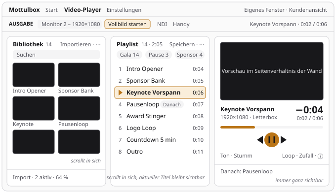
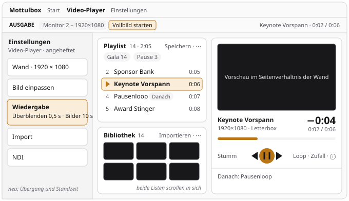

# Gesamtplan

Alles, was an der Mottulbox ansteht – Bedienung, Funktionen, Technik – in einem Dokument, mit
einer Reihenfolge und einheitlichen Paketen. Er ersetzt seit dem 14. November 2026 die Roadmap und
die Pläne zur Durchsicht, zur Arbeitsfläche des Video-Players und zu den kleinen Werkzeugen. Was
die Werkzeuge heute können, beschreibt [WERKZEUGE.md](WERKZEUGE.md); die Geschichte steht im
Git-Log.

**Stand:** 14. November 2026

Die Punkte sind Vorschläge. Was umgesetzt wird und in welcher Reihenfolge, entscheidet Matthias.
Was noch zu entscheiden ist, steht gesammelt unter [Entscheidungen](#entscheidungen); was sich nur
am Gerät prüfen lässt, unter [Abnahmen am Gerät](#abnahmen-am-gerät).

Drei große Vorhaben haben zusätzlich einen **Entwurf** mit Messwerten, Festlegungen und
Stolpersteinen: [PLAN-ATEM.md](PLAN-ATEM.md), [PLAN-MINI-MANUAL.md](PLAN-MINI-MANUAL.md) und
[PLAN-VIDEO-GENERATOR.md](PLAN-VIDEO-GENERATOR.md). Dort steht, **wie** gebaut wird. **Was** offen
ist und **wann** es drankommt, steht nur hier.

- [Leitbild: zwei Muster](#leitbild-zwei-muster) – [Arbeitsfläche](#muster-1-arbeitsfläche),
  [Kleines Werkzeug](#muster-2-kleines-werkzeug)
- [So wird ein Paket umgesetzt](#so-wird-ein-paket-umgesetzt)
- [Übersicht und Reihenfolge](#übersicht-und-reihenfolge)
- **Bedienung:** [P – Video-Player](#p--video-player-fertigstellen),
  [W – Arbeitsfläche für weitere Werkzeuge](#w--arbeitsfläche-für-weitere-werkzeuge),
  [K – Kleine Werkzeuge](#k--kleine-werkzeuge),
  [B – kleine Pakete](#b--bedienung-und-design-kleine-pakete), [D – Rückgängig](#d--rückgängig)
- **Funktionen:** [F – Mehr Nutzen](#f--mehr-nutzen), [Verzahnung](#verzahnung),
  [AT – ATEM-Steuerung](#at--atem-steuerung), [MM – Mini-Manual](#mm--mini-manual),
  [VG – Video-Generator](#vg--video-generator), [G – Neue Werkzeuge](#g--neue-werkzeuge)
- **Technik:** [S – Sicherheit und Auslieferung](#s--sicherheit-und-auslieferung),
  [E – Aufräumen und Qualität](#e--aufräumen-und-qualität), [U – Upgrades](#u--upgrades),
  [H – Skills](#h--skills-und-einstellungen-für-die-arbeit-mit-claude)
- [Abnahmen am Gerät](#abnahmen-am-gerät) · [Entscheidungen](#entscheidungen) ·
  [Nicht tun, nicht geplant](#nicht-tun-nicht-geplant) ·
  [Erledigt](#erledigt--nicht-neu-planen)

## Leitbild: zwei Muster

Zwei Umbauten vom November 2026 haben die Bedienung deutlich verbessert (Rückmeldung von Matthias,
14. November 2026): der **Video-Player ohne Scrollen** und der **neue Aufbau von Testtongenerator
und RTA**. Beide sollen auf andere Werkzeuge übertragen werden. Dieser Abschnitt hält fest, was
die Vorbilder ausmacht, und misst jedes andere Werkzeug daran. Daraus entstehen die Teile
[W](#w--arbeitsfläche-für-weitere-werkzeuge) und [K](#k--kleine-werkzeuge).

### Was beide gemeinsam haben

Sieben Regeln für jede Oberfläche der App – neue Werkzeuge werden gleich so gebaut:

1. **Im Betrieb zuerst.** Was man in der Show greift – Start und Stopp, Transport, die Antwort
   eines Rechners –, steht oben, groß und immer an derselben Stelle. Es verrutscht nicht, wenn
   darunter etwas wechselt.
2. **Einmal Eingestelltes aus dem Weg.** Im großen Werkzeug in die Schublade, im kleinen in eine
   zugeklappte Karte, die ihre Werte als Kurzfassung zeigt.
3. **Ohne Scrollen im kleinsten üblichen Format.** Großes Werkzeug: Fenster 1024 × 600. Kleines
   Werkzeug: Handy im Browser, 393 × 710. Listen scrollen in sich, die Seite nicht.
4. **Der Zustand sagt sich selbst.** Restzeit, „Danach“, „Stumm“, die Kurzfassung einer
   zugeklappten Karte – nichts Wichtiges steckt nur in einem kleinen Symbol.
5. **Wählen mit einem Tipp.** Wenige Möglichkeiten als Knopfgruppe statt als Liste, übliche Werte
   als Schnellwahl, Erklärungen hinter dem ⓘ.
6. **Kein Klick nimmt versehentlich etwas weg.** Löschen und Leeren fragen nach – oder lassen
   sich zurücknehmen (Teil [D](#d--rückgängig)).
7. **Gemessen, nicht geschätzt.** Jede Umstellung beginnt mit einer Messung am heutigen Stand und
   endet mit einer E2E-Prüfung derselben Maße.

### Muster 1: Arbeitsfläche

**Vorbild:** Video-Player (Schritte P1 bis P3, November 2026). **Für:** große Werkzeuge mit
mehreren Bereichen, die gleichzeitig zu sehen sein müssen. Vor dem Umbau war die Seite des Players
bei 1366 × 768 doppelt so hoch wie das Fenster (1323 statt 666 px): Wer zur Playlist scrollte, sah
den Transport nicht mehr.





- **Felder statt Seite:** Die Arbeitsfläche besteht aus Feldern (`Pane`) in einem Raster
  (`WorkArea`). Jedes Feld hat einen Kopf – Titel, Anzahl, höchstens zwei Aktionen und ein Menü
  „⋯“ – und scrollt in sich.
- **Drei Stufen aus dem gemessenen Platz,** nicht aus der Fensterbreite: `breit` (ab 1180 px),
  `mittel` (ab 760 px), `schmal` (darunter oder niedriger als 420 px: eine Spalte, die
  Arbeitsfläche scrollt). So stimmt es auch mit angehefteter Schublade und im eigenen Fenster:
  1024 × 600 ergibt `mittel` (Arbeitsfläche 1024 × 498), mit angehefteter Schublade `schmal`
  (664 × 498); 1366 × 768 ergibt `breit` (1366 × 666), angeheftet `mittel` (1006 × 666);
  1920 × 1080 ist immer `breit`.
- **Die Felder stehen in jeder Stufe in derselben Reihenfolge,** nur ihr Platz im Raster wechselt.
  Sonst baut React beim Öffnen der Schublade alles neu auf – im Player lüde das laufende Video
  neu.
- **Ein Feld für das, was läuft** („Bühne“): Vorschau im Seitenverhältnis der Ausgabe, darunter
  groß, was läuft, wie lange noch und was danach kommt. Sie bekommt den Platz, der übrig ist.
- **Abstände 12 px,** keine Höhen in Pixeln: Raster und `flex` mit `min-h-0` lösen es, gemessen
  wird nur für die Stufe.
- **Bausteine:** `components/WorkArea.tsx` (`WorkArea`, `Pane`, `useStufe`) und
  `components/workAreaRaster.ts` (Stufen und Raster, rein und getestet). Vorbild für das Raster
  eines Werkzeugs: `video-player/layout.ts`; für die Abnahme: `e2e/player-layout.mjs`. Anleitung
  im Skill `neues-werkzeug`, Lehren im Skill `review-checkliste` („Raster und SVG“).
- **Nicht für Dokumente:** Werkzeuge, die man von oben nach unten liest – Video-Konverter,
  Medien-Info, Packliste, YouTube-Downloader, Handbücher, Netzwerk-Scanner –, scrollen weiter
  als Seite.

**Gemessen am 14. November 2026** in der gebauten App mit frischem Profil: um wie viele Pixel
die Seite höher ist als die sichtbare Arbeitsfläche. „zu“ und „an“ heißt: Schublade zugeklappt
bzw. angeheftet. „passt“: Die Seite scrollt nicht.

| Werkzeug | 1024 × 600 (zu · an) | 1366 × 768 (zu · an) | 1920 × 1080 (zu · an) | Folge |
| -------- | -------------------- | -------------------- | --------------------- | ----- |
| Video-Player | passt · Stufe `schmal` | passt · passt | passt · passt | Vorbild; offen P4, P5 |
| Video-Generator (12 Bilder) | +732 · +1074 | +490 · +639 | +169 · +318 | **W1** |
| Stage-Timer (8 Abschnitte) | +142 · +771 | passt · passt | passt · passt | **W2** |
| Testbildgenerator | +124 · +143 | +57 · +57 | passt · passt | **W3** |
| NovaStar-Steuerung | +96 · +112 | passt · passt | passt · passt | **W4** |
| Mini-Manual (leere Anleitung) | +404 · +817 | +196 · +196 | passt · passt | **W5** |
| LED-Wall-Konfigurator | +46 · +1009 | passt · passt | passt · passt | B8, später W6 |
| ATEM-Steuerung (Probebetrieb, Mini Extreme) | passt · passt | passt · passt | passt · passt | nichts: links scrollt die Seite in sich, die Spalte „Übergang“ steht |
| Jingle-Player (acht leere Pads), OSC-Steuerung (Vorgabe) | passt · passt | passt · passt | passt · passt | nichts |
| Video-Konverter, Medien-Info, Packliste, YouTube-Downloader, Handbücher, Netzwerk-Scanner | leer: passt | leer: passt | leer: passt | Dokumente – bleiben |

- **Die Schublade ist der größte einzelne Hebel:** Angeheftet lässt sie der Arbeitsfläche in
  einem 1024 px breiten Fenster 664 px – daher die großen Zahlen in der Spalte „an“. Paket **B8**
  (die Schublade schwebt in schmalen Fenstern) entschärft das für alle Werkzeuge auf einmal und
  kommt deshalb vor den W-Paketen.
- **So wurde gemessen:** Playwright über `e2e/harness.mjs`, je Werkzeug und Fenstergröße
  `scrollHeight` gegen `clientHeight` des Bereichs `data-testid="tool-main"`. Inhalte: im
  Stage-Timer acht Abschnitte (Befehl `setSegments`), im Video-Generator zwölf Bilder über
  „Bilder & Videos“, die ATEM-Steuerung im Probebetrieb. Jedes W-Paket stellt seine Messung als
  E2E-Schritt nach, bevor es etwas ändert.

### Muster 2: Kleines Werkzeug

**Vorbild:** Testtongenerator und RTA (November 2026). **Für:** die elf kleinen Werkzeuge im
eigenen Fenster und in der Handy-PWA – und jedes neue. Vor dem Umbau zeigte der RTA am Handy beim
ersten Öffnen über 1.800 px; im Testtongenerator blieben neben der Beschriftung kaum 150 px für
die Bedienelemente.

- **Eine Karte, ein Strich:** oben, was man im Betrieb greift (Start, Pegel, Kanäle); unter dem
  Strich, was je nach Wahl wechselt (die Felder des Signals). Oben verrutscht beim Umschalten
  nichts.
- **Start und Hauptwert in einer Zeile:** großer Knopf (`RunButton` mit `big`; läuft es, eine
  rote Fläche „Stopp“), daneben das, worum es geht – der Pegel, das gespielte Signal.
- **Bedienfelder in ganzer Breite:** Knopfgruppen, Schieber und Schnellwahl mit der Beschriftung
  darüber und dem Wert rechts (`FieldBlock`). Knopfgruppen brechen in gleichmäßig gefüllten
  Reihen um (`Segmented` mit `wrap`), Schnellwahlen sehen aus wie Knopfgruppen (`QuickPick` mit
  `fill`). Zahlenfelder bleiben Zeilen mit der Beschriftung links (`FieldRow`) – die brauchen die
  Breite nicht.
- **Selten Gebrauchtes zugeklappt:** `FoldCard` zeigt zugeklappt eine Zeile mit dem Stand
  („Mittelung schnell“, die stärkste Feedback-Spitze in Rot). Welche Karten offen sind, bleibt
  gemerkt.
- **Passt aufs Handy:** Bei 393 × 710 steht das Wichtige ohne Scrollen da – der
  Testtongenerator ganz, beim RTA Messen, Pegel, Spektrum und dessen Bedienung.
- **Meldungen in der Seite** (`Alert`), der Stand bleibt gemerkt, Erklärungen hinter dem ⓘ.
- **Bausteine:** `tools/_calc/ui.tsx` und `components/ui/segmented.tsx`; Regeln fürs Handy im
  Skill `rechner-pwa`.

**Gemessen am 14. November 2026** in der PWA bei 393 × 710 (sichtbar unter der Kopfzeile: 657 px,
ohne Tastatur):

| Werkzeug | Höhe der Seite | Karten (Höhe in px) | Listen (Einträge) | Folge |
| -------- | -------------- | ------------------- | ----------------- | ----- |
| Testtongenerator | passt | eine (603) | – | Vorbild |
| RTA | 824 px (+167) | Kopf mit Messen, Pegel und Spektrum; vier zugeklappte Karten (je 64) | zehn, in den Karten | Vorbild; Listen → K6 |
| Rigging-Last | 1209 px (+552) | Traverse 447, Bridle 651 | – | K6 |
| Kameraobjektiv | 1071 px (+414) | Kamera 423, Motiv 601 | Sensor (8), Telekonverter (4) | K6 |
| Stromlast & Absicherung | 929 px (+272) | Last 315, Geräte je Stromkreis 519 | Anschluss (2), Absicherung (4), Auslastung (2) | **K5 – Pilot** |
| Timecode-Rechner | 749 px (+92) | Umrechnen 321, Dauer 381 | Bildrate (10) | K6 |
| Beamer-Lumen | 741 px (+84) | Projektion 423, Vorhandener Beamer 271 | Umgebungslicht (4) | K6 |
| Audio-Delay & SPL | 695 px (+38) | Delay 367, Pegel über Distanz 281 | – | K6 |
| Projektionsverhältnis | passt | Leinwand 337, Objektiv 171 | Seitenverhältnis (6) | K6, nur die Liste |
| DMX-Dip-Schalter | passt | eine (389) | – | nur K3 |
| Kreisrechner | passt | eine (267) | – | nichts |

**Wo die Antwort steht:** In den Rechnern steht das hervorgehobene Ergebnis unter den Feldern. Bei
Stromlast („Max. Geräte“), Rigging („Kraft je Strang“) und Kameraobjektiv (Bildausschnitt) liegt
es damit unter dem Rand des Bildschirms (Unterkante bei 757, 795 und 797 px von 710), bei
Audio-Delay („Pegel in Ziel-Distanz“) halb. Mit offener Tastatur bleibt noch weniger: Wer tippt,
sieht die Antwort nicht – am Gerät zu prüfen.

## So wird ein Paket umgesetzt

Ein Auftrag lautet: **„Setze Paket B3 aus docs/PLAN.md um.“** Mehr braucht es nicht – alles
Weitere steht hier und in den genannten Dateien. So lässt sich ein Paket auch einem anderen Modell
geben, das die Vorgeschichte nicht kennt.

1. **Frisch anfangen:** `git switch main`, `git pull --ff-only`, gemergte lokale Branches
   löschen, neuen Branch anlegen (Name wie das Paket, z. B. `scanner-adapter`). Nach einem
   Dependabot-Merge zuerst `npm ci` und `npm run electron:bin`.
2. **Lesen:** `CLAUDE.md`, das [Leitbild](#leitbild-zwei-muster), dann die im Paket genannten
   Skills (`.claude/skills/<name>/SKILL.md`) und Dateien; bei AT, MM und VG zuerst den Entwurf. Die
   Fundstellen stammen vom November 2026 – **erst am Code prüfen, ob der Befund noch stimmt.**
   Stimmt er nicht mehr, das Paket hier streichen und es sagen.
3. **Nachstellen, bevor etwas geändert wird:** einen Test schreiben, der am heutigen Stand
   scheitert – Unit-Test (`npx vitest run <datei>`) oder E2E-Schritt (`node e2e/<name>.mjs`
   gegen den gebauten alten Stand). Ein Test, der schon vorher grün ist, prüft nichts.
4. **Umsetzen:** nur dieses Paket. Fällt dabei etwas anderes auf, hier als neuen Punkt
   eintragen, nicht mit erledigen.
5. **Prüfen:** Skill `abschluss-check` (Format, `check:refs`, `check:files`, Lint, Typen, Tests,
   bei Änderungen an der Oberfläche `npm run e2e`), bei kleinen Werkzeugen zusätzlich
   `npm run pwa:build`, dazu der Skill `review-checkliste`.
6. **Nachziehen:** `docs/WERKZEUGE.md` (was die App jetzt kann), bei Bedarf weitere Doku, die
   Skills in `.claude/skills/` (jede Änderung zieht sie nach: neue Lehren, neue E2E-Skripte) –
   und **das Paket aus diesem Dokument streichen:** die Zeile in der Tabelle seines Teils und den
   Abschnitt, in der [Übersicht](#übersicht-und-reihenfolge) seine Kennung. Ist ein Teil leer,
   auch seine Überschrift. Was sonst doppelt geplant würde, bekommt eine Zeile unter
   [Erledigt](#erledigt--nicht-neu-planen).
7. **Abliefern:** ein Commit, Push, Pull Request (Freigabe vom 8. Oktober 2026). Gemergt wird
   von Matthias.

Regeln, die für jedes Paket gelten:

- **Ein Paket, ein Pull Request.** Ausnahme: die mit „zusammen“ gekennzeichneten.
- **Nichts erfinden, was das Paket nicht verlangt** – keine neuen Optionen, keine Umbauten
  „bei der Gelegenheit“.
- **Offene Frage im Paket?** Erst fragen, dann bauen. Eine Vorgabe in Klammern gilt nur, wenn
  Matthias sie bestätigt hat.
- **Punkte ohne Abnahme** (F6 bis F17, V1 bis V5, Teil G) sind Wünsche, keine Aufträge: erst als
  Paket ausarbeiten – Heute, So, Abnahme – und freigeben lassen.
- Größen: **S** bis etwa zwei Stunden, **M** ein halber bis ganzer Tag, **L** mehrere Tage und
  ein eigener Entwurf (`docs/PLAN-<THEMA>.md`), bevor Code entsteht. Der Entwurf hält fest, wie
  gebaut wird; Stand, Reihenfolge und Entscheidungen bleiben hier.
- **Größere Änderungen an der Bedienung eines Show-Werkzeugs** beginnen mit einer Skizze und der
  Freigabe durch Matthias, nicht mit Code – das gilt für W1, W2, W5 und die ATEM-Steuerung.

Stolpersteine aus der bisherigen Arbeit:

- Die Arbeitskopie hat unter Windows CRLF. Dateien mit dem Edit-Werkzeug ändern, nicht per
  Skript neu schreiben; danach `npx prettier --write <dateien>` nur auf die geänderten.
- Backslashes gehen auf dem Weg durch Shell und Skript leicht verloren. Reguläre Ausdrücke in
  neuen Dateien nachlesen und `node --check <datei>` laufen lassen.
- `npm run check:refs` prüft jeden Dateinamen in Backticks. **Geplante Dateien** deshalb in
  einen Textblock schreiben, nicht in Backticks.
- `npm run format:check` meldet lokal die unversionierte Datei „OBS-Test“ im Ordner
  `Beispiele/` (Paket E6) – das ist kein Fehler der eigenen Änderung. Sie nicht in Backticks
  nennen: `check:refs` fände sie lokal, in der CI aber nicht.
- Kleine Werkzeuge öffnen ein eigenes Fenster und sind keine Route im Hauptfenster:
  `openRoute(page, '/tool/<id>')` springt zurück zum Start. Im E2E über
  `window.api.openToolWindow('<id>')` öffnen und auf das neue Fenster warten (`openSmall` in
  `e2e/layout.mjs`, Skill `electron-e2e`).
- **Nach jeder Änderung an einem kleinen Werkzeug `npm run pwa:build`.** Er bricht ab, wenn ein
  kleines Werkzeug `api` oder Einstellungen hereinzieht oder eine Datei außerhalb von
  `src/pwa/build/sources.ts` einbindet. `npx vitest run src/pwa` prüft, dass PWA-Liste und
  `SMALL_TOOLS` gleich sind.
- **Es gibt keine Komponententests** (Vitest läuft ohne DOM, Paket E8). Rechnen und Entscheiden
  gehören in reine Module mit Test; Verhalten der Oberfläche prüft ein E2E-Schritt.
- `npm run dev` startet nicht neben der installierten Mottulbox (Einzelinstanz, gleicher
  Benutzerordner). Die E2E-Läufe haben eigene Ordner.
- Testausgaben mit Ersatzzeichen (U+FFFD, die Raute mit Fragezeichen) nicht in Code, Kommentare
  oder Doku übernehmen: Sie sehen danach aus wie ein Kodierfehler der Datei. Vor dem Commit mit
  `git grep` nach dem Zeichen suchen (bekannt und gewollt: je eines in `youtube.mjs`,
  `ytRequest.ts` und im Skill `review-checkliste`, alle zur Ausgabe von yt-dlp).

## Übersicht und Reihenfolge

Empfohlen von oben nach unten. Die Etappen sind keine Sperren: Jedes Paket nennt, was es braucht,
alles andere lässt sich vorziehen.

| Etappe | Pakete | Warum an dieser Stelle |
| ------ | ------ | ---------------------- |
| **1 – Die Vorbilder fertig** | P4, P5 · K1, K2, K3 | Playlist und Bibliothek des Players sind noch die alten. Die Rechner bekommen geprüfte Rechenkerne und sichtbare Fehleingaben, bevor ihr Aufbau angefasst wird |
| **2 – Muster übertragen** | B8 · K5 → K6 → K4 · W1 → W2 → W3 → W4 → W5 | Der größte Gewinn in der Bedienung: Gemessen scrollen fünf große Werkzeuge und sechs Rechner. B8 zuerst, es wirkt in allen Werkzeugen |
| **3 – Täglich spürbar** | B1 bis B7, B9 bis B13 · F3 | Kleine Pakete, die man bei jeder Benutzung merkt |
| **4 – Sicherheitsnetz** | F5 → S3 · D · F1 · E4 | Erstes Release und Aktualisierung, damit Korrekturen ankommen; Rückgängig und Sicherung, damit nichts verloren geht |
| **5 – Mehr Nutzen** | F2, F4, F6 bis F17, V1 bis V5 · AT · MM · VG · G | Funktionen nach Show-Bedarf; die großen Vorhaben nach ihrem Entwurf |
| **Nebenher** | E1 bis E10 · U1 bis U3 · H1 bis H4 · S1, S2, S4 | Wenn das Thema ohnehin anfällt oder ein Paket es braucht (S1 vor AT8, E10 nach P5) |
| **Laufend** | Update-PRs, [Abnahmen am Gerät](#abnahmen-am-gerät) | montags bzw. wenn das Gerät da ist |

**Laufend – Update-PRs von Dependabot:** jeden Montag durchsehen und nach grüner CI mergen (7 Tage
Abstand, [SICHERHEIT.md](SICHERHEIT.md#updates-einspielen)). Eine neue Electron-Hauptversion vor
dem Merge an den Breaking Changes prüfen (Skill `abhaengigkeiten`).

## P – Video-Player fertigstellen

Das [Muster 1](#muster-1-arbeitsfläche) zu Ende bringen. Seit dem 13. November 2026 stehen die
drei Felder Bibliothek · Playlist · Bühne, die Seite scrollt nicht mehr, die Bühne zeigt Restzeit,
„Danach“ und „Stumm“ (P1 bis P3). Offen sind die Inhalte von Playlist und Bibliothek.

| Paket | Inhalt | Größe | Braucht |
| ----- | ------ | ----- | ------- |
| **P4** | Playlist: Miniaturen, „Danach“, laufender Eintrag bleibt sichtbar, Sortieren mit Griff, „Speichern“ und „Leeren“ in den Kopf, Leeren fragt | M | – |
| **P5** | Bibliothek: „Importieren“, Menü „⋯“, Suche, Kacheln nach Platz, Import-Liste unten, Löschen fragt; Menü-Baustein | M | – |

P4 und P5 sind unabhängig voneinander. Vorher lesen: Skills `electron-e2e`, `review-checkliste`
(„Raster und SVG“), `abschluss-check`. Jeder Schritt ergänzt seine Prüfungen in
`e2e/player-layout.mjs` (14 Medien per lavfi, drei gespeicherte Playlists) und lässt sie zuerst
gegen den Stand davor laufen. Vorhandene Skripte, die den Player anfassen: `e2e/player.mjs`
(Playlist-Reiter, Importe), `e2e/layout.mjs` (Ausgabe-Leiste, Monitorwechsel),
`e2e/mini-manual.mjs` (liest Playlists über die Einstellungen) – vor dem Umbau mit
`grep -n "video-player" e2e/*.mjs` nachsehen, was sie anklicken.

### P4 – Playlist

**Heute** (`Playlist.tsx`): „Leeren“ steht im Kopf und leert ohne Rückfrage – ein Klick daneben
nimmt in der Show das Bild weg. „Speichern“ steht am Ende der Zeile mit den gespeicherten
Playlists. Die Zeilen haben keine Miniatur, gezogen wird an der ganzen Zeile, und der laufende
Eintrag kann aus dem sichtbaren Teil der Liste laufen.

**So:**

- **Kopf:** rechts „Speichern“ und ein Menü „⋯“ mit „Playlist leeren …“ (fragt nach,
  `api.confirm`, `danger`). Anzahl und Gesamtdauer stehen schon da.
- **Liste:** je Zeile Griff, Nummer bzw. Abspielzeichen, Miniatur (40 × 22 px aus `thumbUrl`),
  Titel, Dauer, ✕. Der nächste Eintrag trägt die Marke „Danach“ (`danach()` in
  `video-player/layout.ts` kennt ihn, auch bei Zufall).
- **Der laufende Eintrag bleibt sichtbar:** Wechselt `pstate.index`, scrollt die Liste ihn mit
  `scrollIntoView({ block: 'nearest' })` heran – nicht, während gezogen wird.
- **Umsortieren** über `useSortable` und `Griff` aus `sortable.tsx` (Ziehen nur am Griff,
  Pfeil-Knöpfe für die Tastatur). Ziehen aus der Bibliothek (`text/x-media-id`) bleibt, die ganze
  Liste ist Ziel.

**Abnahme** (`e2e/player-layout.mjs`): Befehl `goto` auf den letzten Eintrag – seine Zeile liegt
danach im sichtbaren Teil der Liste. „Playlist leeren …“ mit `stubConfirm(app, false)` – die
Liste hat danach gleich viele Einträge; mit `true` keinen.

### P5 – Bibliothek

**Heute** (`Library.tsx`): Der Kopf zeigt Ansicht, „Dateien“ und „Ordner“ und bricht bei 1366 px
Breite in zwei Zeilen um. Zwei Knöpfe heißen „Ordner“ mit demselben Symbol – oben importiert er
einen Ordner, unten öffnet er den Medienordner. Die Kacheln haben feste Spaltenzahlen nach der
Fensterbreite (`grid-cols-2 sm:grid-cols-3`), nicht nach dem Platz im Feld. Der Papierkorb an
einem Medium löscht ohne Rückfrage.

**So:**

- **Kopf:** „Bibliothek“ und Anzahl; rechts ein Knopf **„Importieren“** mit den Einträgen
  „Dateien …“ und „Ordner …“ und ein Menü „⋯“: Ansicht (große Kacheln, kleine Kacheln, Liste),
  „Alle zur Playlist“, „Medienordner öffnen“, „Bibliothek leeren …“. Die Fußzeile entfällt, der
  doppelte Knopf „Ordner“ damit auch.
- **Suchfeld** darunter: filtert nach Titel, ohne Treffer „Kein Medium heißt so“.
- **Kacheln nach Platz:** `repeat(auto-fill, minmax(…, 1fr))` – groß 170 px, klein 110 px.
- **Hineinziehen von Dateien:** Das ganze Feld nimmt sie an; der gestrichelte Rahmen erscheint
  nur, solange Dateien darüber schweben. Der Leerzustand bleibt als Text in der Mitte.
- **Import-Liste** (`ConvertQueue.tsx`): unten im Feld angeheftet, höchstens drei Aufträge hoch
  und in sich scrollbar; ohne Aufträge unsichtbar. Fehler bleiben stehen, bis „Erledigte
  entfernen“ sie räumt.
- **Medium löschen** fragt nach (`api.confirm`, `danger`, wie „Bibliothek leeren“).
- Der Hinweis „n Medien ≠ Wand-Auflösung“ bleibt über dem Inhalt.
- **Menü-Baustein:** `WallMenu.tsx` und `ProjectFileMenu.tsx` bauen je ein eigenes Aufklappmenü
  (Knopf, Liste, Klick daneben und Esc schließen). Daraus einen Baustein ziehen und im Player
  verwenden; die beiden vorhandenen Menüs stellt Paket E10 um.

```text
src/renderer/src/components/ui/menu.tsx      kleines Aufklappmenü für „⋯“ und „Importieren“
```

**Abnahme** (`e2e/player-layout.mjs`): Papierkorb an einem Medium mit `stubConfirm(app, false)` –
die Bibliothek hat danach gleich viele Einträge; mit `true` einen weniger. Bei 1366 × 768 ist der
Kopf der Bibliothek eine Zeile hoch. Suche nach einem Titel zeigt genau dieses Medium.

### Regeln für beide Schritte

- Keinen Zustand in den Renderer ziehen: Wiedergabe und Playlist bleiben im main, das Fenster
  spiegelt (`api.player.command`, `onState`). Neu sind nur Anordnung und Anzeige.
- Keine neue Farbe: Rot bleibt „live“, „Stumm“ ist `warning`, der laufende Eintrag `primary`.
- Die Steuerseite fürs Handy (`player/remotePage.ts`) und `PlaybackEngine.tsx` bleiben, wie sie
  sind.
- Nicht beide Schritte in einen Pull Request legen, auch wenn sie dieselbe Datei berühren.
- **„Rückgängig“ statt Rückfrage** lässt sich später nachrüsten, die Rückfrage steht dem nicht im
  Weg: für die Playlist klein (das Fenster merkt sich die Kennungen vor dem Leeren und schickt
  sie per `replace` zurück; dazu braucht `toast` einen Knopf), für die Bibliothek mittel – heute
  löscht `deleteMedia` Datei, Miniatur und Datenbank-Zeile sofort; nötig wäre ein Papierkorb im
  main (Dateien verschieben, Zeile merken, nach Ablauf oder beim Beenden endgültig löschen,
  `conv_key` beim erneuten Import beachten), und die Playlist-Plätze, die `dropMediaFromPlaylist`
  entfernt, müssten mit zurück. Das allgemeine Rückgängig aus Teil D deckt den Player nicht ab,
  weil sein Zustand im main lebt.

## W – Arbeitsfläche für weitere Werkzeuge

Das [Muster 1](#muster-1-arbeitsfläche) für die Werkzeuge, deren Seite gemessen scrollt – in der
Reihenfolge des Gewinns. Je Werkzeug ein Pull Request.

| Paket | Werkzeug | Seite zu hoch um (Schublade zu: 1024 · 1366 · 1920) | Größe | Braucht |
| ----- | -------- | --------------------------------------------------- | ----- | ------- |
| **W1** | Video-Generator | 732 · 490 · 169 px (12 Bilder) | M–L | Skizze, besser nach B8 |
| **W2** | Stage-Timer | 142 px · passt · passt (8 Abschnitte) | M | Skizze |
| **W3** | Testbildgenerator | 124 · 57 px · passt | S–M | – |
| **W4** | NovaStar-Steuerung | 96 px · passt · passt | S | – |
| **W5** | Mini-Manual | 404 · 196 px · passt (leer) | M | erst ansehen, Skizze |
| **W6** | LED-Wall-Konfigurator auf `Pane` | 46 px · passt · passt | M | B8; nur wenn sich der Baustein bewährt |

Für jedes W-Paket gilt:

1. **Erst messen, mit Inhalt,** bei 1024 × 600, 1366 × 768 und 1920 × 1080, Schublade zu und
   angeheftet – und die Messung als E2E-Schritt festhalten, der am alten Stand scheitert. Wo die
   Seite nicht scrollt, gibt es nichts zu tun.
2. **W1, W2 und W5 beginnen mit einer Skizze** der Felder in den Stufen `breit` und `mittel` (SVG
   in `docs/bilder/`, wie die beiden Bilder des Players) und der Freigabe durch Matthias. Bei W3
   und W4 genügt die Beschreibung hier.
3. **Raster als reines Modul** neben dem Werkzeug, mit Test – wie `video-player/layout.ts`. Die
   Felder stehen in jeder Stufe in derselben Reihenfolge; keine Höhen in Pixeln; kein `sm:` oder
   `lg:` für den Aufbau der Felder (die richten sich nach dem Fenster).
4. **Nur Anordnung und Anzeige.** Zustand, Befehle und Schublade bleiben, wie sie sind; was man
   einmal einstellt und heute in der Arbeitsfläche steht, darf in die Schublade wandern – ohne
   neue Optionen.
5. **Abnahme wie beim Player:** `tool-main` scrollt nicht bei den drei Größen (1366 × 768 auch
   mit angehefteter Schublade); das Wichtige liegt ganz im Fenster; Listen scrollen in sich; bei
   700 × 600 eine Spalte, die scrollt; der Wechsel der Stufe baut nichts neu auf (Marke am
   Element, wie am `<video>` des Players).

### W1 – Video-Generator

**Heute:** `VideoGenerator.tsx` stapelt drei Karten in einer Seite, die als Ganzes scrollt:
Hinzufügen und Storyboard (`Storyboard.tsx`) mit den Hinweisen des Plans, darunter die Vorschau
(`PreviewCard.tsx`), darunter „Aufträge“. Mit zwölf Bildern ist die Seite bei 1366 × 768 um
490 px zu hoch, selbst bei 1920 × 1080 um 169 px. Wer im Storyboard ordnet, sieht die Vorschau
nicht; wer die Vorschau ansieht, sieht das gewählte Element nicht.

**So:** drei Felder.

- **Storyboard:** Kopf mit Anzahl und Gesamtdauer, „Hinzufügen“ (Bilder & Videos, Ordner) und der
  Ansicht; der Inhalt scrollt in sich. Die Hinweise des Plans stehen als Fuß des Felds und
  bleiben damit sichtbar.
- **Vorschau** (die Bühne): Vorschau im Seitenverhältnis der Ausgabe, darunter ihre Bedienung;
  so hoch wie ihr Inhalt (`kappen={false}`).
- **Aufträge:** nur, wenn es welche gibt; höchstens drei Zeilen hoch, scrollt in sich – wie die
  Import-Liste des Players.

Vorschlag für das Raster, in der Skizze festzulegen: `breit` und `mittel` Storyboard links,
rechts Vorschau über Aufträgen (wie Playlist und Bühne im Player); `schmal` Vorschau, Storyboard,
Aufträge untereinander.

**Nicht tun:** nichts an Plan, Rechenlauf und Store; die Schublade (Ausgabe, Vorgaben, Ton,
Auswahl) bleibt. Paket B5 (Leerzustand nicht rot) passt dazu, ist aber ein eigener Pull Request.

**Abnahme:** `e2e/video-generator.mjs` legt schon Medien an – dort oder in einem eigenen Skript:
mit zwölf Elementen scrollt `tool-main` bei keiner der drei Größen; die Vorschau und das gewählte
Element liegen gleichzeitig im Fenster; der Wechsel der Stufe baut die Live-Vorschau nicht neu
auf.

### W2 – Stage-Timer

**Heute:** `StageTimer.tsx` legt zwei Spalten in ein Raster ohne Höhe
(`minmax(0, min(38%, 34rem)) 1fr`, Rand 24 px): links Vorschau, Steuerung und Nachricht an die
Bühne, rechts die Abschnitte; unter 820 px Breite eine Spalte. Die Seite scrollt als Ganzes. Mit
acht Abschnitten ist sie bei 1024 × 600 um 142 px zu hoch, mit angehefteter Schublade um 771 px –
die Abschnitte liegen dann unter dem Rand. Ab 1366 × 768 passt es.

**So:** zwei Felder. **Bühne:** Vorschau, Transport mit der Restzeit, Nachricht an die Bühne; so
hoch wie ihr Inhalt. **Abschnitte:** Kopf mit Anzahl und Gesamtdauer, die Liste scrollt in sich;
der laufende Abschnitt bleibt sichtbar (`scrollIntoView` wie in P4). `breit` und `mittel`
nebeneinander, die Bühne höchstens 38 % breit wie heute; `schmal` Bühne über Abschnitten. Im
Modus „Uhr“ ein Feld.

**Danach:** E1 für `StageTimer.tsx` (837 Zeilen) und F3 (Schnellstart, bis Uhrzeit, Ablauf
einfügen) – in dieser Reihenfolge, sonst wird zweimal umgebaut.

**Abnahme:** neue Schritte in `e2e/timer.mjs` oder ein eigenes Skript: acht Abschnitte über den
Befehl `setSegments`; bei 1024 × 600 und 1366 × 768 (auch angeheftet) scrollt `tool-main` nicht;
Vorschau, Start/Pause und die ersten vier Abschnitte liegen im Fenster; `goto` auf den letzten
Abschnitt – seine Zeile ist sichtbar.

### W3 – Testbildgenerator

**Heute:** `TestPatterns.tsx` zeigt die Vorschau in voller Spaltenbreite und darunter die Karte
„Export“. Die Seite ist bei 1024 × 600 um 124 px, bei 1366 × 768 um 57 px zu hoch – „Export“
liegt unter dem Rand.

**So:** zwei Felder. **Vorschau** füllt die Höhe und hält das Seitenverhältnis der Ausgabe (Kasten
per Container-Einheiten wie die Vorschau der Bühne in `Stage.tsx`). **Export** als schmales Feld
rechts daneben (`breit`, `mittel`) bzw. darunter (`schmal`).

**Abnahme:** `e2e/testpattern.mjs`: kein Scrollen bei den drei Größen; Breite durch Höhe der
Vorschau entspricht der eingestellten Ausgabe (16 : 9 und 32 : 9 prüfen).

### W4 – NovaStar-Steuerung

**Heute:** `Novastar.tsx` stapelt drei Karten: „Helligkeit“, „Presets / Szenen“ und „Roh-Befehl
(erweitert)“. Bei 1024 × 600 ist die Seite um 96 px zu hoch.

**So:** „Helligkeit“ und „Presets / Szenen“ stehen nebeneinander, sobald der Platz reicht; der
„Roh-Befehl“ ist zugeklappt (selten gebraucht, Regel 2 des Leitbilds) und zeigt aufgeklappt Feld,
Prüfsumme und „Senden“ wie heute. Er bleibt in der Arbeitsfläche – „Senden“ ist eine Aktion und
gehört nicht in die Schublade.

**Abnahme:** `e2e/layout.mjs` (prüft die Leiste der NovaStar-Steuerung): bei 1024 × 600 scrollt
`tool-main` nicht, Helligkeit und Presets liegen im Fenster; der Roh-Befehl lässt sich aufklappen
und senden wie bisher.

### W5 – Mini-Manual

**Heute:** `MiniManual.tsx` zeigt ab 1000 px Breite das Formular des Kapitels und daneben die
Vorschau, die beim Scrollen der Seite oben haften bleibt (`sticky`); darunter stehen beide
untereinander. Schon eine leere Anleitung ist bei 1366 × 768 um 196 px, bei 1024 × 600 um 404 px
zu hoch. Das Formular ist ein Dokument und darf scrollen – die Frage ist, ob die Vorschau dabei
immer sichtbar bleibt.

**Erst ansehen:** mit einer gefüllten Anleitung (Vorlage aus `e2e/mini-manual.mjs`) bei den drei
Größen prüfen, ob die Vorschau beim Bearbeiten eines langen Kapitels im Bild bleibt und ob die
Leiste der Kapitel erreichbar ist. Bleibt sie es, entfällt das Paket.

**So, falls nötig:** zwei Felder – „Kapitel“ (scrollt in sich) und „Vorschau“ (bleibt stehen,
Art der Vorschau im Kopf); `schmal`: Vorschau hinter einem Umschalter im Kopf statt unter dem
Formular.

**Abnahme:** `e2e/mini-manual.mjs`: Beim Scrollen im Kapitel bleibt die Vorschau im Fenster;
`tool-main` scrollt nicht bei 1366 × 768.

### W6 – LED-Wall-Konfigurator auf `Pane`

Der Konfigurator hat sein eigenes Gerüst (`LedWall.tsx`: Kennzahlen, Zeichenfläche, Pläne) und
passt ab 1366 × 768. Bei 1024 × 600 fehlen 46 px; mit angehefteter Schublade bricht das Gerüst um
(1009 px zu hoch) – das behebt B8. Ob er `WorkArea` und `Pane` übernimmt, entscheidet sich, wenn
sich der Baustein in W1 bis W3 bewährt hat. Bis dahin kein Auftrag.


## K – Kleine Werkzeuge

Das [Muster 2](#muster-2-kleines-werkzeug) für die Rechner – und was ihnen unabhängig vom Aufbau
fehlt: geprüfte Rechenkerne und sichtbare Fehleingaben. Elf Werkzeuge stehen in `SMALL_TOOLS`
(`src/shared/toolWindows.ts`): Kreisrechner, DMX-Dip-Schalter, Projektionsverhältnis, Audio-Delay
& SPL, RTA, Testtongenerator, Beamer-Lumen, Timecode-Rechner, Stromlast, Kameraobjektiv,
Rigging-Last. Jedes öffnet sich im eigenen kleinen Fenster (Höhe folgt dem Inhalt, schmal bis
320 px) und läuft unverändert in der PWA (`src/pwa/tools.ts`). Neun davon sind Formulare aus den
Bausteinen in `tools/_calc/ui.tsx`; um sie geht es hier.

Was bleibt: eine kurze Zeile je Karte, alles Weitere hinter dem ⓘ, Zahlen mit Komma, berechnete
Felder in Akzentfarbe.

| Paket | Inhalt | Größe | Braucht |
| ----- | ------ | ----- | ------- |
| **K1** | Rechenkerne der sieben Rechner mit Tests – ohne sichtbare Änderung | M | – |
| **K2** | Bausteine: `NumField` zeigt Fehleingaben, Minus am Handy; `Readout` mit Statusstufe | S | – |
| **K3** | Eingaben und Meldungen der Rechner angleichen | M | K2, besser nach K1 |
| **K5** | Neuer Aufbau am Pilot: Stromlast & Absicherung | M | K3 |
| **K6** | Neuer Aufbau der übrigen Rechner, Listen des RTA als Knopfgruppen | M je zwei bis drei Rechner | K5, Entscheidung 2 |
| **K4** | Rechner merken sich die Eingaben | M | K3, Entscheidung 3 |

K1 und K2 hängen nicht voneinander ab. Vor jedem Schritt den Skill `rechner-pwa` lesen.

### Befunde

Am Code geprüft am 13. November 2026, die Maße am 14. November; vor jedem Schritt erst nachsehen,
ob die Stelle noch so aussieht. Die Nummern stammen aus dem ersten Plan (3, 10, 12, 15 und 16 sind
mit dem Testtongenerator erledigt), damit Verweise darauf gültig bleiben.

| Nr. | Befund | Fundstelle | Paket |
| --- | ------ | ---------- | ----- |
| 1 | Sieben Rechner rechnen mitten in der Komponente, ohne einen einzigen Test – darunter Rigging-Last und Stromlast, wo ein Rechenfehler am meisten schadet. Nur Kameraobjektiv (`optics.ts`), Timecode (`tc.ts`) und RTA haben einen geprüften Kern | `CircleCalc.tsx`, `DmxAddress.tsx`, `ThrowRatio.tsx`, `AudioDelay.tsx`, `ProjectorLumen.tsx`, `PowerLoad.tsx`, `Rigging.tsx` | K1 |
| 2 | Ungültige Eingaben bleiben stumm: Das Feld sieht aus wie immer, das Ergebnis zeigt „–“. Zwei Werte werden sogar heimlich ersetzt – Leinwand-Gain ≤ 0 rechnet mit 1, cos φ über 1 mit 1 | `NumField` in `tools/_calc/ui.tsx`; `ProjectorLumen.tsx`, `PowerLoad.tsx` | K2, K3 |
| 4 | Timecode am Handy: Das Feld ist ein `NumField` mit Dezimaltastatur (Ziffern und Komma), ohne Doppelpunkt. Tippen lässt sich „1,02,03,12“ (Komma wird als Trenner gelesen) – darauf kommt niemand; reine Ziffern „01020312“ lehnt `parseTc` ab | `Timecode.tsx`, `tc.ts` | K3 |
| 5 | Temperatur unter 0 °C lässt sich am iPhone nicht eintippen: Die Dezimaltastatur hat dort kein Minus (WebKit-Fehler 193825; am Gerät zu prüfen) | `AudioDelay.tsx`, `NumField` (`inputMode="decimal"`) | K2, K3 |
| 6 | Auswahl aus wenigen Möglichkeiten ist mal eine Liste (zwei Tipps, Optionen verdeckt), mal eine Knopfgruppe: in der Stromlast Anschluss, Absicherung und Auslastung, im RTA die Listen in den Karten, dazu Umgebungslicht (Beamer-Lumen), Telekonverter (Kameraobjektiv), Seitenverhältnis (Projektionsverhältnis) und Bildrate (Timecode). Die Bausteine `ChoiceField` und `Segmented` gibt es | `PowerLoad.tsx`, `RtaCards.tsx`, `ProjectorLumen.tsx`, `CameraLens.tsx`, `ThrowRatio.tsx`, `Timecode.tsx` | K5, K6 |
| 7 | Dasselbe Ergebnis steht doppelt: Der DMX-Dip-Schalter zeigt die Adresse im Feld und gleich darunter noch einmal groß | `DmxAddress.tsx` | K3 |
| 8 | Status steht als Zeichen im Text statt über die Statusstufen der App: „ausreichend ✓ / zu dunkel ✗“, Warnungen mit „⚠“ | `ProjectorLumen.tsx`, `Rigging.tsx`; Vorgabe `components/ui/status.ts` | K2, K3 |
| 9 | Die Schalter des DMX-Dip-Schalters sagen Vorlesewerkzeugen nicht, ob sie an sind (nur `title`) | `DmxAddress.tsx` | K3 |
| 11 | Alle Eingaben sind weg, sobald das Fenster zugeht oder das Handy die PWA aus dem Speicher wirft; es erscheinen wieder die Beispielwerte (der Testtongenerator merkt sich seinen Stand schon) | alle Rechner (`useState`) | K4 |
| 13 | Totes und Doppeltes: `NumField` hat eine Eigenschaft `readOnly`, die niemand nutzt; `parseNum` und `parseDecimal` (`components/ui/decimal-field.tsx`) tun dasselbe | `tools/_calc/ui.tsx` | K2 |
| 14 | Die PWA nennt alles „Rechner“ („Weitere Rechner“, „Alle Rechner“), obwohl RTA und Testtongenerator keine sind (Manifest und Beschreibung sind schon nachgezogen) | `src/pwa/App.tsx` | K3 |
| 17 | Sechs Rechner sind am Handy höher als der Bildschirm, und die Antwort steht unter den Feldern – bei dreien unter dem Rand | Messung im [Leitbild](#muster-2-kleines-werkzeug) | K5, K6 |

### K1 – Rechenkerne mit Tests

**Heute:** Befund 1. **So:** Je Rechner ein reines Modul neben der Komponente (wie
`tools/camera-lens/optics.ts`), mit Test. Zahlen hinein, Zahlen oder `null` heraus; die
Komponente liest nur noch Text und zeigt an. **Keine sichtbare Änderung**, keine neue Formel,
keine andere Rundung.

```text
src/renderer/src/tools/circle-calc/math.ts        je mit math.test.ts daneben
src/renderer/src/tools/dmx-address/math.ts
src/renderer/src/tools/throw-ratio/math.ts
src/renderer/src/tools/audio-delay/math.ts
src/renderer/src/tools/projector-lumen/math.ts
src/renderer/src/tools/power-load/math.ts
src/renderer/src/tools/rigging/math.ts
```

Die Tests halten zuerst fest, was die Rechner heute mit ihren Vorgabewerten zeigen:

| Rechner | Eingabe | Ergebnis |
| ------- | ------- | -------- |
| Kreis | Durchmesser 1 | Radius 0,5 · Umfang π · Fläche π ÷ 4 |
| DMX | Adresse 1 / 10 / 512 | alle aus / Schalter 1 und 4 an / alle neun an; und zurück |
| Projektionsverhältnis | 16 : 9, Breite 5 m, Abstand 8 m | Höhe 2,8125 m · Diagonale 5,737 m · Throw Ratio 1,6 |
| Audio-Delay | 20 °C, 10 m | 343,42 m/s · 29,119 ms · 1.398 Samples bei 48 kHz |
| Pegel über Distanz | 100 dB in 1 m, Ziel 10 m | 80 dB |
| Beamer-Lumen | 4 × 2,25 m, gedimmt (400 lx), Gain 1; vorhanden 6.500 lm | 3.600 lm · 722 lx, ausreichend |
| Stromlast | einphasig 230 V, cos φ 1, 16 A / dreiphasig 400 V, 16 A | 3.680 W / 11.085 W |
| Geräte je Stromkreis | 500 W an 230 V, 16 A bei 100 % / 80 % | 2,174 A je Gerät · 7 / 5 Geräte |
| Traverse | Spannweite 8 m, Last 120 kg bei 3 m, Eigengewicht 10 kg/m | Punkt A 115 kg · Punkt B 85 kg |
| Bridle | 200 kg, Höhe 2 m, Punktabstand 4 m | 45° · Faktor 1,414 · 141,4 kg je Strang · Stranglänge 2,828 m · Stufe „gelb“ (genau auf der Grenze) |

Dazu je Rechner die Ränder: leere und negative Eingaben, Lastposition außerhalb der Spannweite,
Bridle ab 60° („rot“), Adresse unter 1 und über 512.

**Abnahme:** `npx vitest run src/renderer/src/tools`; `npm run e2e -- layout` unverändert grün;
`npm run pwa:build`. In den sieben Komponenten steht keine Formel mehr.

### K2 – Bausteine für die Rechner

Alles in `tools/_calc/ui.tsx`, sofern nicht anders genannt. Das Aussehen der Rechner ändert
sich erst in K3.

1. **`NumField`:** `readOnly` entfällt. Ein nicht leeres Feld, das `parseNum` nicht lesen kann,
   ist rot umrandet (`border-danger`) und trägt `aria-invalid`; zusätzlich `invalid` für Werte,
   die lesbar, aber nicht rechenbar sind. `signed` öffnet am Handy eine Tastatur mit Minus
   (`inputMode="text"` statt `decimal`; taugt das am Gerät nicht, stattdessen ein Knopf „±“ am
   Feld). `parseNum` reicht nur noch `parseDecimal` weiter (`components/ui/decimal-field.tsx`)
   – eine Lese-Funktion statt zwei.
2. **`Readout` mit `tone`** (`success`, `warning`, `danger`): Wert in der Statusfarbe, davor das
   Symbol aus `STATUS` (`components/ui/status.ts`).
3. Skill `neues-werkzeug`, kleine Werkzeuge: die beiden Eigenschaften nennen.

**Abnahme:** `npm run typecheck`; `npm run e2e -- layout` unverändert grün; `npm run pwa:build`.

### K3 – Eingaben und Meldungen der Rechner angleichen

Sichtbare Änderungen am Verhalten, je Rechner klein. Der Aufbau der Karten ändert sich erst mit
K5 und K6 – Listen bleiben hier Listen. Ein Pull Request.

- **Alle:** Ein Feld, mit dessen Wert nicht gerechnet wird, ist rot umrandet (`invalid`) –
  leere Felder nicht. Heimliches Ersetzen entfällt: Gain ≤ 0 und cos φ außerhalb von 0 bis 1
  ergeben kein Ergebnis mehr statt eines mit 1 gerechneten; ein leeres Feld rechnet dort
  weiter mit 1 und zeigt die 1 als Platzhalter. Hervorgehoben (`accent`) ist je Karte nur die
  Antwort auf ihre Frage, `big` nur zusammen mit `accent`.
- **DMX-Dip-Schalter:** das Ergebnis „Adresse“ entfällt (steht im Feld), „Binär“ bleibt. Jeder
  Schalter trägt `aria-pressed` und einen Namen („Schalter 3, Wert 4“). Klassen über `cn` statt
  zusammengesetzter Zeichenketten.
- **Timecode:** Die drei Timecode-Felder werden Textfelder in einem `FieldRow` mit
  Zifferntastatur (`inputMode="numeric"`). `parseTc` liest zusätzlich reine Ziffern paarweise
  von rechts („1020312“ = 01:02:03:12, „312“ = 00:00:03:12); ein oder zwei Ziffern bleiben
  Frames wie heute, Eingaben mit Trennzeichen ändern sich nicht. Tests in
  `tools/timecode/tc.test.ts`. Ungültige Timecodes markieren ihr Feld – auch „A“ und „B“ in
  der zweiten Karte, die heute nur leer bleibt.
- **Audio-Delay:** „Temperatur“ mit `signed`.
- **Beamer-Lumen:** „Bewertung“ als `Readout` mit `tone` – „ausreichend“ (`success`), „zu
  dunkel“ (`danger`), ohne ✓ und ✗.
- **Rigging-Last:** die beiden Winkel-Warnungen als `Alert` mit Titel und Symbol aus `STATUS`
  („Flacher Winkel“, „So nicht anschlagen“), ohne „⚠“ im Text.
- **PWA:** „Rechner“ wird in den sichtbaren Texten von `src/pwa/App.tsx` zu „Werkzeuge“
  („Weitere Werkzeuge“, „Alle Werkzeuge“, der Tipp zum Stern).

**Abnahme:** `npm run e2e -- layout`; neue Schritte in `e2e/layout.mjs`: im Kreisrechner „abc“
tippen – das Feld trägt `aria-invalid`; im Timecode-Rechner „01020312“ – „Frames (gesamt)“ zeigt
93087 (25 fps: 3.723 s × 25 + 12). `npx vitest run src/renderer/src/tools src/pwa`,
`npm run pwa:build`.

### K5 – Neuer Aufbau am Pilot: Stromlast & Absicherung

Die drei Griffe des Musters 2 an einem Rechner, zum Ansehen und Entscheiden. Stromlast, weil dort
alle drei wirken.

**Heute** (`PowerLoad.tsx`, gemessen bei 393 × 710): Die Seite ist 929 px hoch, sichtbar sind
657 px. Zwei Karten stehen untereinander – „Last“ (315 px) und „Geräte pro Stromkreis“ (519 px).
Anschluss, Absicherung und Auslastung sind Listen mit zwei bis vier Einträgen. Die Antwort „Max.
Geräte“ steht ganz unten und endet bei 757 px, also unter dem Rand.

**So:**

1. **Antwort zuerst:** In der Karte „Geräte pro Stromkreis“ steht die Antwort (`Readout` mit `big`
   und `accent`) als erste Zeile unter dem Titel, darunter die Felder, darunter die Nebenwerte
   (Strom je Gerät, Summen). Am Handy steht sie so über den Feldern, in die man tippt. In der
   Karte „Last“ sind Leistung und Strom verknüpfte Felder – dort gibt es keine eigene Antwort,
   sie bleibt, wie sie ist.
2. **Wählen mit einem Tipp:** Anschluss („1∼ 230 V“, „3∼ 400 V“) und Auslastung („100 %“, „80 %
   Dauer“) als `ChoiceField`; die Absicherung (10, 16, 32, 63 A) als Knopfgruppe in ganzer Breite
   (`FieldBlock` mit `Segmented`). Was die Liste heute dazusagt („Schuko“, „CEE“), steht hinter
   dem ⓘ.
3. **Zweite Frage zugeklappt:** Beide Karten werden `FoldCard`. Zugeklappt zeigt jede ihre Antwort
   als Kurzfassung („3.680 W · 16 A“, „7 Geräte je Kreis“). Ab Werk ist am Handy die erste
   offen, im breiten Fenster am Rechner (zwei Karten nebeneinander) beide; was man auf- und
   zuklappt, bleibt gemerkt.

Neue Bausteine braucht es dafür nicht – `FoldCard`, `FieldBlock`, `ChoiceField` und `Segmented`
sind da. Fehlt doch etwas, kommt es nach `tools/_calc/ui.tsx` und in den Skill `rechner-pwa`.

**Abnahme:** In der PWA bei 393 × 710 (messen per `getBoundingClientRect`, Skill `rechner-pwa`):
Die Seite ist im Auslieferungszustand höchstens 657 px hoch; die Antwort einer offenen Karte liegt
über ihrem ersten Feld; es gibt keine Liste (`select`) mehr. E2E in `e2e/layout.mjs`: Stromlast
öffnen, die zweite Karte trägt `aria-expanded="false"` und zeigt ihre Kurzfassung; aufklappen,
Fenster schließen und wieder öffnen – sie ist noch offen. Die Tests aus K1 bleiben unverändert
grün; `npm run pwa:build`.

**Danach:** Matthias sieht sich den Pilot am Rechner und am Handy an und entscheidet, ob die
übrigen Rechner so folgen (Entscheidung 2).

### K6 – Neuer Aufbau der übrigen Rechner

Wie der Pilot, je Pull Request zwei bis drei Rechner, in der Reihenfolge des gemessenen Gewinns.
Die Fensterbreiten in `src/shared/toolWindows.ts` bleiben; ob zweispaltige Fenster noch nötig
sind, zeigt der Pilot.

| Rechner | Was sich ändert |
| ------- | --------------- |
| Rigging-Last (+552 px) | „Traverse“ und „Bridle“ als `FoldCard` (Kurzfassung „A 115 kg · B 85 kg“ bzw. „141 kg je Strang · 45°“); Antwort zuerst, die Winkel-Warnung direkt darunter |
| Kameraobjektiv (+414 px) | „Kamera & Objektiv“ zuklappbar („Vollformat · 200 mm“); Telekonverter (vier Werte) als Knopfgruppe, der Sensor bleibt eine Liste; in „Motiv & Bildausschnitt“ die Antwort zuerst |
| Timecode-Rechner (+92 px) | „Dauer zwischen zwei Timecodes“ zuklappbar; Bildrate (zehn Werte) als Knopfgruppe mit Umbruch, wenn die Beschriftungen bei 320 px Breite lesbar bleiben – sonst bleibt die Liste |
| Beamer-Lumen (+84 px) | Umgebungslicht (vier Werte) als Knopfgruppe mit kurzen Namen, die Erklärung der gewählten Stufe darunter („Vortragssaal · Ziel 400 lx“) – wie die Signale ohne eigene Felder im Testtongenerator; „Vorhandener Beamer“ zuklappbar („6.500 lm · ausreichend“); Lumen-Bedarf zuerst |
| Audio-Delay & SPL (+38 px) | „Pegel über Distanz“ zuklappbar („80 dB in 10 m“), Antwort zuerst |
| Projektionsverhältnis | Seitenverhältnis (sechs Werte) als Knopfgruppe mit Umbruch |
| RTA | In den zugeklappten Karten werden Listen mit bis zu vier kurzen Möglichkeiten Knopfgruppen in ganzer Breite (`FieldBlock` mit `Segmented`): Kanal, Kalibrator, Mittelung, Spitzen, Pegelmesser, Skala, Farbe, Spektrogramm, Empfindlichkeit. „Eingang“ bleibt eine Liste. `e2e/rta.mjs` wählt Spektrogramm, Kanal und Mittelung heute per `selectOption` und zieht mit |
| DMX-Dip-Schalter, Kreisrechner | nichts – beide passen und haben eine Karte |

**Abnahme** je Rechner wie in K5: Seite im Auslieferungszustand höchstens 657 px hoch, Antwort
über dem ersten Feld der offenen Karte, ein Schritt in `e2e/layout.mjs`, Tests aus K1 grün,
`npm run pwa:build`. Die neuen Maße in den Skill `rechner-pwa`, die Beschreibung nach
`docs/WERKZEUGE.md`.

### K4 – Rechner merken sich die Eingaben

Nur nach Entscheidung 3. **Heute:** Befund 11. **So:**

```text
src/renderer/src/tools/_calc/useCalcFields.ts        gemerkte Felder eines Rechners
src/renderer/src/tools/_calc/useCalcFields.test.ts   Prüfung beim Lesen
```

- Je Rechner ein Eintrag über `usePersistentState` (das ist der Ort für Bedien-Kleinigkeiten),
  Schlüssel `calc:<kennung>`: alle Eingaben als Text, bei verknüpften Feldern auch, welches die
  Quelle ist. Beim Lesen geprüft: nur bekannte Felder, nur Text bis 40 Zeichen, sonst die
  Vorgabe – rein und getestet.
- `useLinkedFields` nimmt den gemerkten Stand wahlweise entgegen; ohne bleibt es wie heute.
- **„Zurücksetzen“** unter den Karten (`CalcPage`), nur sichtbar, wenn etwas von der Vorgabe
  abweicht: stellt die Beispielwerte wieder her.
- Nicht für RTA und Testtongenerator – die haben ihren Store.

**Abnahme:** Unit-Test der Prüfung (Unsinn, fehlende und fremde Felder). E2E in
`e2e/layout.mjs`: Kreisrechner, Durchmesser 3 tippen, Fenster schließen, wieder öffnen – 3
steht da; „Zurücksetzen“ – 1 steht da, der Knopf ist weg. `npm run pwa:build`.

### Regeln für alle K-Pakete

- **Kein `api`, keine Einstellungen, kein Toast** in einem kleinen Werkzeug (Skill
  `rechner-pwa`) – der PWA-Build bricht sonst ab. Meldungen als `Alert` in der Seite.
- **Keine neuen Formeln, Einheiten oder Felder** in den Rechnern.
- **Keinen zweiten Ton-Kern** – Töne nur über `tools/_tone`.
- **`tools/rta/testSignals.ts` nicht mit dem Rauschen des Ton-Kerns zusammenlegen:** andere
  Verteilung, die Tests des RTA hängen an den Zahlen.
- **`Rta.tsx` nicht nebenbei teilen** (E1) und **keine Beschreibungen vorhandener Werkzeuge
  ändern** (B6).
- **Namen der PWA im Code lassen:** „Rechner-PWA“, `out-pwa`, der Cache-Name im Service Worker
  (ein neuer ließe die alten Caches auf den Handys liegen). Geändert werden nur sichtbare Texte.

### Später möglich

Ideen aus der Planung, keine Aufträge:

- Testtongenerator: rosa Rauschen je Oktav- oder Terzband (einzelne Wege prüfen), Sweep mit
  wählbarem Bereich.
- Im RTA ein Knopf „Rauschen“, der rosa Rauschen aus dem Ton-Kern spielt – Generator und
  Analysator auf einem Gerät.
- „Immer im Vordergrund“ für die Fenster der kleinen Werkzeuge.
- Der Punkt „läuft“ an der Kachel des Startbildschirms (`launcher/useToolActivity.ts` kennt
  heute nur, was der main-Prozess selbst weiß).
- LTC-Generator und -Leser (G10) auf dem Ton-Kern.

## B – Bedienung und Design, kleine Pakete

Kleine Pakete, die man täglich merkt. Unabhängig voneinander, soweit nichts anderes dasteht.

| Paket | Inhalt | Größe | Braucht |
| ----- | ------ | ----- | ------- |
| **B1** | Suche: Enter öffnet den ersten Treffer | S | – |
| **B2** | Strg+K: Werkzeug wechseln von überall | M | B1 |
| **B3** | Netzwerk-Scanner: sinnvoller Adapter vorgewählt | S | – |
| **B4** | Stopp-Symbole gefüllt | S | – |
| **B5** | Video-Generator: Leerzustand nicht rot | S | – |
| **B6** | Startbildschirm: Namen und Beschreibungen ganz lesbar | S | – |
| **B7** | App-Einstellungen als Dialog mit Reitern | M | – |
| **B8** | Schublade schwebt in schmalen Fenstern | S | – |
| **B9** | „Über und Diagnose“: Version, Protokoll, Datenordner | M | B7 |
| **B10** | Mini-Manual: Schritt-Texte ganz sichtbar | S | – |
| **B11** | Kundenansicht ohne Aufblitzen des Startbildschirms | S | – |
| **B12** | ATEM: Mischer im Netz suchen | M | – |
| **B13** | Helles Design: Akzent als Schrift lesbar | S | – |

### B1 – Suche: Enter öffnet den ersten Treffer

**Heute:** Das Suchfeld am Startbildschirm (`launcher/Launcher.tsx`) filtert nur. Wer „tim“
tippt und Enter drückt, öffnet nichts.

**So:** `onKeyDown` am Feld: Enter öffnet den ersten sichtbaren Treffer – in der Reihenfolge der
Anzeige (erst Favoriten-Kategorien, dann die Kategorien von oben nach unten), auf demselben Weg
wie ein Klick auf die Kachel (kleine Werkzeuge im eigenen Fenster). Ohne Suchtext passiert
nichts. Die Reihenfolge als reine Funktion neben `matches()`.

**Abnahme:** Schritt in `e2e/smoke.mjs`: „medien-info“ tippen, Enter – die Route ist
`/tool/media-info`. Unit-Test für die Reihenfolge.

### B2 – Strg+K: Werkzeug wechseln von überall

**So:** Strg+K (macOS Cmd+K) öffnet in jedem Fenster mit Kopfleiste ein kleines Suchfeld über
der Seite: tippen, Pfeiltasten, Enter öffnet, Esc schließt. Gleiche Suche und Reihenfolge wie
B1. Nicht in der Kundenansicht, nicht in Ausgabefenstern, nicht in den Fenstern der kleinen
Werkzeuge. Ausgewertet im Renderer (`keydown`), nicht im main – die App hat kein Programm-Menü.

**Vorher prüfen:** Belegt ein Werkzeug Strg+K schon? (`grep -rn "'k'" src/renderer`: die
Kundenansicht nutzt Strg+**Shift**+K.)

**Abnahme:** E2E: im Video-Konverter Strg+K, „timer“, Enter – Route `/tool/stage-timer`; in der
Kundenansicht öffnet sich nichts.

### B3 – Netzwerk-Scanner: sinnvoller Adapter vorgewählt

**Heute:** `NetScan.tsx` wählt den ersten Adapter der Liste vor
(`setIface((cur) => cur || list[0]?.address || '')`). Auf dem Entwicklungsrechner war das
„Ethernet 2 · 169.254.213.138“ – ein Anschluss ohne DHCP – statt des WLANs.

**So:** reine Funktion im Ordner des Werkzeugs: zuerst der zuletzt gewählte Adapter, wenn es
ihn noch gibt (gemerkt per `usePersistentState`), sonst der erste, dessen Adresse nicht mit
`169.254.` beginnt, sonst der erste. Die Auswahl selbst bleibt unverändert.

**Abnahme:** Unit-Test der Funktion (drei Fälle). `e2e/layout.mjs` prüft die Adapter-Liste
schon – dort darf nichts rot werden.

### B4 – Stopp-Symbole gefüllt

**Heute:** Das Stopp-Zeichen ist ein leeres Quadrat und sieht aus wie eine Checkbox – im
Stage-Timer steht es direkt über der echten Checkbox „blinkend“.

**So:** `fill-current` an den drei `Square`-Symbolen: `StageTimer.tsx` („Stopp“) und
`JinglePlayer.tsx` („Stopp (Esc)“ in der Leiste und das kleine am Pad). Sonst nichts.

### B5 – Video-Generator: Leerzustand nicht rot

**Heute:** Ein leeres Projekt zeigt unter der Ablagefläche rot „Noch keine Bilder oder Videos.“
– der Hinweis `empty` aus `videoGenPlan.ts` hat die Stufe `error`, damit „Video erzeugen“
gesperrt bleibt.

**So:** In `VideoGenerator.tsx` den Hinweis `empty` aus der **angezeigten** Liste nehmen; für
die Sperre des Knopfs zählt er weiter. Die Ablagefläche sagt schon, was zu tun ist.

**Abnahme:** `e2e/video-generator.mjs`: im frischen Projekt gibt es keinen roten Hinweis, der
Knopf „Video erzeugen“ ist gesperrt.

### B6 – Startbildschirm: Namen und Beschreibungen ganz lesbar

**Heute:** Bei mittlerer Kachelgröße (Vorgabe) werden Namen abgeschnitten
(„LED-Wall-Konfigura…“, „Projektionsverhä…“, „Stromlast & Absi…“), Beschreibungen brechen
mitten im Satz ab. Eine mittlere Kachel hat für die Beschreibung zwei Zeilen zu etwa 26
Zeichen.

**So:**

- `ToolCard.tsx`: Auch bei mittleren und großen Kacheln darf der Name zwei Zeilen haben
  (`line-clamp-2` mit `softHyphenate` wie heute bei den kleinen), mit reservierter Höhe für
  zwei Zeilen, damit alle Kacheln gleich hoch bleiben.
- Beschreibungen (`description` in `tools/<id>/index.ts`) auf höchstens 50 Zeichen kürzen, das
  Wichtigste zuerst. **Begriffe, die dabei wegfallen, wandern in `keywords`** – die Suche liest
  beides.

| Werkzeug | Neue Beschreibung |
| -------- | ----------------- |
| Video-Player | Playlist-Player für LED-Wand und Beamer |
| Jingle-Player | Kurze Audios auf Pads, mit Hotkeys |
| Stage-Timer & Uhr | Sprechzeit-Timer und Uhr für die Bühne |
| Testbildgenerator | Testbilder und Testton für Beamer und LED |
| OSC-Steuerung | Frei belegbares Pult, sendet OSC |
| NovaStar-Steuerung | LED-Prozessor steuern: Helligkeit, Presets |
| ATEM-Steuerung | Blackmagic-Mischer vom Laptop bedienen |
| Netzwerk-Scanner | Geräte im Netz finden: IP, Hersteller, Typ |
| DMX-Dip-Schalter | DMX-Adresse ↔ Dip-Schalter |
| LED-Wall-Konfigurator | Wand planen: Auflösung, Strom, Verkabelung |
| Projektionsverhältnis | Abstand, Bildgröße und Objektiv des Beamers |
| Kameraobjektiv | Bildausschnitt aus Brennweite und Entfernung |
| Beamer-Lumen | Wie viel Lumen die Bildgröße braucht |
| Video-Konverter | Clips fürs Zielsystem: HAP, H.264, ProRes |
| Video-Generator | Bilder und Videos zu einem Video |
| Medien-Info | Eckdaten und Show-Check für Videodateien |
| Manuals-Bibliothek | Handbücher offline durchsuchen |
| YouTube-Downloader | Videos und Audio mit yt-dlp laden |
| Packliste | Material-Checkliste, auch aus der LED-Wall |
| Mini-Manual | Kurz-Anleitung und Fehlersuche als PDF |
| Stromlast & Absicherung | Leistung ↔ Strom, Geräte je Stromkreis |
| Rigging-Last | Auflager- und Bridle-Kräfte an der Traverse |
| Kreisrechner | Durchmesser, Umfang und Fläche |
| Audio-Delay & SPL | Laufzeit und Pegelabfall über die Distanz |
| RTA (Echtzeit-Analysator) | Spektrum und Pegel übers Mikrofon |
| Testtongenerator | Sinus, Rauschen, Sweep, Metronom, Kanaltest |
| Timecode-Rechner | Timecode ↔ Frames ↔ Echtzeit |

**Abnahme:** `e2e/smoke.mjs` („Alle Kacheln gleich hoch“) bleibt grün; neuer Schritt: bei
1366 × 768 und mittlerer Größe ist kein Name abgeschnitten (`scrollWidth` gleich `clientWidth`
bzw. nicht mehr als zwei Zeilen). Unit-Test über die Registry: Jede Beschreibung hat höchstens
50 Zeichen, und die Suche nach „prores“, „hap“, „madmapper“, „ptz“ und „handbuch“ findet weiter
das jeweilige Werkzeug. Die PWA zeigt dieselben Beschreibungen – `npm run pwa:build`.

### B7 – App-Einstellungen als Dialog mit Reitern

**Heute:** `AppMenu.tsx` klappt ein 340 px breites Feld mit acht Bereichen auf (Design,
Akzentfarbe, Anzeige, Projektordner, Firmenprofil, Online-Ablage, ffmpeg, yt-dlp). Bei 768 px
Fensterhöhe läuft es unten aus dem Bild und scrollt in sich.

**So:** Der Knopf öffnet einen Dialog (Muster `FirmenprofilDialog.tsx`: Rolle `dialog`, Esc und
Klick daneben schließen, Fokus bleibt im Dialog) mit `Reiter` aus `reiter.tsx`:
**Darstellung** (Design, Akzentfarbe, Anzeige), **Ordner und Profil** (Projektordner,
Firmenprofil, Online-Ablage), **Programme** (ffmpeg, yt-dlp). Die Inhalte bleiben die
vorhandenen Komponenten. Design, Akzent und Dichte wirken weiter sofort.

**Abnahme:** `e2e/layout.mjs` prüft das App-Menü (13 Akzentfarben, yt-dlp-Bereich) und
`e2e/mini-manual.mjs` das Firmenprofil über das Menü – beide anpassen. Neu: Bei 1024 × 600 liegt
der ganze Dialog im Fenster.

### B8 – Schublade schwebt in schmalen Fenstern

**Heute:** Die Schublade ist ab Werk in jedem Werkzeug offen und angeheftet (`ToolShell.tsx`,
360 px). In einem 1024 px breiten Fenster bleiben der Arbeitsfläche 664 px. Gemessen am
14. November 2026 bei 1024 × 600 mit angehefteter Schublade: Die Seite ist im
LED-Wall-Konfigurator um 1009 px zu hoch, im Mini-Manual um 817 px, im Stage-Timer um 771 px, im
Video-Generator um 1074 px; der Video-Player fällt in die Stufe `schmal` (Tabelle im
[Leitbild](#muster-1-arbeitsfläche)).

**So:** Ist das Werkzeugfenster schmaler als 1100 px, verhält sich die Schublade wie gelöst
(schwebt über der Arbeitsfläche), auch wenn „angeheftet“ gemerkt ist – der gemerkte Wert bleibt
unangetastet und gilt wieder, sobald das Fenster breiter ist. Schwebt sie, schließt ein Klick
in die Arbeitsfläche sie. Die Nadel ist in schmalen Fenstern ausgegraut, mit Hinweis.

**Abnahme:** `e2e/layout.mjs` (Schublade anheften, lösen, schließen) erweitern: bei 1024 px
Breite `data-pinned="false"`, bei 1366 px wieder `true`, ohne dass jemand die Nadel angefasst
hat; ein Klick daneben schließt nur die schwebende.

### B9 – „Über und Diagnose“: Version, Protokoll, Datenordner

**Heute:** Die App-Version steht nirgends. Das Protokoll (`avtoolbox-debug.log`) erreicht man
nur über einen Knopf in der Manuals-Bibliothek.

**So:** Vierter Reiter **Über** im Dialog aus B7: Version der App, von Electron, Chromium und
Node, ffmpeg und yt-dlp (beides gibt es schon), Betriebssystem. Knöpfe „Protokoll zeigen“
(`api.getLogPath` und `api.showItemInFolder` gibt es), „Datenordner öffnen“, „Angaben
kopieren“ (alles als Text, für eine Fehlermeldung). Neuer Kanal für die Versionsangaben nach
Skill `ipc-kanal`.

**Abnahme:** E2E: Reiter öffnen, die Version gleicht `package.json`; „Angaben kopieren“ füllt
die Zwischenablage (über die Brücke lesen).

### B10 – Mini-Manual: Schritt-Texte ganz sichtbar

**Heute:** Schritte und Fragen stehen in einzeiligen Feldern (`LiveInput` aus `textarea.tsx`,
verwendet in `BloeckeEditor.tsx` und `FehlersucheEditor.tsx`). Ein Satz, der länger ist als das
Feld, ist abgeschnitten; man sieht ihn nur in der Vorschau.

**So:** `TextArea` bekommt eine Art „wächst mit“: eine Zeile hoch, wächst mit dem Inhalt
(`field-sizing: content`, Chromium kann es), ohne Griff zum Ziehen. Für Schritt-Texte und
Fragen zusätzlich „einzeilig“: Enter übernimmt und fügt keinen Umbruch ein, eingefügte
Umbrüche werden zu Leerzeichen. Nur die Felder für Schritt-Text und Frage umstellen – Namen,
Kurznamen und Ähnliches bleiben `LiveInput`.

**Abnahme:** `e2e/mini-manual.mjs`: einen Schritt mit 120 Zeichen eintragen – das Feld ist
danach höher als eine Zeile, `scrollWidth` gleich `clientWidth`; im gespeicherten Text steht
kein Zeilenumbruch.

### B11 – Kundenansicht ohne Aufblitzen des Startbildschirms

**Heute:** In der Kundenansicht lädt das Hauptfenster erst den Startbildschirm; ein Effekt in
`launcher/Launcher.tsx` liest danach die Einstellung und springt ins Werkzeug. Für einen Moment
ist der Startbildschirm zu sehen und anklickbar.

**So:** `createMainWindow()` in `src/main/index.ts` liest `kioskToolId` aus den Einstellungen
und lädt gleich die Route `/tool/<id>?kiosk=1` (Kennung prüfen wie in `smallToolWindows.ts`:
nur Kleinbuchstaben, Ziffern, Bindestrich). Der Effekt im Launcher bleibt als Netz.

**Abnahme:** E2E mit `launchApp({ settings: { kioskToolId: 'media-info' } })`: Die erste
geladene Adresse des Hauptfensters endet auf `kiosk=1`; „Werkzeug suchen…“ war nie im Dokument
(im main die Navigationen mitschreiben).

### B12 – ATEM: Mischer im Netz suchen

**Heute:** Die Adresse des Mischers tippt man in `AtemControl.tsx` von Hand. Der
Netzwerk-Scanner erkennt ATEMs schon per UDP-Handshake (`probeAtem()` in `netscan/atem.ts`).

**So:** Knopf „Suchen“ neben dem Adressfeld: fragt über einen neuen Kanal alle Adressen der
lokalen /24-Netze ab (je Adapter, in Gruppen, mit dem Zeitlimit von `probeAtem`) und zeigt die
Treffer als Liste; ein Klick trägt die Adresse ein. Kein Treffer: „Kein Mischer gefunden – ist
er per Ethernet angeschlossen?“ Die Adressliste und das Gruppieren als reine Funktion.

**Skills:** `atem-steuerung`, `ipc-kanal`. **Abnahme:** Unit-Test der reinen Funktion (Netz
192.168.1.0/24 ohne die eigene Adresse; Netze größer als /24 werden auf das /24 um die eigene
Adresse begrenzt, wie im Scanner). Am echten Mischer von Hand – der Schein-Mischer der E2E
lauscht nur auf 127.0.0.1.

### B13 – Helles Design: Akzent als Schrift lesbar

**Heute:** Im hellen Design ist der Akzent als Schriftfarbe zu schwach: Gold
(`--primary: 41 96% 44%` in `main.css`) hat auf Weiß einen Kontrast von 2,5 : 1. Betroffen sind
alle Texte mit `text-primary` – Bereichstitel in Versalien, Kennzahlen, das Etikett der Leiste.
Üblich sind 4,5 : 1.

**So:** Eigene Variable für Akzent-**Schrift** im hellen Design, `--primary` bleibt für
Flächen und Rahmen:

- Reine Funktion neben den Akzenten in `accent.ts`: dunkelt eine Farbe (H S L) so weit ab, bis
  ihr Kontrast auf Weiß mindestens 4,5 : 1 ist.
- `cssFor()` setzt daraus `--primary-text` für `:root.light`; im dunklen Design ist
  `--primary-text` gleich `--primary`.
- Eine Regel in `main.css`: Im hellen Design nimmt `.text-primary` die neue Variable. So muss
  keine der vielen Stellen angefasst werden.

**Abnahme:** Unit-Test: Für alle 13 Akzente ist der Kontrast der Schrift-Variante auf Weiß
mindestens 4,5 : 1, und der Farbton bleibt gleich. E2E: im hellen Design hat das Etikett der
Ausgabe-Leiste eine dunklere Farbe als der Knopf „Vollbild starten“. Die PWA hat eigene Farben
(`src/pwa/colors.ts`) – nachsehen, ob sie dieselbe Regel braucht, und `npm run pwa:build`.

## D – Rückgängig

**Heute:** Kein Editor der App kennt Strg+Z – weder die OSC-Fläche noch der Kabelverlauf, das
Mini-Manual, die Packliste, das Storyboard oder die Jingle-Pads (im Renderer kommt „undo“ nicht
vor). Eine gelöschte Kachel oder ein gelöschter Schritt ist weg. Das ist die größte einzelne
Lücke in der Bedienung.

Größe L. Bevor Code entsteht, wird daraus ein eigener Entwurf (Datei „PLAN-RUECKGAENGIG“ in
`docs/`). Wovon er ausgeht:

- **Ein Baustein für alle zustand-Stores**, rein und getestet: Er beobachtet einen Store, merkt
  sich frühere Stände des **Arbeitsstands** (nicht Bedienzustand, nicht die Bindung an eine
  Projektdatei) und kann zurück- und vorgehen. Je Store legt eine Funktion fest, was zum
  Arbeitsstand gehört.
- **Ein Schritt ist, was der Nutzer als eine Handlung erlebt:** Änderungen kurz hintereinander
  (Tippen in ein Feld, Ziehen eines Reglers) zählen als ein Schritt. Höchstens 50 Schritte.
- **Kein Schritt:** Laden einer Projektdatei, „Neu“, Übernahme aus einem anderen Werkzeug und
  der Abgleich mit einem anderen Fenster (`syncAcrossWindows` in `persistStorage.ts`) – sie
  leeren den Verlauf. Der Verlauf gehört dem Fenster und wird nicht gespeichert.
- **„Ungespeichert“ stimmt von selbst:** Der Punkt am Dateinamen kommt aus einem Vergleich des
  Standes mit dem gespeicherten (`projectFile.ts`); wer bis zum gespeicherten Stand zurückgeht,
  hat nichts Ungespeichertes mehr.
- **Tasten:** Strg+Z, Strg+Y und Strg+Shift+Z im Renderer, **nicht in Textfeldern** – dort gilt
  das Rückgängig des Feldes. Dazu zwei Knöpfe in der Leiste des Werkzeugs.
- **Reihenfolge:** OSC-Steuerung zuerst (dort schmerzt Löschen am meisten), dann
  LED-Wall-Konfigurator, Mini-Manual, Packliste, Video-Generator, Jingle-Player – je Werkzeug
  ein Pull Request mit E2E („löschen, Strg+Z, wieder da“).

Offen und im Entwurf zu klären: Wie fasst man Änderungen aus gepufferten Feldern (`useDraft`,
Übernahme nach 250 ms) zu einem Schritt zusammen? Was passiert mit Fotos des Mini-Manuals, die
ein rückgängig gemachter Schritt wieder braucht? Soll ein Hinweis sagen, was zurückgenommen
wurde („Kachel wiederhergestellt“)?


## F – Mehr Nutzen

Fünf ausgearbeitete Pakete, darunter die Wünsche je Werkzeug und die Verzahnung.

| Paket | Inhalt | Größe | Braucht |
| ----- | ------ | ----- | ------- |
| **F1** | Sicherung und Umzug auf einen anderen Rechner | L | eigener Entwurf nötig |
| **F2** | Show-Datei: OSC, Jingle, Timer, Packliste in der `.mottul` | M je Werkzeug | – |
| **F3** | Stage-Timer: Schnellstart, bis Uhrzeit, Ablauf einfügen | S–M | besser nach W2 |
| **F4** | Steuer-Schnittstelle dokumentieren | S | – |
| **F5** | Erstes Release | S | – |

### F1 – Sicherung und Umzug auf einen anderen Rechner

**Wozu:** Der Ersatz-Laptop für die Show soll in einer Minute dieselben Einstellungen,
OSC-Projekte, Jingles, Bausteine und das Firmenprofil haben.

**Größe L, eigener Entwurf nötig.** Richtung: „Sicherung speichern …“ und „Sicherung einlesen …“
im Reiter „Ordner und Profil“ der App-Einstellungen. Eine Datei (ZIP wie die Projektdatei, der
Leser und Schreiber in `zip.ts` ist da) mit `settings.json`, den Ständen der Werkzeuge, den
eigenen Bausteinen und dem Firmenlogo; die Jingle-Dateien wahlweise dazu. Einlesen ersetzt
nach Rückfrage und legt vorher eine Sicherung des jetzigen Stands ab. Zu klären: Pfade, die
auf dem anderen Rechner nicht stimmen (Zielordner, Projektordner), die Player-Bibliothek (groß,
eher nicht), Versionen.

### F2 – Show-Datei: weitere Werkzeuge in der `.mottul`

Die Projektdatei hat heute Abschnitte für LED-Wall und Mini-Manual. Nach Skill `projektdatei`
je Werkzeug ein Pull Request: zuerst **Packliste** (bringt die Ersatzteile ins Mini-Manual), dann
**OSC-Steuerung** (hat heute gar keinen Export – Projekte lassen sich weder weitergeben noch
sichern), **Jingle-Player** (Belegung; die Audiodateien als Anhang wie die Fotos des
Mini-Manuals) und **Stage-Timer** (Abschnitte und Schwellen). Das ist der erste Schritt zum
Show-Profil (V4); „Event öffnen …“ folgt mit MM5.

### F3 – Stage-Timer: Schnellstart, bis Uhrzeit, Ablauf einfügen

Drei unabhängige Pakete:

- **Schnellstart (S):** Im leeren Timer Knöpfe „5 · 10 · 15 · 20 · 30 min“ – ein Klick legt
  einen Abschnitt an und macht ihn startbereit. Heute muss man erst einen Abschnitt anlegen und
  die Zeit eintippen.
- **Bis Uhrzeit (M):** ein Abschnitt, der auf eine Uhrzeit herunterzählt („Beginn 20:00“).
  Zustand und Ablauf leben im main (`stageTimer.ts`); auch die Fernsteuerung und die
  Bühnen-Anzeige müssen ihn kennen (Skill `fernsteuerung-seite`).
- **Ablauf einfügen (S–M):** Zeilen aus Excel einfügen („Titel ⇥ Dauer“, auch „Redner ⇥ Titel ⇥
  Dauer“), Dauer als `mm:ss` oder Minuten. Reiner Leser mit Tests, Vorschau vor dem Übernehmen.

### F4 – Steuer-Schnittstelle dokumentieren

Die Fernsteuerungen nehmen Befehle als `POST api/command` an – das taugt für Companion, Stream
Deck und eigene Skripte, steht aber nirgends. Neuer Abschnitt in `docs/FERNSTEUERUNG.md`: je
Werkzeug Adresse, Befehle mit Feldern und Grenzen (aus den Prüfern: `parseTimerCommand` in
`timerRemoteServer.ts`, `parsePlayerRemoteCommand` in `player/remoteCommand.ts`, die Prüfer von
OSC und Jingle), `api/state` zum Lesen, je ein Beispiel mit `curl`. Hinweis: ohne
`Origin`-Kopfzeile schicken (Herkunftsprüfung). Ein Test hält die Liste der Befehle in der
Doku und im Code gleich.

### F5 – Erstes Release

Es gibt noch keinen Tag `v*`; der Ablauf „Installer bauen“ steht bereit und hängt bei einem
Tag die vier Installer an ein GitHub Release. Ablauf in `docs/ENTWICKLUNG.md` („Release
veröffentlichen“): Version in `package.json` per Pull Request erhöhen, nach dem Merge taggen.
Anlass genug: Ohne Release erreichen die Sicherheits-Korrekturen aus Electron 45.2.1 und die
vier Show-Punkte niemanden außerhalb der Entwicklung. Dazu der Skill aus H3.

### Wünsche je Werkzeug

Funktionen nach Show-Bedarf. Noch keine Aufträge: Wer einen Punkt umsetzt, arbeitet ihn zuerst als
Paket aus (Heute, So, Abnahme) und lässt es freigeben.

| Punkt | Werkzeug | Inhalt |
| ----- | -------- | ------ |
| **F6** | OSC-Steuerung | MadMapper-Vorlagen (Surfaces, Medien, Cues) – bisher gibt es nur Beispiel-Kacheln |
| **F7** | OSC-Steuerung | „Restzeit aus OSC-Position“: Anzeige-Modus, der aus der eingehenden MadMapper-Position (0–1) und einer eingetragenen Clip-Dauer die Restzeit als mm:ss errechnet – MadMapper liefert nur die Position. Die Restzeit des eigenen Video-Players kann die Anzeige schon |
| **F8** | OSC-Steuerung | OSC-Trigger aus anderen Werkzeugen: Jingle-Player, Stage-Timer und Video-Player senden OSC |
| **F9** | OSC-Steuerung | Weitere Bedienelemente: Auto-Center-Fader/Wippe (federt in die Mitte zurück – Jog, PTZ, Speed), Tap-Tempo/BPM, Set-Wechsel-Knopf, Farbregler wahlweise vertikal |
| **F10** | NovaStar-Steuerung | Testbild; Ist-Zustand vom Gerät lesen (heute zeigt die Oberfläche den zuletzt gesendeten Stand); weitere Modelle (VX-Serie, MCTRL) |
| **F11** | Video-Player | Logo-Overlay (PNG mit Alpha; Größe, Position, Deckkraft – als Ebene, nicht eingebacken) |
| **F12** | Video-Player | Playlist beim Start von selbst laden und abspielen, Loop und Zufall über einen Neustart merken – heute heißt es nach dem Einschalten „Playlist antippen“ |
| **F13** | Video-Konverter | ProRes auf der GPU auch unter Windows/Linux (ffmpegs neuer `prores_ks_vulkan`) prüfen; ProRes 4444 mit Alpha über VideoToolbox freigeben, sobald auf einem Mac bestätigt (heute geht Transparenz bewusst über die CPU) |
| **F14** | Stage-Timer | Steuerung per OSC (Start, Pause, ±1 min aus Companion oder Stream Deck) – heute nur über die HTTP-Fernsteuerung, siehe F4 |
| **F15** | Testbildgenerator | AV-Sync auch als Video mit Ton exportieren (für Medienserver und Player ohne Mottulbox) |
| **F16** | Jingle-Player | Ducking, MIDI-Pads |
| **F17** | Manuals-Bibliothek | OCR für gescannte PDFs; Stecker-/Kabel-Kompendium mit Pin-Belegungen, Steckertypen und technischen Daten |

### Verzahnung

Was heute zwischen den Werkzeugen übergeben wird, steht in
[WERKZEUGE.md](WERKZEUGE.md#übergaben-zwischen-werkzeugen). Geplant, ebenfalls erst auszuarbeiten:

| Punkt | Inhalt |
| ----- | ------ |
| **V1** | **Übergabe-Speicher verallgemeinern.** Heute gibt es nur einen NovaStar-IP-Slot; deshalb setzt „IP in der OSC-Steuerung verwenden“ nur die NovaStar-IP, nicht das OSC-Ziel. Ein Slot „Wert + Zielwerkzeug“ ist die Grundlage für alles Weitere – auch für „In der ATEM-Steuerung verwenden“ im Netzwerk-Scanner (bis dahin sucht B12 den Mischer selbst) |
| **V2** | **LED-Wall → Stromlast und Rigging:** Gewicht und Stromaufnahme sind schon berechnet |
| **V3** | **Packliste aus mehr Quellen:** Rigging (Anschlagmittel je Bridle), Stromlast (Kabel und Verteiler je Kreis), ATEM (Mischer, Kabel, Tally) |
| **V4** | **Show-Profil:** Wandauflösung, Geräte-IPs, NovaStar- und OSC-Ziele und Packliste werkzeugübergreifend speichern und als „Event“ laden. Grundlage ist die Projektdatei `.mottul` (ein Abschnitt je Werkzeug, heute LED-Wall und Anleitung). Der Weg: F2 (weitere Abschnitte), dann MM5 („Event öffnen …“) |
| **V5** | **ATEM:** Standbild aus Testbild und Video-Generator per `uploadStill` in den Media-Pool; das Kapitel Bedienfeld des Mini-Manuals übernimmt Seiten und Makro-Namen; später ein Kachel-Ziel „ATEM“ in der OSC-Steuerung, damit Companion und Stream Deck über OSC mitschalten und SuperSource-Layouts abrufen |

## Große Vorhaben mit eigenem Entwurf

Drei Vorhaben sind zu groß für ein Paket. Ihr Entwurf – Aufbau, Messwerte, Festlegungen,
Stolpersteine – steht je in einem eigenen Dokument; hier steht, was davon offen ist. Vor jeder
Phase den Entwurf und den genannten Skill lesen.

### AT – ATEM-Steuerung

Entwurf: [PLAN-ATEM.md](PLAN-ATEM.md), Skill `atem-steuerung`. **Gebaut:** Dienst, Simulator
(Probebetrieb), Verbinden und die Seiten Mischen, Keyer, Makros, Medien und AUX als Pult (Phasen 1
und 2); die Probe ohne Mischer (Installer auf drei Systemen, Schein-Mischer im E2E). Die Seite
„Mischen“ lief am ATEM Mini Extreme. Offen:

| Paket | Inhalt | Fertig, wenn | Braucht |
| ----- | ------ | ------------ | ------- |
| **AT0** | Rest der Probe am Gerät: Verbinden aus dem Installer unter Windows und macOS; Messungen zur Animation (Länge einer Makro-Pause bei 25p und 50p, wirken mehrere Box-Befehle im selben Bild, wie viele Schritte fasst ein Makro, Dauer des Hochladens, direkte Befehle je Bild); USB-Ausgang des Extreme als Kamera im Fenster samt Bus und Verzögerung | der Installer verbindet sich unter Windows und macOS (sonst Entscheidung: `disableMultithreaded`, Abhängigkeit ersetzen oder eigener, kleiner Protokoll-Client); der Weg der Animation steht fest | Mischer |
| **AT3** | SuperSource: Seite mit Boxen, Quellen, Beschnitt, Art und Layouts, Abschnitt in der Projektdatei | Layout anlegen, abrufen, in anderem Projekt laden; Abnahme am Mischer | – |
| **AT4** | Animation: Schritte je Bild, Kurven, Makro und direktes Senden, Abbruch | ein Wechsel läuft bei 25p und 50p ohne Sprung und endet exakt im Ziel, belegt an einer Aufnahme | AT0, AT3, Entscheidung 9 |
| **AT5** | Multiview: Kamera-Gerät wählen, USB-Ausgang umschalten, Bild mit Raster, Tally, Klick schaltet, eigenes Fenster, Ansicht ohne Bild | das Bild steht im Werkzeug, die Fenster treffen bei jeder Aufteilung; Abnahme am Mischer | AT0 – hängt sonst nur an der Seite „Mischen“ und lässt sich vorziehen |
| **AT6** | Ton: Master und Eingänge, Pegel, Stream und Aufzeichnung | beide Ton-Welten (klassisch, Fairlight) laufen, mindestens im Simulator | – |
| **AT7** | Eigene Seiten auf dem Raster der OSC-Steuerung, Abschnitt in der Projektdatei | Seite anlegen, speichern, in anderem Projekt laden | – |
| **AT8** | Handy: Steuerseite, Fernsteuer-App | das Tablet schaltet, ohne PIN geht nichts | S1 |
| **AT9** | Pult für große Mischer und Finger: Bänke (heute brechen die Reihen um), größere Reiter für Touch | – | bei Bedarf |

- **Die Abnahmen am Mischer** für das Gebaute stehen unter
  [Abnahmen am Gerät](#abnahmen-am-gerät); Rückmeldungen daraus gehören in einen neuen Branch ab
  `main`.
- **Bedienung besprechen, nicht eigenmächtig umbauen** (Wunsch von Matthias, 1. November 2026):
  erst den Entwurf zeigen, bauen nach Zustimmung.
- **Später:** Animation auch für DVE-Keyer (für Mischer ohne SuperSource; dort gibt es zudem die
  eingebauten Fly-Keys), Fensterbelegung des Multiview ändern, HyperDeck, mehrere Mischer
  gleichzeitig, Kamerasteuerung, automatisches Umschalten nach Tonpegel.

### MM – Mini-Manual

Entwurf: [PLAN-MINI-MANUAL.md](PLAN-MINI-MANUAL.md), Skills `projektdatei`, `kabelverlauf`,
`anleitung-inhalte`. **Gebaut:** Projektordner und Projektdatei, das Werkzeug mit Handbuch,
Kurzkarte und Handy-Fassung, Online-Ablage, mehrere Wände, Kabelverlauf mit Prozessor, Strom und
Glasfaser, Tastenfeld-Editor und die Übernahme aus Jingle-Player, OSC-Steuerung und Video-Player
(Phasen 0 bis 2b und der größte Teil von Phase 3). Offen:

| Paket | Inhalt | Fertig, wenn | Braucht |
| ----- | ------ | ------------ | ------- |
| **MM3** | Importe für Bedienfelder, je Format ein Pull Request: OBS-Szenensammlung (am einfachsten – eine Beispieldatei liegt im Ordner `Beispiele/`), Companion, Stream-Deck-Profil. Mit dem ersten Import der Skill „fremdformat-import“ (anonymisierte Beispieldateien als Fixtures, Größen- und ZIP-Grenzen, tolerant lesen, nichts ausführen, Zugangsdaten verwerfen) | Bedienfeld- und Szenenseiten ohne Abtippen; je Format ein Test mit Beispieldatei | Beispieldateien (Entscheidung 12) |
| **MM4** | Weitere Quellen: MadMapper live über OSCQuery (erst testen, ob Namen von Timelines und Szenen im Baum stehen), MadMapper-Datei nur nach Prüfung echter Dateien, NovaLCT nur bei Bedarf, OBS live, Resolume als Ausblick | Cue- und Szenenlisten automatisch | Beispieldateien, MadMapper zum Testen |
| **MM5** | Team und Gesamtprojekt: Bausteinordner für Kollegen (geteilter Ordner, eine Datei je Baustein), Etiketten für Kabel und Geräte, „Event öffnen …“ am Startbildschirm (listet die Abschnitte einer Datei und bindet die gewählten Werkzeuge – eine Aktion, kein Zustand), Dateizuordnung `.mottul` (braucht `perMachine: true` im Installer) | ein Projekt für Planung, Material und Übergabe | F2 |
| **MM6** | Kleinigkeiten, je für sich: Foto-Speicher aufräumen (heute wächst er nur – etwa Fotos löschen, die seit 180 Tagen weder eingefügt noch geöffnet wurden und in keinem Arbeitsstand stehen); Logo als SVG (muss vorher bereinigt werden); eingebettete Schrift im PDF (heute Systemschriften, je Betriebssystem anders – im Probedruck prüfen); Drehregler und Touchleisten im Tastenfeld-Editor (stehen vorerst in der Notiz); Vorschaubilder der Clips bei der Übernahme aus dem Video-Player | – | – |

- **Laufend:** weitere Fehlerfälle aus der Praxis in die Bibliothek (Skill `anleitung-inhalte`).
- **Im Betrieb nachsehen** (halten nichts auf): Redundanz-Paare 5 → 6 und 7 → 8 am Tessera S8;
  Empfangskarte und Prozessor des rX3ioBF – beides unter
  [Abnahmen am Gerät](#abnahmen-am-gerät).
- **Die Oberfläche** (Formular und Vorschau) ist Paket W5.

### VG – Video-Generator

Entwurf: [PLAN-VIDEO-GENERATOR.md](PLAN-VIDEO-GENERATOR.md) mit den geprüften ffmpeg-Befehlen,
Messwerten und Stolpersteinen; Skills `ffmpeg-labor`, `konvertierungs-kern`. **Gebaut:** Phasen 0
bis 2 – Storyboard, Übergänge, Ken Burns, nahtlose Schleife, Musik, Live-Vorschau und „Vorschau
rechnen“. Offen:

| Paket | Inhalt | Größe | Braucht |
| ----- | ------ | ----- | ------- |
| **VG3** | Nach Bedarf, je für sich: Titel- und Texttafeln (im Renderer gezeichnet → PNG → Standbild-Element, wie der Testbild-Export), eingebackenes Logo (`overlay`, PNG mit Alpha), Farbkorrektur/LUT (`lut3d`), benannte Projekt-Vorlagen, Transparenz (HAP Alpha, ProRes 4444) | je M | – |
| **VG4** | Zwei offene Messungen: die 4:4:4-Zwischenstufe für ProRes- und HAP-Ziele (gemessen ist nur `yuv420p`) und der Neustart des Players an der Naht einer nahtlosen Schleife | S–M | erst messen |

- **Später:** Schnitt auf den Takt der Musik, „ein Video je Ordner“.
- **Die Oberfläche** (Storyboard und Vorschau gleichzeitig sichtbar) ist Paket W1.

## G – Neue Werkzeuge

Steckbriefe, keine Aufträge. Jedes Werkzeug bekommt vor der Umsetzung einen eigenen Entwurf
(`docs/PLAN-<NAME>.md`) und folgt dem Skill `neues-werkzeug`. Geordnet nach Nutzen je Aufwand.
Neue Werkzeuge entstehen gleich nach dem [Leitbild](#leitbild-zwei-muster): kleine nach Muster 2
und auch in der PWA, große mit mehreren Bereichen nach Muster 1.

| Nr. | Werkzeug | Wozu | Baut auf | Größe |
| --- | -------- | ---- | -------- | ----- |
| **G1** | **Betrachtungsabstand und Schriftgröße** | Ab welchem Abstand sieht man die Pixel, wie groß muss Schrift auf Wand oder Leinwand sein | Rechner-Bausteine, Daten der LED-Module; auch in der PWA | S–M |
| **G2** | **IP- und Subnetz-Rechner** | Netz, Maske, Bereich für Dante, NDI, AV-over-IP | Rechner-Bausteine; passt zum Netzwerk-Scanner | S–M |
| **G3** | **Show-Check für den Rechner** | Ampel vor der Show: Netzteil, Energieplan, Benachrichtigungen, Monitore und Skalierung, freier Speicher, Audiogeräte, GPU-Encoder | Ampel-Muster der Medien-Info, Encoder-Erkennung | M |
| **G4** | **Cue-Liste** | Ein „Go“ löst nacheinander aus: Clip im Player, Jingle, OSC-Befehl, ATEM-Makro, Timer-Start – macht aus der Werkzeugkiste eine Show-Steuerung | Befehle aller Werkzeuge im main; eigener Abschnitt in der `.mottul` | L |
| **G5** | **Teleprompter** | Lauftext auf dem Referentenmonitor | Ausgabefenster und Fernsteuerung des Stage-Timers | M |
| **G6** | **Art-Net/sACN-Tester** | DMX übers Netz senden, Geräte finden | UDP wie OSC; DMX-Dip-Schalter | M–L |
| **G7** | **Bauchbinden** | Name und Titel einblenden – per NDI mit Transparenz oder als Key für den ATEM | NDI-Sender, ATEM-Steuerung | L |
| **G8** | **PTZ-Steuerung** | Kameras per VISCA over IP: Presets, Schwenk, Zoom | Netzwerk-Scanner erkennt PTZ-Kameras schon | L |
| **G9** | **Patchliste und Stageplot** | Kanalliste und Bühnenplan als PDF | Druck-Bausteine, Projektdatei | L |
| **G10** | **LTC-Generator und -Leser** | Timecode als Ton ausgeben und mitlesen | Testton, Timecode-Rechner | M–L |
| **G11** | **Weitere Rechner** | Spannungsabfall und Kabelquerschnitt (an die Stromlast angedockt), Edge-Blend (Beamer-Softedge), Video-Datenrate und Dateigröße, Gel-/Farbfilter (Lee ↔ Rosco ↔ RGB), Funkfrequenz-Planer, Sonnenstand und Dämmerung für Open-Air | Rechner-Bausteine; auch in der PWA | je S–M |
| **G12** | **DMX-Universum-Planer** | Automatische Adressvergabe, Kollisions-Check | DMX-Dip-Schalter; zusammen mit G6 | M |
| **G13** | **Manuals am Tablet oder Handy** | Handbücher als eigene App (z. B. Capacitor); Konverter und Testbilder bleiben am Desktop | Manuals-Bibliothek | L, Idee |

## S – Sicherheit und Auslieferung

Was die App heute schützt, steht in [SICHERHEIT.md](SICHERHEIT.md). Offen:

| Paket | Inhalt | Größe | Braucht |
| ----- | ------ | ----- | ------- |
| **S1** | **PIN oder Token für die Fernsteuerungen** (optional): Sie sind ohne Passwort; Befehle werden geprüft, Uploads begrenzt, Websites abgewiesen – wer im selben Netz ist, kann aber steuern. Voraussetzung für die ATEM-Steuerung vom Handy (AT8) | M | – |
| **S2** | **CSP ohne `'unsafe-inline'`** für Skripte im Produktiv-Build; braucht eine eigene Dev-CSP, weil der Vite-Dev-Server eine Inline-Präambel lädt. (`'unsafe-eval'` ist bereits entfernt.) | M | – |
| **S3** | **App-Aktualisierung** (`electron-updater` über GitHub Releases): Electron mit Chromium und alle npm-Pakete kommen heute nur mit einem neuen Installer – selbst aktuell halten sich nur ffmpeg und yt-dlp. Die Installer baut die CI schon und legt sie bei einem Tag `v*` als GitHub Release ab („Installer bauen“); `electron-updater` braucht dort zusätzlich die `latest*.yml` und `.blockmap`-Dateien. Windows warnt ohne Signatur beim Installieren, macOS geht nur mit einem Apple-Entwicklerzertifikat | L | F5 |
| **S4** | **NDI im Installer:** Die Lizenz erlaubt die Weitergabe mit Auflagen, die die App noch nicht erfüllt – siehe [NDI.md](NDI.md) | M | S3 |

## E – Aufräumen und Qualität

| Paket | Inhalt | Größe | Braucht |
| ----- | ------ | ----- | ------- |
| **E1** | Große Komponenten teilen | M je Datei | – |
| **E2** | `shared/types.ts` nach Bereichen teilen | M | – |
| **E3** | Lint mit Typwissen, E2E-Skripte linten | M | – |
| **E4** | Werkzeug-Stände als Dateien statt Local Storage | L | eigener Entwurf nötig |
| **E5** | ffmpeg mit niedriger Priorität, solange eine Ausgabe läuft | M | erst messen |
| **E6** | Kleinkram: Beispiele-Ordner, Prüfung der Werkzeug-Zahl in der Doku | S | Entscheidungen 7 und 8 |
| **E7** | Tests für Player-Zustand, yt-dlp und Fernsteuer-Parser | M | – |
| **E8** | Komponententests möglich machen | M | – |
| **E9** | Handy-Steuerseiten als echte Dateien | L | eigener Entwurf nötig |
| **E10** | Menü-Baustein in LED-Wall- und Datei-Menü | S | P5 |

### E1 – Große Komponenten teilen

Sechs Dateien tragen zu viel in einer Komponente: `Rta.tsx` (818 Zeilen, 3 Funktionen, 10
Effekte), `VideoConverter.tsx` (1106 Zeilen, 6 Funktionen), `MediaInfo.tsx` (1008),
`led-wall/Settings.tsx` (921), `video-generator/Inspector.tsx` (915), `StageTimer.tsx` (837).
Vorbild ist `VideoPlayer.tsx`, das so von 1.765 auf unter 300 Zeilen kam.

**So:** Skill `aufraeumen` (Helfer `teilen.mjs`, Pixelvergleich `pixel.mjs`): je Datei ein Pull
Request, **ohne sichtbare Änderung** – das E2E des Werkzeugs und der Pixelvergleich vor und
nach dem Umbau sind die Abnahme. `StageTimer.tsx` erst nach dem Umbau auf die Arbeitsfläche
(Paket W2), `Rta.tsx` erst nach K6 – sonst wird zweimal umgebaut.

### E2 – `shared/types.ts` nach Bereichen teilen

1985 Zeilen, 199 Exporte. Je Bereich eine Datei (Player, Timer, Konvertierung, Video-Generator,
OSC, ATEM, Netzwerk, Einstellungen …) in einem neuen Ordner unter `src/shared/`; `types.ts`
bleibt als Sammel-Export, damit kein Import brechen muss. `AppSettings` und `DEFAULT_SETTINGS`
kommen zuletzt. Skill `aufraeumen` (`move.mjs` rechnet Importe neu). Abnahme: Typecheck und
Tests unverändert grün; die gebaute `index.js` des main-Prozesses (unter out/main) ist vor und
nach dem Umbau gleich bis auf Namen.

### E3 – Lint mit Typwissen, E2E-Skripte linten

**Heute:** `eslint.config.mjs` lintet bewusst ohne Typen (schnell). Damit fehlt
`no-floating-promises` – gerade bei IPC nützlich, wo ein vergessenes `await` oder `void` einen
Fehler verschluckt. `e2e/` (rund 9.000 Zeilen) und `scripts/` sind vom Lint ausgenommen.

**So:** Zuerst messen: Laufzeit und Zahl der Funde mit `no-floating-promises` und
`no-misused-promises` für `src/`. Bleibt der Lauf unter etwa 30 Sekunden, die beiden Regeln als
Fehler aufnehmen und die Funde beheben (kein pauschales Abschalten). `e2e/` und `scripts/` mit
den Grundregeln für JavaScript linten (ungenutzte Variablen, nicht definierte Namen).

### E4 – Werkzeug-Stände als Dateien statt Local Storage

**Heute:** OSC-Projekte, Packlisten, Jingle-Belegung, Anleitungen und Planungen ohne Datei
liegen in Chromiums `Local Storage/` im Benutzerordner. Das ist der einzige Speicherort ohne
Wiederherstellung – `settings.json` und `library.db` werden bei einem Defekt gesichert und neu
angelegt, dieser nicht – und er ist für alle Werkzeuge zusammen begrenzt.

**Größe L, eigener Entwurf nötig.** Richtung: je Store eine Datei im Benutzerordner, geschrieben
vom main (atomar wie `settings.json`, mit Sicherung des vorigen Stands), der Renderer spricht
über einen Kanal statt über `localStorage`; Umzug der vorhandenen Stände beim ersten Start. Zu
klären: Abgleich zwischen Fenstern (heute über das `storage`-Ereignis), die Rechner-PWA (hat
keinen main), Tests. Etwas Druck nimmt schon heraus, dass ein gescheitertes Speichern seit
November 2026 gemeldet wird und der Stand bis zum Schließen erhalten bleibt
(`setStorageErrorHandler` in `persistStorage.ts`); F1 nimmt weiteren.

### E5 – ffmpeg mit niedriger Priorität, solange eine Ausgabe läuft

**Idee:** Ein Import oder eine Konvertierung während der Show konkurriert mit der Wiedergabe um
die Rechenzeit. ffmpeg könnte mit niedrigerer Priorität laufen, solange eine Ausgabe oder NDI
aktiv ist (`os.setPriority` auf den Prozess in `runFfmpeg.ts`).

**Erst messen** (Skill `ffmpeg-labor`): Ruckelt die Wiedergabe heute überhaupt, wenn nebenher
vier Importe laufen – und wird es mit niedriger Priorität besser? Ohne messbaren Gewinn
entfällt das Paket. Mit Gewinn: der Schalter „Ausgabe läuft“ kommt als Rückruf in den Läufer,
nicht per Import aus `beenden/laufend.ts` (Kreis in den Importen).

### E6 – Kleinkram

- **Ordner `Beispiele/`** (liegt unversioniert im Projekt, `npm run format:check` scheitert
  lokal daran): in `.gitignore` und `.prettierignore` eintragen – oder einchecken und
  formatieren (Entscheidung 7).
- **Zahl der Werkzeuge:** Seit dem Testtongenerator (13. November 2026) nennen `README.md` und
  `docs/WERKZEUGE.md` die richtige Zahl (27). Offen: `scripts/check-doc-refs.mjs` um eine
  Prüfung ergänzen – die Zahl vor „Werkzeuge“ in beiden Dateien gleicht der Zahl der Einträge
  in `tools/registry.ts`, sonst läuft sie beim nächsten Werkzeug wieder auseinander.
- **Liegengebliebener Worktree** `.claude/worktrees/wonderful-taussig-0eac94` (1,8 GB, Branch
  `electron-45-pruefung`, Stand ist in main): nur auf ausdrücklichen Wunsch entfernen
  (Entscheidung 8).

### E7 – Tests für Player-Zustand, yt-dlp und Fernsteuer-Parser

Drei Stellen ohne Test: `playerState` (better-sqlite3 läuft seit Version 13 auch unter Node – eine
`:memory:`-Datenbank statt Mock), die yt-dlp-Argumente und -Ausgabezeilen sowie die Parser der
Fernsteuerungen (Body, OSC- und Jingle-Befehle, Upload). Je Stelle ein Pull Request, ohne
Änderung am Verhalten.

### E8 – Komponententests möglich machen

Vitest sammelt Dateien mit der Endung „.test.tsx“ schon ein, sie laufen aber ohne DOM. jsdom und
@testing-library ergänzen (Skill `abhaengigkeiten`: Pakete mit 7 Tagen Abstand), ein erster Test
für einen Baustein aus `tools/_calc/ui.tsx` als Vorbild. Danach lassen sich Bausteine wie
`FoldCard` und `Segmented` ohne E2E prüfen.

### E9 – Handy-Steuerseiten als echte Dateien

Die Steuerseiten der Fernsteuerungen sind rund 1.200 Zeilen HTML, CSS und JavaScript in
Template-Strings – ungelintet und ohne Typen. Ziel: echte Build-Artefakte bzw. `?raw`-Importe, die
Lint und Prettier sehen. Größe L, eigener Entwurf nötig (Skill `fernsteuerung-seite`: alte
TV-Browser, relative API-Pfade, Einbindung in die Fernsteuer-App).

### E10 – Menü-Baustein in LED-Wall- und Datei-Menü

`WallMenu.tsx` und `ProjectFileMenu.tsx` bauen je ein eigenes Aufklappmenü. Sobald P5 den
Baustein gezogen hat, beide darauf umstellen – ohne sichtbare Änderung; `e2e/projektdatei.mjs` und
`e2e/kabelverlauf.mjs` bleiben grün.

## U – Upgrades

Große Umstiege sind eigene Vorhaben und in `.github/dependabot.yml` als Hauptversion ausgenommen
(Skill `abhaengigkeiten`).

| Paket | Inhalt |
| ----- | ------ |
| **U1** | **React 18 → 19** – mechanisch: 160× globales `JSX.Element` → `React.JSX.Element` |
| **U2** | **Tailwind 3 → 4** – eigene Tokens und die `light:`-Variante auf `@theme`/`@custom-variant` umstellen; postcss und autoprefixer entfallen |
| **U3** | **lucide-react 0.577 → 1.x** – Icon-Umbenennungen prüfen |

**Beobachten:** Vite 8 (electron-vite 6 kann es schon; offen sind @vitejs/plugin-react und
vitest), TypeScript 7 („tsgo“).

## H – Skills und Einstellungen für die Arbeit mit Claude

| Paket | Inhalt | Größe | Braucht |
| ----- | ------ | ----- | ------- |
| **H1** | Veraltete Skill-Beschreibungen | S | – |
| **H2** | Lange Skills teilen | M | – |
| **H3** | Fehlende Skills (`rechner-pwa` gibt es seit 13.11.) | S je Skill | – |
| **H4** | Versionierte Claude-Einstellungen, Prettier-Hook | S | – |

### H1 – Veraltete Skill-Beschreibungen

Die Beschreibung im Kopf entscheidet, ob ein Skill greift. Drei sind überholt:

- `neues-werkzeug`: nennt „den geplanten Video-Generator“ – es gibt ihn. Neu: „… (großes
  Werkzeug oder Rechner im eigenen Fenster).“
- `konvertierungs-kern`: „später Video-Generator“ – er nutzt den Kern längst. Neu: „(Video-
  Konverter, Player-Import, Video-Generator, Testbild-Export)“.
- `projektdatei`: „geplant Anleitung und Packliste“ – die Anleitung hat ihren Abschnitt. Neu:
  „(LED-Wall und Mini-Manual haben es, geplant Packliste)“.

### H2 – Lange Skills teilen

`review-checkliste` (rund 370 Zeilen), `electron-e2e` (rund 330) und Schritt 4 von
`neues-werkzeug` laden bei jedem Aufruf ganz. Je Skill: die `SKILL.md` auf Ablauf und
Inhaltsverzeichnis kürzen, die Sammlungen in Nachschlage-Dateien im selben Ordner legen, die
nur bei Bedarf gelesen werden (bei `review-checkliste` je Thema eine, bei `neues-werkzeug`
Drucken, Zeichnen auf Canvas, Rechner). Abnahme: `npm run check:refs`, und jede Lehre steht
noch genau einmal da.

### H3 – Fehlende Skills

Je Skill ein kleiner Pull Request, am besten dann, wenn das Thema das nächste Mal anfällt:

- **`release`** – Version erhöhen, Tag, Ablauf „Installer bauen“, Text des Release, was danach
  zu prüfen ist (mit F5).
- **`oberflaeche`** – Änderungen an bestehenden Werkzeugen: die sieben Regeln und die beiden
  Muster aus dem [Leitbild](#leitbild-zwei-muster), dazu Tokens, `Alert` und `STATUS`, `Select`,
  Kontrast im hellen Design, Leerzustände. Am besten mit dem ersten W-Paket.
- **„fremdformat-import“** – Importer für fremde Dateien, mit dem ersten Import des Mini-Manuals
  (MM3).
- **`ausgabe-ndi`** – Ausgabefenster und NDI-Sender: Starten und Stoppen mit Zähler, was ein
  Fenster im Hintergrund nicht bekommt, Wachhalten.
- **`fehlersuche-log`** – das Protokoll lesen: wo es liegt, welche Zeilen was bedeuten,
  typische Muster in der gepackten App.

### H4 – Versionierte Claude-Einstellungen, Prettier-Hook

**Heute:** Es gibt nur eine unversionierte Datei „settings.local“ im Ordner `.claude` mit
Einmal-Freigaben voller alter Pfade. Jede neue Sitzung fragt für die Standardbefehle wieder
nach.

**So** (mit dem Skill `update-config`, der das Format kennt): eine versionierte Datei
„settings“ im Ordner `.claude` mit Freigaben für die Befehle aus `CLAUDE.md` (Lint, Typecheck,
Tests, `check:*`, Prettier auf einzelne Dateien, `node e2e/run.mjs`, Git lesend, `gh pr` und
`gh run`) und einem Hook, der nach jeder Bearbeitung Prettier auf die geänderte Datei laufen
lässt (nur `ts`, `tsx`, `mjs`, `json`, `css` – Markdown ist ausgenommen). Die lokalen
Einmal-Freigaben aufräumen.

## Abnahmen am Gerät

Was kein Test kann und nur Matthias mit dem Gerät prüfen kann. Ergebnisse gehören in
`docs/WERKZEUGE.md` und in den genannten Skill – auch, was nicht geht. Fehler daraus werden ein
neues Paket in diesem Plan.

**Video-Player** (nach P1 bis P3, wieder nach P4 und P5): ein echtes Video mit Ton abspielen, die
Ausgabe auf einem zweiten Monitor öffnen, im laufenden Betrieb umsortieren und zwischen
gespeicherten Playlists wechseln – ohne Ruckeln und ohne Idle-Bild dazwischen.

**Testtongenerator und RTA am Handy** (Skill `rechner-pwa`) – mit der veröffentlichten PWA oder
`npm run pwa:preview` im LAN (dort ohne HTTPS: kein Wachhalten, kein Offline):

- **iPhone, als App installiert:** Der Testton startet nach einem Tipp; hörbar auch bei
  umgelegtem Stummschalter (ab iOS 17); der Bildschirm bleibt an (in der installierten App ab iOS
  18.4); App wechseln und zurück – der Knopf zeigt „Ton starten“, ein Hinweis sagt warum; danach
  misst der RTA wieder (das Mikrofon geht).
- **Android (Chrome):** dasselbe; dazu, ob das Metronom bei gesperrtem Bildschirm sauber läuft
  oder anhält – beides ist in Ordnung, solange die Anzeige stimmt.
- **Beide:** Metronom mit „Tippen“; Knopfgruppen ohne Querscrollen; der Testtongenerator passt
  ohne Scrollen; im RTA Karten auf- und zuklappen – der Zustand bleibt gemerkt. ⓘ antippen –
  Blase da; daneben tippen – weg; scrollen – sie läuft mit.
- **Nach K3:** Timecode nur mit Ziffern eintippen, −5 °C im Audio-Delay. **Nach K5:** Bleibt die
  Antwort der Stromlast beim Tippen über der Tastatur sichtbar?
- **Am Rechner:** das Ausgabegerät des Testtons im Betrieb wechseln.

**ATEM-Steuerung am Mischer** (Skill `atem-steuerung`, Messwerte im Entwurf):

1. **Am ATEM Mini Extreme mit Quellen und Monitor:** Übergänge, Hebel und Fade to Black im Bild.
   Der Hebel lief mit dem Stand nach dem 1. November 2026 nur am Schein-Mischer und im
   Probebetrieb (drei Fehler behoben: Einrasten am Ende, Hängen an einer Textauswahl, Dauer bei
   50p).
2. **Null am Ende des Hebels:** Gesendet wird 10000 und danach 0, wie ältere Hardware-Steuerungen
   (aus der Erinnerung an die Arduino-Bibliothek von SKAARHOJ). Im Grobtest fiel nichts auf; ob die
   Null nötig ist, wurde aber nicht gemessen.
3. **Am ATEM Mini:** Verbinden, Quellen und Stile wie am Gerät, Reiter nur für das, was er kann.
4. **Keyer, Makros, Medien, AUX am Extreme:** Key und DSK hart und mit Übergang, DSK-Auto mit
   Dauer, Fill und Cut; Makros mit Pause; Standbilder im Media-Player. Zeigt die Liste bei den
   AUX-Bussen nur, was der jeweilige Bus annimmt? Die Bibliothek nennt vier AUX-Bits; welches zu
   welchem Bus gehört, ist nicht belegt. Ist einer der Busse der USB-Ausgang, gilt die Vorsicht
   aus dem Entwurf („Multiview im Werkzeug“).
5. **Zählung der Dauer:** Gemessen ist nur der Mix bei 1080p50 (Dauer 50 = 1981 ms). FTB, DSK,
   Dip, Wipe und DVE sowie 59,94p und 60p sind daraus übertragen. Zeigt eines davon die falschen
   Sekunden, gehört das in `bilderJeSchritt`.
6. **Das Pult** (seit 2. November 2026): Keyer-Streifen mit „Auf Sendung“, „Mit Übergang“ und
   DSK-„Auto“, die Reihenfolge der kleinen Quellen, die Spalte „Übergang“ auf jeder Seite.

**Mini-Manual und LED-Wall:** die Handy-Fassung (HTML-Datei) auf iPhone und Android öffnen, auch
als Anhang in WhatsApp; die Kabelpläne ausdrucken – ist die gelbe Kette lesbar? Im Betrieb
nachsehen: Gehen am Tessera S8 auch die Redundanz-Paare 5 → 6 und 7 → 8 (das Handbuch nennt nur
1 → 2 und 3 → 4)? Welche Empfangskarte und welcher Prozessor gehören zum rX3ioBF (die Tabelle
rechnet bis dahin mit der Grenze des UHD Jr)? Zeigt die Anzeige am 496-2,0 wirklich blau für die
Main- und leicht violett für die Backup-Leitung?

**Video-Konverter:** GPU-Encoder auf echter Hardware gegenprüfen (NVENC, Quick Sync, AMF,
VideoToolbox samt ProRes) – ohne GPU im Testrechner sind nur Erkennung, Argumente und der
Rückfall auf die CPU geprüft. ProRes 4444 mit Alpha über VideoToolbox auf einem Mac (F13).

## Entscheidungen

Offen. In Klammern steht jeweils der Vorschlag; er gilt erst, wenn du ihn bestätigst:

1. **Reihenfolge:** die Etappen wie in der [Übersicht](#übersicht-und-reihenfolge) – erst die
   Vorbilder fertig, dann die Muster übertragen? (Ja.)
2. **Neuer Aufbau der Rechner** (K5, K6): Antwort zuerst, Wahl als Knopfgruppen, zweite Karte
   zugeklappt – nach dem Pilot an der Stromlast für alle Rechner übernehmen? (Entscheidung nach
   dem Pilot; die Alternative zur zugeklappten Karte wäre ein Umschalter oben, wie „Signal“ im
   Testtongenerator.)
3. **Sollen sich die Rechner ihre Eingaben merken** (K4)? (Ja, mit „Zurücksetzen“.)
4. **Heißt die Kategorie weiter „Rechner“?** (Ja.) Mit RTA und Testtongenerator wäre „Rechner &
   Messen“ treffender – das ändert eine Beschriftung in `tools/types.ts` und die Überschriften in
   Doku und README.
5. **Arbeitsfläche für weitere Werkzeuge:** W1 bis W5 in dieser Reihenfolge – Video-Generator,
   Stage-Timer, Testbildgenerator, NovaStar, Mini-Manual? (Ja; der Stage-Timer zuerst, wenn die
   Show-Werkzeuge Vorrang haben.)
6. **Verbundene Geräte wach halten?** Eine offene Verbindung zu ATEM, NovaStar oder OSC hält den
   Rechner heute nicht wach und steht auch nicht in „Wirklich beenden?“. Wenn ja: ein Feld mehr
   in `LaufendStand` (`services/beenden/`), dann fragt das Beenden danach und der Rechner bleibt
   wach. (Offen.)
7. **Ordner `Beispiele/`:** ignorieren oder einchecken (E6)? (Ignorieren; die OBS-Datei darin
   kommt anonymisiert als Test-Fixture ins Repo, sobald MM3 den OBS-Import baut.)
8. **Worktree `wonderful-taussig-0eac94`** (1,8 GB, Branch `electron-45-pruefung`, Stand ist in
   main) löschen? (Offen – nur auf ausdrücklichen Wunsch.)
9. **ATEM: Darf die Animation einen Makro-Platz belegen?** (Ja, ein freier von hinten.)
10. **ATEM: wofür zuerst** – für den Laptop neben dem Mischer oder als Bedienung vom Tablet? Beim
    Tablet rücken S1 (PIN) und AT8 nach vorn. (Laptop.)
11. **ATEM: Sperre** – genügt ein Schalter, oder soll Entsperren eine eigene Bestätigung
    verlangen? (Ein Schalter.)
12. **Mini-Manual: Beispieldateien** für die Importe – exportiertes Stream-Deck-Profil (am besten
    je Gerät), Companion-Export, ein MadMapper-6-Projekt und ein Abzug seines OSCQuery-Baums,
    NovaLCT-Dateien. Eine OBS-Szenensammlung liegt vor. (Matthias sammelt; ohne Datei kein
    Import.)
13. **Welche neuen Werkzeuge** aus Teil G überhaupt – und welches zuerst? (Offen.)

Entschieden – damit nichts neu gefragt wird:

- **Die beiden Muster übertragen** (14. November 2026): Der Aufbau von Testtongenerator und RTA
  und der neue Video-Player haben die Bedienung deutlich verbessert; sie sollen auf andere
  Werkzeuge angewendet werden. Wie weit, entscheiden die Punkte 2 und 5.
- **Video-Player** (13. November 2026, „passt alles so“): Übergang und Bild-Standzeit in die
  Schublade (am Handy bleiben sie auf der Steuerseite); Löschen mit Rückfrage statt
  „Rückgängig“; Reihenfolge der Felder Bibliothek · Playlist · Bühne; stumm ab Werk bleibt, die
  Bühne zeigt es; die Ansicht der Bibliothek wandert ins Menü „⋯“.
- **Testtongenerator** (13. November 2026): Der Testbildgenerator behält seinen Ton (beide nutzen
  denselben Kern), „Gegenphase“ ist die fünfte Kanalwahl.
- **ATEM-Steuerung** (31. Oktober bis 2. November 2026): eigenes Werkzeug; Steuerung nur über
  das Netzwerk, USB verworfen; Aufbau als Pult mit der Spalte „Übergang“ auf jeder Seite; feste
  Bedeutungen (massiv löst aus, Rot auf Sendung, Grün Vorschau, Gelb wirkt beim Übergang); Fade
  to Black behält den zweiten Klick; Schublade anfangs zu. Einzelheiten im Entwurf.
- **Mini-Manual und Projektdatei** (Oktober 2026): die Festlegungen 1 bis 34 im Entwurf.
- **Video-Generator** (7. Oktober 2026): Name, Hauptzweck Diashow und Sponsor-Loop, Musik, kein
  Schnitt-Editor – „Festlegungen“ im Entwurf.

## Nicht tun, nicht geplant

Regeln, die über die einzelnen Pakete hinaus gelten:

- **Keinen Zustand verlagern:** Was im main lebt (Wiedergabe, Timer, ATEM-Verbindung), bleibt
  dort; Fenster spiegeln. Ein Knopf zeigt, was das Gerät meldet, nie, was gedrückt wurde.
- **Keine neue Farbe und keine neue Bedeutung:** Rot bleibt „live“, Bernstein der laufende
  Auftrag, Gelb in der ATEM-Steuerung „wirkt beim Übergang“. Farben nur über die Tokens.
- **Kein app-weites „aktives Projekt“** und keine Export-„Mappen“: Jedes Werkzeug liest und
  schreibt nur seinen Abschnitt der Projektdatei.
- **Kein Verlauf von selbst:** Der Kabelverlauf der LED-Wall wird von Hand angegeben – kein
  Einspeisepunkt, keine gerechnete Zuleitung.
- **Nichts ins Repo, was nicht öffentlich sein darf:** Firmenlogo, Kontakte, Handbücher der
  Hersteller, Kundendateien. Beispieldateien nur anonymisiert.
- **Die PWA bleibt bei den kleinen Werkzeugen:** kein `api`, keine Einstellungen, kein Toast –
  und kein großes Werkzeug als PWA.

Bewusst nicht geplant:

- **Video-Generator:** Schnitt-Editor (Clips teilen, mehrere Ausschnitte je Clip, Schnittmarken,
  mehrere Spuren) – dafür gibt es Schnittprogramme.
- **Mini-Manual:** DOCX-Export, englische Ausgabe, „Sie“-Form; Rich-Text- oder WYSIWYG-Editor;
  Editor in der PWA oder als eigene App; eingebaute Cloud-Synchronisation (ein geteilter Ordner
  reicht); Verschlüsselung von Zugangsdaten in der Datei; Fremdmodule im LED-Wall-Konfigurator
  (vorerst); grafischer Baum-Editor für die Fehlersuche (beschrieben, nicht eingeplant); Import
  von NovaLCT-Empfangskarten-Dateien und Brompton-Projekten.
- **ATEM-Steuerung:** Steuerung über USB (neu bewerten nur, wenn Windows dort von selbst WinUSB
  nimmt und ein Einsatz ohne Netzwerkkabel wirklich gebraucht wird); Multiview aufs Handy.
- **Video-Player:** Änderungen an der Steuerseite fürs Handy im Zuge von P4 und P5.

## Erledigt – nicht neu planen

Damit nichts doppelt geplant wird. Was die App kann, steht in [WERKZEUGE.md](WERKZEUGE.md), wie
sie gebaut ist, in [ENTWICKLUNG.md](ENTWICKLUNG.md), die Einzelheiten im Git-Log.

- **November 2026:** Show-Härtung (kein Standardmenü von Electron, Zoom fest auf 100 %, kein
  Energiesparen, solange etwas läuft, eine Mottulbox je Benutzerordner, Fernsteuerungen weisen
  fremde Websites ab); drei kleine Fehler aus der Durchsicht (Medien ausliefern, Umlaute in
  Befehlen vom Handy, gescheitertes Speichern der Werkzeug-Stände); Video-Player ohne Scrollen
  mit der Bühne (P1 bis P3); Testtongenerator; neuer Aufbau von Testtongenerator und RTA.
- **Show-Härtung davor:** Fehlergrenzen je Werkzeug, globale Fehler-Handler, Hinweise in der App
  statt stiller Fehler, Wiederherstellung von `settings.json` und der Player-Bibliothek,
  versionierte Stores.
- **Speichern:** eine Persistenz-Regel mit vier Orten (Einstellungen, Werkzeug-Store,
  Bedien-Kleinigkeiten, Projektdatei), keine eigenen localStorage-Parser; kein Datenverlust
  zwischen Fenstern (Teiländerungen feldweise zusammengeführt, atomar geschrieben, Abgleich der
  Werkzeug-Stände).
- **Technik:** Electron 40 → 45, better-sqlite3 13 (N-API, kein Rebuild je Electron-Version),
  pdfjs-dist 6, react-router 7; Dependabot mit 7 Tagen Abstand, Electron-Binary gegen Prüfsumme;
  ffmpeg hält sich beim Entwickeln und in der fertigen App aktuell; CI auf Linux, Windows und
  macOS mit Unit-Tests, Build und allen E2E-Skripten.
- **Sicherheit:** Fenster-Wächter für alle Fenster, Berechtigungen nach Allowlist,
  Fernsteuer-Befehle feldweise geprüft, Uploads begrenzt, CSP ohne `unsafe-eval`, yt-dlp nur mit
  http(s)-Adressen.
- **Konvertierung:** ein Kern für Video-Konverter, Player-Import, Video-Generator und
  Testbild-Export; eigene Player-Spur in der Warteschlange; GPU-Encoder nach Probelauf mit
  Rückfall auf die CPU; Lautheit in zwei Durchgängen.
- **Fernsteuerung:** Fernsteuer-App mit gemeinsamer Startseite (Port 8090), Stage-Timer am
  Handy, Bühnen-Anzeige im Browser, Start und Stopp über `registerRemoteControl()`.
- **Oberfläche:** gleiche Kopfleiste, Ausgabe-Leiste und Schublade in allen großen Werkzeugen;
  die kleinen Werkzeuge im eigenen Fenster und als PWA; Statusfarben als Tokens, eine Hinweisbox
  (`Alert`), eine Status-Tabelle; Startbildschirm mit Favoriten, Kachelgröße und Ausgabe-Status.
- **Aufgeräumt:** `main/services` nach Bereichen, Fensterlogik aus `main/index.ts`, der
  IPC-Vertrag als einzige Quelle, `VideoPlayer.tsx` von 1.765 auf unter 300 Zeilen,
  `OscControl.tsx` von 3.276 auf 387.
- **Große Vorhaben:** Video-Generator Phasen 0 bis 2; Mini-Manual mit Projektdatei, mehreren
  Wänden, Kabelverlauf, Handy-Fassung und Tastenfeld-Editor; ATEM-Steuerung mit den Seiten
  Mischen, Keyer, Makros, Medien und AUX.
